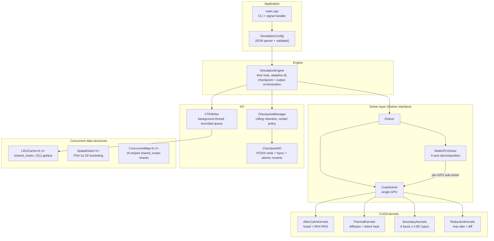
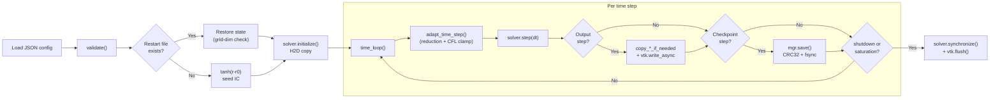
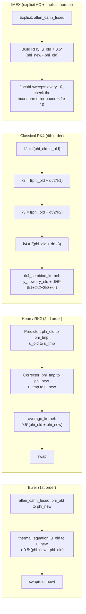
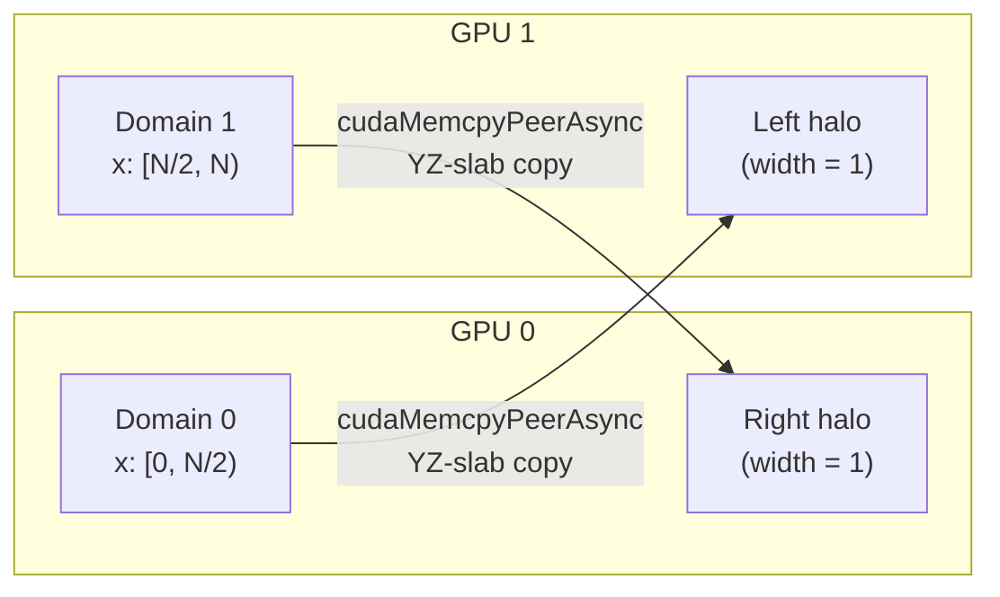

# Allen-Cahn CUDA — Phase-Field Simulation of Dendritic Solidification

Production-grade GPU-accelerated 3D phase-field simulation of dendritic crystal growth, built on the Karma–Rappel thin-interface formulation of the coupled Allen–Cahn and thermal-diffusion equations.

Built with C++23, CUDA 12+, VTK 9, and CMake 3.28+. Designed for production environments handling complex solidification problems without numerical simplification.

---

## Table of Contents

- [Features](#features)
- [Architecture Overview](#architecture-overview)
- [Simulation Data Flow](#simulation-data-flow)
- [Time Integration Schemes](#time-integration-schemes)
- [Multi-GPU Domain Decomposition](#multi-gpu-domain-decomposition)
- [Dependencies](#dependencies)
- [Build](#build)
- [Run](#run)
- [Visualization](#visualization)
- [Configuration](#configuration)
- [GPU Memory Budget](#gpu-memory-budget-600-grid)
- [Docker](#docker)
- [Kubernetes](#kubernetes)
- [Testing](#testing)
- [Project Structure](#project-structure)
- [Documentation](#documentation)
- [References](#references)

---

## Features

- **Modern C++23 / CUDA 20** with RAII, move semantics, and no raw owning pointers.
- **Four time integrators**: Forward Euler, Heun (RK2), classical RK4, and IMEX (explicit Allen–Cahn, linearly implicit with the Willmore term, + implicit thermal via Jacobi).
- **Compact anisotropic operator**: the Allen–Cahn kernel evaluates the anisotropic flux at the six cell faces (±1-cell stencil, second-order, exactly the 7-point Laplacian at ε = 0) and updates φ in one pass, with no stored flux arrays.
- **O(1) field swap**: pointer swap (`std::swap` of `DeviceField` handles) replaces O(N) data-copy kernels at the end of each step.
- **Multi-GPU support**: X-axis domain decomposition with `cudaMemcpyPeerAsync` halo exchange (one-plane halos, the reach of every stencil), bit-identical to a single-GPU run.
- **Anisotropic solidification**: cubic anisotropy A(n) with 4-fold crystal symmetry, including the corrected isotropic spherical-average fallback `1 − 3ε/5` when the gradient vanishes.
- **Strong anisotropy (ε > 1/15)**: the Allen–Cahn equation is ill-posed there (its solutions do not converge under grid refinement), so `physics.willmore_beta > 0` is required. It adds the Willmore regularisation, integrated linearly implicitly by the Euler and IMEX schemes: every step solves a symmetric positive-definite system by conjugate gradients with a single-precision Chebyshev polynomial preconditioner whose degree guarantees two outer iterations in exact arithmetic; at the shipped configurations' h = 0.4 every measured step took two (`docs/THEORY.md` §4.3–4.4).
- **Two Laplacian stencils**: standard 7-point and isotropic 27-point (Patra–Karttunen weights `14·face + 3·edge + 1·corner − 128·center`, divisor `30·h²`).
- **Per-face boundary conditions**: independent Dirichlet / Neumann / Periodic / Robin on each of the 6 faces (`x_lo`, `x_hi`, `y_lo`, `y_hi`, `z_lo`, `z_hi`); periodic identifies the two faces of an axis, so it must be set on both (`docs/DESIGN.md` §5.2).
- **Adaptive time stepping**: target-tolerance control via parallel reduction, capped at `cfl_safety` times the explicit stability limits (`docs/THEORY.md` §10.1: exact for the thermal update, a necessary condition for the phase field).
- **Async I/O**: dedicated VTK/raw writer thread with bounded job queue, `condition_variable` backpressure, atomic temp-then-rename writes, and an LRU-cached field-statistics map.
- **Crash-safe binary checkpointing**: 128-byte fixed header with magic `ACCHKPT`, CRC32 over field data, atomic rename + parent-directory `fsync`, and rolling retention that keeps one consistent trajectory per directory.
- **Fail-loud runs**: a NaN/Inf field stops the run with an error before anything is written (never a corrupted checkpoint), a missing `restart_file` is an error rather than a silent cold start, and `SIGINT`/`SIGTERM` exit with 130/143 after writing a resumable checkpoint.
- **Saturation guard**: an O(N²) reduction over the cells next to the walls stops the run cleanly (final checkpoint + output, exit 0) once the solid reaches a wall, where the simulation stops modelling growth into an unbounded melt.
- **Thread-safe data structures**: striped concurrent map (16 shards), LRU cache (`std::shared_mutex`), spatial hash (FNV-1a 3D bucketing).
- **Comprehensive test suite**: 27 unit-test files, 8 integration-test files and an end-to-end test of the binary; mathematical correctness checked against analytic solutions (Laplacian on quadratic fields, anisotropy along axes/diagonals, etc.).
- **Docker infrastructure**: multi-stage `dev` / `test` / `prod` images plus a one-shot `cuda-dev` image for the `make cuda-*` workflow.
- **Kubernetes orchestration**: batch-Job manifests with non-root pod security context, RBAC (ServiceAccount + Role + RoleBinding), NetworkPolicy (deny-ingress + DNS-only egress), CUDA-driver init container, and Kustomize overlays for `dev` and `prod` namespaces.
- **CI/CD**: GitHub Actions matrix for Debug/Release, clang-format and clang-tidy gates, K8s manifest validation via `kubeconform` (offline), Docker multi-target build, and self-hosted GPU runner job.

---

## Architecture Overview



## Simulation Data Flow



## Time Integration Schemes



With `physics.willmore_beta > 0` (required when ε > 1/15), the φ update of
Euler and IMEX is the linearly implicit Willmore step instead of
`allen_cahn_fused`: `(τ/dt + βL) δφ = rhs`, solved by flexible conjugate
gradients in double precision with a Chebyshev polynomial preconditioner in
single precision (`src/cuda/WillmoreSolve.cu`, `docs/THEORY.md` §4.4). Heun
and RK4 are fully explicit and reject β > 0. The shipped configurations set
β = |S(ε)| ℓ*² with the corner length ℓ* = 0.528 W₀ (S(ε) = (1+ε)(1−15ε),
the most negative gradient-energy stiffness) and, as dt, the largest of
0.02, 0.01, 0.005, … (each half the previous) whose time error does not
exceed the spatial error at h = 0.4 in the max norm and in the mean; both
errors were measured per configuration, with its physics in a box of side
50.4 at t = 15 (`docs/THEORY.md` §4.3).

## Multi-GPU Domain Decomposition



Halo width is 1 because every stencil reads ±1 cell: the Allen–Cahn operator evaluates the anisotropic flux at the six cell faces from compact face gradients (see `docs/THEORY.md` §11), and the thermal Laplacian and Jacobi sweep are 7- or 27-point. Halos exist only on sides that face another domain: the first and last domains hold the physical X walls and apply the configured BCs there, and a periodic X boundary is wrapped across domains by the exchange. Halos are refreshed before every stencil evaluation (between Heun/RK4 stages and after every IMEX Jacobi sweep), so the multi-GPU result is bit-identical to the single-GPU one; `tests/unit/test_MultiGPUSolver.cu` checks this for every scheme with several domains sharing one GPU (`gpu.device_ids` may repeat an ID).

---

## Dependencies

| Dependency       | Version       | Required | Notes                                  |
|------------------|---------------|----------|----------------------------------------|
| CMake            | ≥ 3.28        | Yes      | Native CUDA language support           |
| CUDA Toolkit     | ≥ 12.0        | Yes      | CUDA C++20 device code                 |
| GCC / Clang      | C++23-capable | Yes      | GCC 13+ recommended                    |
| `nlohmann_json`  | ≥ 3.11        | Auto     | `FetchContent` (URL tarball)           |
| `spdlog`         | ≥ 1.12        | Auto     | `FetchContent` (URL tarball)           |
| GoogleTest       | ≥ 1.14        | Auto     | `FetchContent` (tests only)            |
| VTK              | ≥ 9.0         | Optional | Required for `.vts` output             |
| HDF5             | any           | Optional | Optional checkpoint backend            |

---

## Build

```bash
git clone https://github.com/myousefi2016/Allen-Cahn-CUDA.git
cd Allen-Cahn-CUDA

# Release build
cmake -S . -B build/release -G Ninja \
  -DCMAKE_BUILD_TYPE=Release \
  -DCMAKE_CUDA_ARCHITECTURES=native
cmake --build build/release -j

# Debug build with tests
cmake -S . -B build/debug -G Ninja \
  -DCMAKE_BUILD_TYPE=Debug \
  -DAC_BUILD_TESTS=ON
cmake --build build/debug -j
ctest --test-dir build/debug --output-on-failure
```

CMake presets are also available (see `CMakePresets.json`):

```bash
cmake --preset release
cmake --build build/release -j

cmake --preset debug
cmake --build build/debug -j
```

---

## Run

Native binary (after a build):

```bash
./build/release/src/allen-cahn-cuda                        # uses config/default.json (if present)
./build/release/src/allen-cahn-cuda config/run_dendrite.json
./build/release/src/allen-cahn-cuda config/benchmark_small.json
```

Or use the `Makefile` — it wraps build, test, and run for both the native CMake-preset workflow and the containerized CUDA workflow. See `make help` for the full list.

```bash
# Native (host has cmake + nvcc)
make build                       # Release build via CMake preset
make test                        # Build debug + run ctest
make run CONFIG=config/benchmark_small.json

# Any docker host with nvidia-container-toolkit
make cuda-image                  # one-time: build prebuilt dev image (~1-2 min)
make cuda-build                  # configure + build inside the prebuilt image
make cuda-test                   # full unit + integration suite
make cuda-test-unit              # unit tests only
make cuda-test-integration       # integration tests only
make cuda-run-small              # 128^3 quick benchmark      -> ./out/benchmark_small (raw)
make cuda-run-vtk                # 128^3 dendrite             -> ./out/run_vtk (.vts for ParaView)
make cuda-run-dendrite           # 160^3 dendrite (Euler + Willmore beta=0.25, 27pt, eps=0.12) -> ./out/run_dendrite (.vts)
make cuda-run-dendrite-large     # 384^3 dendrite until saturation (179 min of compute on an RTX 4090)
make cuda-run-dendrite-long      # 192^3 long run until saturation, crash-safe checkpointing
make cuda-resume-dendrite        # resume the long run from latest intact checkpoint
make cuda-resume-dendrite-large  # resume the large run
make cuda-status-dendrite        # show progress: latest checkpoint, frame count, % done
make cuda-watch-dendrite         # tail run_long.log
make cuda-run-default            # 600^3 production run        -> ./out/default (.vts)
make cuda-run CONFIG=config/my.json  # arbitrary config
make cuda-visualize              # render ./out/run_dendrite/*.vts -> ./viz/run_dendrite/*.png + dendrite.mp4 (panels; VIZ_IN=out/<run> for another run)
make cuda-visualize-single       # 3D cutaway view only, no sidebar
make cuda-visualize-self-test    # synthetic-data smoke test of the visualizer
make cuda-dendrite-demo          # build + run-dendrite + visualize end-to-end
make cuda-shell                  # interactive shell in the CUDA container
make cuda-all                    # build + test + run-vtk + visualize end-to-end
make cuda-clean                  # wipe build/, out/, checkpoints/, viz/
make cuda-image-rebuild          # force-rebuild the dev image (after apt-pkg change)
```

### Long resumable run

`cuda-run-dendrite-long` grows a 192³ crystal at ε = 0.15 (β = 0.401, Euler,
dt = 0.0003125) until the saturation guard stops it. Measured on an RTX 4090:
the guard fires at step 113 600 (t = 35.5, 63 τ₀), when the six ⟨100⟩ tips
reach the walls, with 16 frames (1.06 GB), and a step takes 14.4 ms (median
of 200 steps), so the run needs 113 600 × 14.4 ms = 27 minutes of compute.
The crystal is a convex octahedron with rounded ⟨100⟩
corners at t = 17.5 and has grown six ⟨100⟩ tips with concave faces between
them by the end. `cuda-run-dendrite` (160³, ε = 0.12) ends at t = 17.5
(31 τ₀).

Crash safety:
- Checkpoints every 48 000 steps (15 time units, 11.5 minutes of compute at 14.4 ms per step on an RTX 4090, the most lost on `SIGKILL` / suspend).
- `keep_last = 3` (340 MB on disk for 192³).
- `cuda-resume-dendrite` finds the highest-numbered intact checkpoint
  (the 128-byte header must match the config's grid, the file size must be
  exact and the stored CRC32 must match the data; truncated, foreign-grid
  and corrupted files are skipped), injects it into the config, and resumes
  the binary at the next step. If no usable checkpoint exists it cold-starts.

Exit status of `allen-cahn-cuda`:

| Status | Meaning |
|---|---|
| 0 | Reached `max_steps`, or stopped by the saturation guard |
| 1 | Error, including a diverged (NaN/Inf) field or a missing `restart_file`; no output or checkpoint of a diverged state is written |
| 130 / 143 | Interrupted by `SIGINT` / `SIGTERM` after writing a checkpoint of the current step (resume with `cuda-resume-dendrite`) |

Checkpoint retention treats `checkpoint_dir` as one trajectory: after
writing step *S* it keeps *S* and the `keep_last - 1` newest older
checkpoints, and deletes any checkpoint *above* *S* (left by an earlier
run past the point this run restarted from), so "resume from the latest
checkpoint" can never jump back to a stale history; each removal is logged.
So every run needs its own `checkpoint_dir`: every shipped configuration
writes to `checkpoints/<config>` and `out/<config>`. As a safety net,
retention leaves alone checkpoints of another grid (header `Nx`, `Ny`, `Nz`,
spacing) and files not named `checkpoint_<step>.acbin`; it cannot tell two
runs of the same grid apart.

Recommended workflow (mandatory backgrounding so it survives terminal close):

```bash
# Option 1 — tmux (preferred; you can re-attach to see live progress)
tmux new -s dendrite 'make cuda-run-dendrite-long'
# Detach with Ctrl-B then D; reattach with: tmux attach -t dendrite

# Option 2 — nohup + log file
nohup make cuda-run-dendrite-long > run_long.log 2>&1 &
make cuda-watch-dendrite          # = tail -F run_long.log

# Check progress at any time
make cuda-status-dendrite

# After ANY interrupt (Ctrl-C, container kill, host suspend, OOM, ...)
make cuda-resume-dendrite         # picks up where it left off, no flags needed

# Visualize partial / completed output (works mid-run too)
make cuda-visualize VIZ_EXTRA_ARGS="--skip-saturated"
```

The resume mechanism is implemented in `scripts/resume_from_latest_checkpoint.py`,
which is idempotent and safe to invoke repeatedly.

Override defaults on the command line:

```bash
make cuda-build CUDA_ARCH=80     # A100 instead of T4
make cuda-run CONFIG=config/my.json
```

A run writes where its configuration's `output.output_dir` and
`checkpoint.checkpoint_dir` say. The `cuda-*` targets mount the repository
at `/work` in the container, so these paths must be relative and stay
inside the repository.

---

## Visualization

`scripts/visualize_dendrite.py` is a production-quality PyVista tool that
renders the `.vts` snapshots produced by `cuda-run-vtk` /
`cuda-run-dendrite` / `cuda-run-default` into PNG frames plus an optional
MP4 video. It runs fully **headless** (no X server) via
`pv.start_xvfb()` and is baked into the `cuda-dev` Docker image, so no
host Python install is needed.

### Anti-speckle rendering pipeline

The default output uses several techniques to avoid the moiré / dotted-grid
artifacts that a naïve `contour() + slice_orthogonal(opacity=0.85)` recipe
produces in late frames:

1. **Opaque cutaway slices** on the three back walls of the bounding box
   instead of three semi-transparent mid-plane slices — eliminates the
   alpha-blending speckle that appears when the dendrite reaches the box.
2. **Taubin smoothing** of the marching-cubes mesh (`--smooth-iters`,
   default 20). Shape-preserving (unlike Laplacian), so dendrite tips
   stay sharp while grid-aligned vertex noise is removed.
3. **SSAA + 8× MSAA** + low specular on the iso surface — kills
   grid-frequency specular aliasing.
4. **Silhouette outline** on the iso surface — clean reading edge against
   any background.
5. **Three-light rig** + soft gradient background (steel-blue → near-white)
   for proper 3D depth cues.

### Layouts

| Layout              | What you see | Best for |
|---------------------|--------------|----------|
| `panels` (default)  | 1920×1080 composite: cutaway 3D (left), `phi` mid-z slice (top right), `u` mid-z slice (bottom right), time-series sidebar with solid fraction & ⟨u⟩ + saturation shading | publication / animation frames |
| `single`            | only the 3D cutaway view at the requested window size | quick previews, small files |

### Saturation guard

When the dendrite reaches a wall (`phi > -0.5` anywhere in the cells next
to a wall, the rule of the engine's guard) the frame carries no useful
morphology. By default these frames are
rendered with a red **SATURATED — wall reached** badge in the upper-right.
`--skip-saturated` (or `make cuda-dendrite-demo`, which sets it) drops
them entirely.

### End-to-end demo (recommended)

```bash
make cuda-image                # one-time, ~3 min
make cuda-dendrite-demo        # build + 160^3 dendrite run + production viz
                               # 6.4 and 8.7 min in two runs on an RTX 4090:
                               # build ~40 s, 28 000 steps 229 s, rendering
                               # 36 frames and the video 2-4 min
```

Output:

```
viz/run_dendrite/
  frame_000000.png    # step 0
  frame_000060.png    # step 60
  ...
  dendrite.mp4        # stitched video
```

### Common overrides

```bash
# Higher resolution, 24 fps
make cuda-visualize VIZ_WINDOW_W=2560 VIZ_WINDOW_H=1440 VIZ_FPS=24

# Just the 3D cutaway, no sidebar
make cuda-visualize-single

# Different output directories
make cuda-visualize VIZ_IN=/data/run42 VIZ_OUT=/data/run42/viz

# Drop saturated frames; cap at 30 frames; no silhouette outline
make cuda-visualize VIZ_EXTRA_ARGS="--skip-saturated --limit 30 --no-silhouette"

# Aggressive smoothing for very noisy iso surfaces (dx >> typical)
make cuda-visualize VIZ_SMOOTH_ITERS=40 VIZ_PASS_BAND=0.05

# Different colormap pair
make cuda-visualize VIZ_PHI_CMAP=RdBu_r VIZ_U_CMAP=inferno
```

### Verifying the visualizer (CI-friendly)

The visualizer ships a smoke test that synthesizes a 24³ structured grid
and exercises every code path (prescan, render, saturation guard,
scan-JSON dump, MP4 stitching). Runs in < 10 s with no GPU and no real
`.vts` data:

```bash
make cuda-visualize-self-test     # in-image smoke test
# OR directly:
python3 scripts/visualize_dendrite.py --self-test
python3 tests/visualize_smoke.py
```

### Direct CLI

```bash
docker run --rm -v $PWD:/work -w /work allen-cahn-cuda-dev:local \
  python3 scripts/visualize_dendrite.py \
    --input-dir ./out/run_dendrite --output-dir ./viz/run_dendrite \
    --layout panels --make-video --fps 15 \
    --phi-cmap coolwarm --u-cmap plasma \
    --smooth-iters 20 --pass-band 0.10 \
    --window-size 1920 1080 \
    --skip-saturated \
    --scan-json ./viz/run_dendrite/scan.json
```

Full CLI: `python3 scripts/visualize_dendrite.py --help`.

---

## Configuration

All parameters are specified in JSON. Started without a file, the binary
loads `config/default.json` (or `../config/default.json`); the example below
is equivalent to it. `config/run_dendrite*.json` are dendrite-friendly
presets. A key that a file leaves out takes its compiled-in value
(`src/core/SimulationConfig.hpp`; a per-face boundary object must still name
all six faces, see below), and with neither file present the binary runs on
the compiled-in values alone. The compiled-in values differ from
`config/default.json` in `physics.epsilon` (0.05), `physics.willmore_beta`
(0), `time.dt` (0.01), `time.max_steps` (6000),
`time.saturation_check_freq` (100), `output.frequency` (100),
`output.output_dir` (`./out`), `checkpoint.frequency` (500),
`checkpoint.checkpoint_dir` (`./checkpoints`) and the `u` boundary value
(-1.0). The dt rule of `docs/THEORY.md` §4.3 was applied to the shipped
configurations, not to the compiled-in values.

```json
{
    "physics":  { "delta": 0.8, "epsilon": 0.07, "W0": 1.0, "beta0": 0.0, "D": 2.0, "d0": 0.5, "willmore_beta": 0.0149 },
    "grid":     { "Nx": 600, "Ny": 600, "Nz": 600, "dx": 0.4, "dy": 0.4, "dz": 0.4 },
    "time":     { "dt": 0.0025, "max_steps": 24000, "scheme": "euler", "adaptive": false, "cfl_safety": 0.9, "saturation_check_freq": 400 },
    "stencil":  "7pt",
    "output":   { "frequency": 400, "output_dir": "./out/default", "format": "vts", "async_io": true },
    "checkpoint": { "frequency": 2000, "checkpoint_dir": "./checkpoints/default", "keep_last": 3 },
    "gpu":      { "device_ids": [0], "multi_gpu": false },
    "initial":  { "seed_radius": 2.0 },
    "boundary": {
        "phi": { "type": "dirichlet", "value": -1.0 },
        "u":   { "type": "dirichlet", "value": -0.8 }
    }
}
```

### Available options

| Parameter             | Accepted values |
|-----------------------|-----------------|
| `time.scheme`         | `"euler"`, `"heun"`, `"rk4"`, `"imex"` |
| `time.dt`             | at most the explicit stability limits of the scheme, stencil and spacing (`docs/THEORY.md` §10.1; `--validate-config` reports them); with `time.adaptive`, at most `cfl_safety` times them, like `time.dt_min` |
| `time.cfl_safety`     | in (0, 1]: adaptive steps are capped at this fraction of the stability limits |
| `physics.epsilon`     | anisotropy strength in [0, 1/3); above 1/15 it requires `physics.willmore_beta > 0` |
| `physics.willmore_beta` | Willmore regularisation strength ≥ 0 (0 when omitted); > 0 requires `time.scheme` `"euler"` or `"imex"` |
| `stencil`             | `"7pt"` / `"standard"`, `"27pt"` / `"isotropic"` (Patra–Karttunen) |
| `boundary.*.type`     | `"dirichlet"`, `"neumann"`, `"periodic"` (on both faces of an axis), `"robin"` |
| `boundary.*` robin    | `alpha·u + beta·∂u/∂n = gamma`: `alpha`, `beta` not both zero and not of opposite signs (`docs/THEORY.md` §9.1) |
| `output.format`       | `"vts"` (VTK structured grid), `"raw"` (binary) |
| `output.async_io`     | `true`: write snapshots in the background; `false`: each output step waits until its file is on disk |

Unknown keys are errors (keys starting with `_` are comments), so a typo
cannot silently fall back to a default. Check a file without a GPU:

```bash
./build/release/src/allen-cahn-cuda --validate-config config/run_dendrite.json
```

### Per-face boundary conditions

Each field can have independent BCs on each of the 6 faces. A per-face
object must name all six faces (a missing face is an error, not a default):

```json
{
    "boundary": {
        "phi": {
            "x_lo": { "type": "neumann",   "flux": 0.0 },
            "x_hi": { "type": "dirichlet", "value": -1.0 },
            "y_lo": { "type": "periodic" },
            "y_hi": { "type": "periodic" },
            "z_lo": { "type": "robin", "alpha": 1.0, "beta": 0.5, "gamma": 0.0 },
            "z_hi": { "type": "neumann", "flux": 0.0 }
        }
    }
}
```

---

## GPU memory budget (600³ grid)

Device memory allocated by `CudaSolver`, measured with `cudaMemGetInfo`
around its construction on a 256³ grid (RTX 4090), per grid cell, and the
fields' total for 600³ = 2.16 × 10⁸ cells (GiB = 2³⁰ bytes). Every
double-precision field costs 8 bytes per cell and every single-precision
one 4; the rest (0.125 bytes per cell at 256³, 2 to 7 MiB on grids from
128³ to 384³) is reduction scratch and allocation granularity and is not in
the 600³ column. The fused Allen–Cahn kernel stores no flux or index arrays.

| Scheme | Fields | Bytes per cell | 600³ |
|---|---|---|---|
| Euler | φ, u (old and new) | 32.1 | 6.4 GiB |
| Heun, IMEX | + φ, u stage buffers | 48.1 | 9.7 GiB |
| RK4 | + stage buffers and the four stages of φ and u | 112.1 | 22.5 GiB |
| Euler, `willmore_beta > 0` | Euler + 7 double (τ, x, r, z, p, Ap, ∇²p) + 5 single (τ/dt, scaled r, two iterates, their Laplacian) | 108.1 | 21.7 GiB |
| IMEX, `willmore_beta > 0` | IMEX + the same | 124.1 | 24.9 GiB |

A regularised 600³ Euler run fits on a 24 GB GPU (measured on the RTX 4090:
21.7 GiB allocated, 1.4 GiB left); a regularised 600³ IMEX run does not. A
grid fits when N³ times the bytes per cell is below the free memory: on a
16 GB-class GPU (e.g. T4, about 15 GiB free) that is about 500³ for RK4 and
the regularised schemes. Larger grids can use several GPUs
(`gpu.device_ids`), which split the X planes between them.

---

## Docker

```bash
# Development environment (mounts source, ccache)
docker compose --profile dev up

# Run the test suite
docker compose --profile test up

# Production simulation (provide config by absolute path inside the image);
# results land in ./output/out/default and ./output/checkpoints/default
make docker-run                                  # default.json, as the host user
docker compose --profile prod run prod /app/config/default.json
```

| File                          | Purpose                                                                                |
|-------------------------------|----------------------------------------------------------------------------------------|
| `docker/Dockerfile.dev`       | Full CUDA 12.6 development environment, non-root user, source mount expected           |
| `docker/Dockerfile.prod`      | Multi-stage builder + minimal runtime (non-root)                                       |
| `docker/Dockerfile.test`      | Builds debug, runs `ctest` as entrypoint                                                |
| `docker/Dockerfile.cuda-dev`  | Prebuilt dev image used by the `make cuda-*` targets (saves apt-install per invocation) |
| `docker-compose.yml`          | Profiles: `dev`, `test`, `prod` (image tag `allencahn-cuda:<profile>`)                  |

The `make cuda-*` targets use `allen-cahn-cuda-dev:local` (the
`Dockerfile.cuda-dev` image), built once via `make cuda-image`.

---

## Kubernetes

This project deploys as a batch **Job** (the simulation is a finite,
checkpointable computation, not a long-lived service).

```bash
# Deploy to development namespace
kubectl apply -k k8s/overlays/dev/

# Deploy to production namespace
kubectl apply -k k8s/overlays/prod/

# Monitor
kubectl -n allen-cahn-prod get pods
kubectl -n allen-cahn-prod logs -f job/prod-allen-cahn-simulation
```

Manifests in `k8s/base/`:

| File                  | Purpose                                                                                       |
|-----------------------|-----------------------------------------------------------------------------------------------|
| `configmap.yaml`      | Embedded JSON simulation config (`/config/simulation.json`)                                   |
| `pvc.yaml`            | `ReadWriteOnce` PVC for output + checkpoints                                                  |
| `rbac.yaml`           | `ServiceAccount` + minimal `Role` + `RoleBinding`                                             |
| `networkpolicy.yaml`  | Deny all ingress; egress restricted to DNS                                                     |
| `job.yaml`            | The `Job` itself: GPU resource request, init container running `nvidia-smi`, non-root pod, `readOnlyRootFilesystem`, dropped capabilities, 300 s grace period |

Per-environment overlays in `k8s/overlays/{dev,prod}/` add the namespace and
patch resources / activeDeadlineSeconds / PVC size / config payload.

GPU memory: the base configuration (600³, ε = 0.07 with `willmore_beta`,
Euler) allocates 21.7 GiB on the GPU (measured on an RTX 4090), so it needs
a 24 GB-class GPU; the Job requests one `nvidia.com/gpu` and does not select
nodes by GPU memory. The dev overlay (128³) needs 0.21 GiB.

The Job runs `ghcr.io/myousefi2016/allen-cahn-cuda:latest`, which the CI
`release-docker` job pushes from the default branch (alongside
`sha-<commit>` tags). The image is set once, via `images:` in
`k8s/base/kustomization.yaml`.

CI validates these manifests offline via `kubeconform` (no API server
required) — see `.github/workflows/ci.yml`.

---

## Testing

The suite has three `ctest` groups, selectable with `-R "^unit[.]"`,
`-R "^integration[.]"` and `-R "^e2e[.]"`: the `unit_tests` and
`integration_tests` executables and an end-to-end test that drives the
built binary (Python 3). It is verified on an NVIDIA RTX 4090
(compute 8.9) with CUDA 13.2.

Without a usable GPU the CUDA tests are reported as *Skipped*. Set
`AC_REQUIRE_GPU=1` on a GPU machine to turn that into a failure, so a job
meant to exercise the GPU cannot pass by skipping:

```bash
AC_REQUIRE_GPU=1 ctest --test-dir build --output-on-failure --no-tests=error
```

| Suite             | Files | Status            |
|-------------------|-------|-------------------|
| Unit tests        | 24    | ✅ all passing     |
| Integration tests | 8     | ✅ all passing     |

```bash
git clone https://github.com/myousefi2016/Allen-Cahn-CUDA.git
cd Allen-Cahn-CUDA
git checkout feature/production-cuda-rewrite

docker run --rm --gpus all -v $PWD:/work -w /work \
  nvidia/cuda:12.6.0-devel-ubuntu24.04 bash -c '
    apt-get update && apt-get install -y --no-install-recommends \
      cmake ninja-build gcc-13 g++-13 git pkg-config \
      libvtk9-dev libhdf5-dev ca-certificates python3 python3-yaml &&
    update-alternatives --install /usr/bin/gcc gcc /usr/bin/gcc-13 100 &&
    update-alternatives --install /usr/bin/g++ g++ /usr/bin/g++-13 100 &&
    cmake -B build -G Ninja -DCMAKE_BUILD_TYPE=Release \
      -DCMAKE_CUDA_ARCHITECTURES=75 -DAC_BUILD_TESTS=ON &&
    cmake --build build -j$(nproc) &&
    ctest --test-dir build --output-on-failure -j$(nproc)
  '
```

### Unit tests (`tests/unit/`, 27 files)

| File                          | What it covers                                                                  |
|-------------------------------|----------------------------------------------------------------------------------|
| `test_Grid.cpp`               | Grid construction, indexing, spacing, validity checks                            |
| `test_GridValidation.cu`      | Configuration-time grid validation                                               |
| `test_StabilityLimits.cpp`    | Explicit stability limits: closed forms (RK4's interval is the root of its polynomial, the gradient energy's Hessian diagonal, the phase-field limit over the axis subsets and gradient directions), `validate()` rejects a fixed dt one ulp above each limit, with both numbers told apart, and adaptive settings above the cap |
| `test_SimulationConfig.cpp`   | JSON config parsing (unknown keys rejected, per-face all-six rule), validation (Willmore rules, periodic pairs, Robin signs and denominator, finite BC parameters), defaults, derived quantities |
| `test_FieldData.cpp`          | Host field allocation, accessors, copies, layout invariants                      |
| `test_InitialCondition.cu`    | tanh seed profile correctness, centre/corner sentinels                           |
| `test_CheckpointIO.cpp`       | Binary checkpoint serialize/deserialize round-trip, CRC32, exact file size (trailing or missing bytes rejected, long axes accepted, overflowing headers rejected) |
| `test_CheckpointManager.cpp`  | Frequency, retention (just-written file kept, one trajectory after a restart, checkpoints of other grids left alone, removals logged at info), restart-from-latest, missing restart file |
| `test_LRUCache.cpp`           | LRU eviction order, capacity, hit/miss, concurrent access                        |
| `test_SpatialHash.cpp`        | 3D bucket insert/query, FNV-1a hashing                                           |
| `test_ConcurrentMap.cpp`      | Striped concurrent map operations under contention                               |
| `test_Logger.cpp`             | spdlog init idempotency, level changes                                           |
| `test_DeviceField.cu`         | RAII allocation, async H2D/D2H, swap, large allocs                               |
| `test_Laplacian.cu`           | 7- and 27-point isotropic Laplacian on analytic quadratic / linear / constant fields |
| `test_Gradient.cu`            | 2nd- and 4th-order central-difference gradient kernels                           |
| `test_Anisotropy.cu`          | A(n), dFunc, dF/dphi; face flux = ∂f/∂∇φ; ∇·F second-order (all ε) and = W₀²·7-point Laplacian at ε = 0 |
| `test_BoundaryConditions.cu`  | Dirichlet, Neumann, Periodic, Robin (also with a tiny denominator), per-face mixed, interior unchanged |
| `test_Reduction.cu`           | Block-strided max-abs and max-abs-diff reductions; the fused change and magnitude reduction of the IMEX check (exact maxima, NaN and Inf reach both) |
| `test_ThermalKernels.cu`      | Thermal diffusion + latent-heat coupling                                         |
| `test_CudaSolver.cu`          | Solver lifecycle, all 4 time schemes, per-face BC end-to-end, NaN-propagating reductions |
| `test_ImexJacobi.cu`          | IMEX thermal solve: error within 1e-10 of a long-double solution at s ≈ 17 (both stencils, every kind of u face, one GPU and three domains); NaN temperature and a tolerance below rounding throw; the stopping rule on the host |
| `test_StabilityLimitsGpu.cu`  | The solver's explicit updates have these limits: a checkerboard decays at 0.99× and grows at 1.01× (thermal: every scheme and stencil; phase field: the uniform liquid's 3-D, 1-D and 2-D checkerboards with and without the Willmore term, and a liquid with a ⟨111⟩ gradient) |
| `test_MultiGPUSolver.cu`      | Multi-GPU vs single-GPU, bit for bit: every scheme, BC layout and split, with and without the Willmore term; engine run |
| `test_Willmore.cu`            | Willmore step: one step of a Fourier mode vs its analytic amplification factor, β → 0 equals explicit Euler, first order in time, scheme and ε > 1/15 rules |
| `test_WillmorePreconditioner.cu` | Spectral bounds vs exact eigenvalues (every BC, anisotropic spacing), lowest-degree Chebyshev plan and its polynomial, single-precision preconditioner vs the exact polynomial, power-of-two scaling, true residual, per-step plans, non-finite states |
| `test_SimulationEngine.cu`    | Engine init, IC, adaptive dt (capped at the stability limits after the dt_min clamp, also after a restart; growth when φ is at rest), short run, saturation stop, shutdown, divergence errors, restart-file and spacing checks, dt after a restart |
| `test_VTKWriter.cpp`          | Async and synchronous writes, raw / VTS output, VTS topology, write failures reported (never a published broken file), statistics cache |

### Integration tests (`tests/integration/`, 8 files)

| File                          | What it covers                                                                  |
|-------------------------------|----------------------------------------------------------------------------------|
| `test_SphereRegression.cu`    | Dendritic growth from spherical seed reproduces reference behaviour              |
| `test_EulerConvergence.cu`    | Forward Euler shows expected error reduction under dt refinement                 |
| `test_EnergyConservation.cu`  | Phase-field free-energy decreases monotonically                                  |
| `test_SchemeComparison.cu`    | Euler vs Heun vs RK4 agreement; at 3× the explicit thermal limit `validate()` rejects Euler, which overflows, and IMEX stays finite |
| `test_CheckpointRestart.cu`   | Checkpoint at midpoint then restart matches uninterrupted run                    |
| `test_StencilComparison.cu`   | 7-point vs 27-point: bounded fields, smoother 27-pt interface, same physics      |
| `test_AnisotropyForce.cu`     | Seed growth favours <100> increasingly with ε; grid anisotropy at ε = 0 is < 2% and vanishes under refinement |
| `test_WillmoreRefinement.cu`  | At ε = 0.12 grid refinement does not converge without the Willmore term and converges with it |

### End-to-end test (`tests/e2e/`)

| File              | What it covers                                                                  |
|-------------------|----------------------------------------------------------------------------------|
| `signal_exit.py`  | The binary exits 143/130 on `SIGTERM`/`SIGINT` and leaves a valid checkpoint of the step it stopped at |
| `validate_shipped_configs.py` | Every shipped configuration (`config/*.json`, k8s payloads, the Makefile's `run_vtk.json`, docs examples) passes `--validate-config`; a misspelled key and copies that break a validation rule (ε > 1/15 without β, β with heun, β < 0, one-sided periodic, Robin α and β of opposite signs) are rejected; the runs from the repository root use their own output and checkpoint directories |

### Run a single test

```bash
ctest --test-dir build -R BoundaryConditionsTest --output-on-failure
ctest --test-dir build -R StencilComparisonTest  --output-on-failure
```

> **Note:** if you re-run after pulling new commits, delete `build/`
> first — Ninja will otherwise report `no work to do` if the cache is
> stale relative to source changes.

---

## Project Structure

```
Allen-Cahn-CUDA/
├── src/
│   ├── core/                  # Grid, SimulationConfig, StabilityLimits, FieldData,
│   │                          # CheckpointManager, LRUCache, SpatialHash, ConcurrentMap
│   ├── cuda/                  # ISolver, CudaSolver, MultiGPUSolver,
│   │                          # AllenCahn / Thermal / Boundary / Reduction / Willmore kernels,
│   │                          # WillmoreSolve (implicit Willmore step),
│   │                          # JacobiStopping (IMEX thermal solve stopping rule),
│   │                          # DeviceField (RAII GPU memory), CudaUtils (Stream, Event)
│   ├── io/                    # VTKWriter (async), CheckpointIO (binary, fsync, CRC32)
│   ├── logging/               # Logger (spdlog wrapper)
│   ├── main.cpp               # Entry point + signal handler
│   └── CMakeLists.txt
├── tests/
│   ├── unit/                  # 27 unit-test files
│   ├── integration/           # 8 integration-test files
│   ├── visualize_smoke.py     # PyVista visualizer self-test
│   └── CMakeLists.txt
├── config/                    # JSON simulation configs (default, dendrite, etc.)
├── docker/                    # Dockerfile.dev, .test, .prod, .cuda-dev
├── docker-compose.yml         # dev / test / prod profiles
├── k8s/
│   ├── base/                  # configmap, pvc, rbac, networkpolicy, job, kustomization
│   └── overlays/{dev,prod}/   # namespace + per-env patches + kustomization
├── scripts/                   # visualize_dendrite.py, resume_from_latest_checkpoint.py
├── docs/                      # ARCHITECTURE.md, DESIGN.md, THEORY.md
├── cmake/                     # Dependencies.cmake, CompilerWarnings.cmake, CUDAConfig.cmake
├── .github/                   # workflows/ci.yml, ISSUE_TEMPLATE/, PULL_REQUEST_TEMPLATE.md
├── CMakeLists.txt
├── CMakePresets.json
├── Makefile
└── README.md
```

---

## Documentation

- [Architecture Guide](docs/ARCHITECTURE.md) — system design, module dependencies, threading model, halo-exchange protocol.
- [Design Document](docs/DESIGN.md) — algorithm details, data structures, numerical schemes, multi-GPU strategy.
- [Theory Document](docs/THEORY.md) — phase-field PDEs, Karma–Rappel formulation, anisotropy, stencils, time integrators.

---

## References

1. Karma, A., & Rappel, W.-J. (1998). Quantitative phase-field modeling of dendritic growth in two and three dimensions. *Physical Review E*, **57**(4), 4323.
2. Plapp, M., & Karma, A. (2000). Multiscale finite-difference–diffusion–Monte-Carlo method for simulating dendritic solidification. *Journal of Computational Physics*, **165**(2), 592–619.
3. Patra, M., & Karttunen, M. (2006). Stencils with isotropic discretization error for differential operators. *Numerical Methods for Partial Differential Equations*, **22**(4), 936–953.
4. Provatas, N., Goldenfeld, N., & Dantzig, J. (1998). Efficient computation of dendritic microstructures using adaptive mesh refinement. *Physical Review Letters*, **80**(15), 3308.

---

## License

See [LICENSE](LICENSE) for details.
