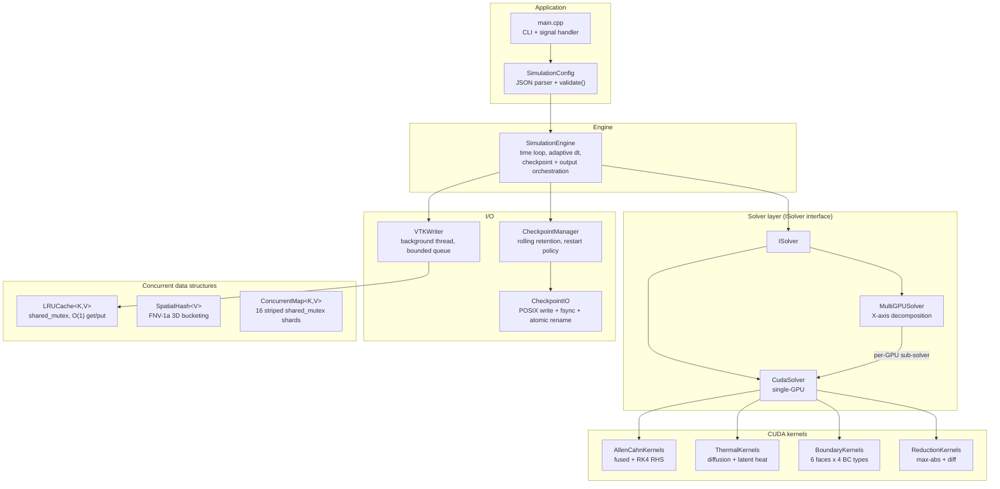
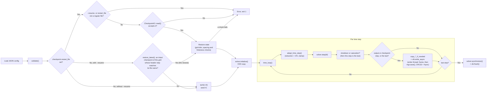
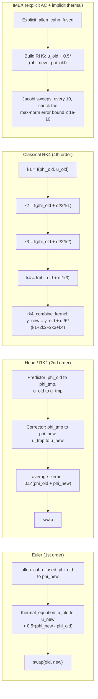
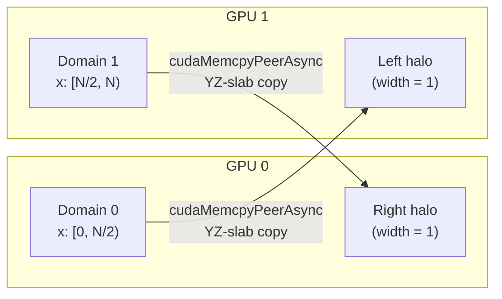

# Allen-Cahn CUDA — Phase-Field Simulation of Dendritic Solidification

Production-grade GPU-accelerated 3D phase-field simulation of dendritic crystal growth, built on the Karma–Rappel thin-interface formulation of the coupled Allen–Cahn and thermal-diffusion equations.

Built with C++23, CUDA 12+, VTK 9, and CMake 3.28+. Designed for production environments handling complex solidification problems without numerical simplification.

---

## Table of Contents

- [Features](#features)
- [Architecture Overview](#architecture-overview)
- [Simulation Data Flow](#simulation-data-flow)
- [Time Integration Schemes](#time-integration-schemes)
- [Multi-GPU Domain Decomposition](#multi-gpu-domain-decomposition)
- [Dependencies](#dependencies)
- [Build](#build)
- [Run](#run)
- [Visualization](#visualization)
- [Configuration](#configuration)
- [GPU Memory Budget](#gpu-memory-budget-600-grid)
- [Docker](#docker)
- [Kubernetes](#kubernetes)
- [Testing](#testing)
- [Project Structure](#project-structure)
- [Documentation](#documentation)
- [References](#references)

---

## Features

- **Modern C++23 / CUDA 20** with RAII, move semantics, and no raw owning pointers.
- **Four time integrators**: Forward Euler, Heun (RK2), classical RK4, and IMEX (explicit Allen–Cahn, linearly implicit with the Willmore term, + implicit thermal via Jacobi).
- **Compact anisotropic operator**: the Allen–Cahn kernel evaluates the anisotropic flux at the six cell faces (±1-cell stencil, second-order, exactly the 7-point Laplacian at ε = 0) and updates φ in one pass, with no stored flux arrays.
- **O(1) field swap**: pointer swap (`std::swap` of `DeviceField` handles) replaces O(N) data-copy kernels at the end of each step.
- **Multi-GPU support**: X-axis domain decomposition with `cudaMemcpyPeerAsync` halo exchange (one-plane halos, the reach of every stencil), bit-identical to a single-GPU run.
- **Anisotropic solidification**: cubic anisotropy A(n) with 4-fold crystal symmetry, including the corrected isotropic spherical-average fallback `1 − 3ε/5` when the gradient vanishes.
- **Strong anisotropy (ε > 1/15)**: the Allen–Cahn equation is ill-posed there (its solutions do not converge under grid refinement), so `physics.willmore_beta > 0` is required. It adds the Willmore regularisation, integrated linearly implicitly by the Euler and IMEX schemes: every step solves a symmetric positive-definite system by conjugate gradients with a single-precision Chebyshev polynomial preconditioner whose degree guarantees two outer iterations in exact arithmetic; at the shipped configurations' h = 0.4 every step of their measured dt ladders took two (`docs/THEORY.md` §4.3–4.4).
- **Two Laplacian stencils**: standard 7-point and isotropic 27-point (Patra–Karttunen weights `14·face + 3·edge + 1·corner − 128·center`, divisor `30·h²`).
- **Per-face boundary conditions**: independent Dirichlet / Neumann / Periodic / Robin on each of the 6 faces (`x_lo`, `x_hi`, `y_lo`, `y_hi`, `z_lo`, `z_hi`); periodic identifies the two faces of an axis, so it must be set on both (`docs/DESIGN.md` §5.2).
- **Adaptive time stepping**: target-tolerance control via parallel reduction, capped at `cfl_safety` times the explicit stability limits (`docs/THEORY.md` §10.1: exact for the thermal update, a necessary condition for the phase field).
- **Async I/O**: dedicated VTK/raw writer thread with bounded job queue, `condition_variable` backpressure, atomic temp-then-rename writes, and an LRU-cached field-statistics map.
- **Crash-safe binary checkpointing**: 128-byte fixed header with magic `ACCHKPT`, CRC-32 over the header and over the field data, atomic rename + parent-directory `fsync`, and rolling retention that keeps one consistent trajectory per directory.
- **Fail-loud runs**: a NaN/Inf field stops the run with an error before anything is written (never a corrupted checkpoint), a missing `restart_file` is an error rather than a silent cold start, and `SIGINT`/`SIGTERM` exit with 130/143 after writing a resumable checkpoint.
- **Saturation guard**: an O(N²) reduction over the cells next to the walls stops the run cleanly (final checkpoint + output, exit 0) once the solid reaches a wall, where the simulation stops modelling growth into an unbounded melt.
- **Thread-safe LRU cache** (`std::shared_mutex`) for the VTK writer's field statistics. `src/core/` also holds a striped concurrent map (16 shards) and a spatial hash (FNV-1a 3D bucketing); the program uses neither, and only their unit tests include them.
- **Comprehensive test suite**: 30 unit-test files, 8 integration-test files and thirteen end-to-end tests (four of the binary, seven of the Makefile's targets and docker-compose.yml, two of the documentation); mathematical correctness checked against analytic solutions (Laplacian on quadratic fields, anisotropy along axes/diagonals, etc.).
- **Docker infrastructure**: multi-stage `dev` / `test` / `prod` images plus a one-shot `cuda-dev` image for the `make cuda-*` workflow.
- **Kubernetes orchestration**: batch-Job manifests with non-root pod security context, RBAC (ServiceAccount + Role + RoleBinding), NetworkPolicy (deny-ingress + DNS-only egress), CUDA-driver init container, and Kustomize overlays for `dev` and `prod` namespaces.
- **CI/CD**: GitHub Actions: the full suite in Debug and Release on a self-hosted GPU runner, the CPU tests without a GPU, a clang-format gate and an advisory clang-tidy run, the visualizer's smoke test, the `dev` / `test` / `prod` / `cuda-dev` Docker builds (the `test` image runs its suite), and K8s manifest validation via `kubeconform` (offline).

---

## Architecture Overview



## Simulation Data Flow



## Time Integration Schemes



With `physics.willmore_beta > 0` (required when ε > 1/15), the φ update of
Euler and IMEX is the linearly implicit Willmore step instead of
`allen_cahn_fused`: `(τ/dt + βL) δφ = rhs`, solved by flexible conjugate
gradients in double precision with a Chebyshev polynomial preconditioner in
single precision (`src/cuda/WillmoreSolve.cu`, `docs/THEORY.md` §4.4). Heun
and RK4 are fully explicit and reject β > 0. The shipped configurations set
β = |S(ε)| ℓ*² with the corner length ℓ* = 0.528 W₀ (S(ε) = (1+ε)(1−15ε),
the most negative gradient-energy stiffness) and, as dt, the largest of
0.02, 0.01, 0.005, … (each half the previous) whose time error does not
exceed the spatial error at h = 0.4 in the max norm and in the mean; both
errors were measured per configuration, with its physics in a box of side
50.4 at t = 15 (`docs/THEORY.md` §4.3).

## Multi-GPU Domain Decomposition

A run splits its grid between GPUs when `gpu.multi_gpu` is `true` and
`gpu.device_ids` lists several devices: each id gets one contiguous slab of
X planes, `Nx / n` planes each and one more for each of the first `Nx % n`,
and every slab must own at least 2 planes. Without `multi_gpu` the whole
grid runs on the first id, so the validator rejects a list of several ids
then (they would be ignored).



Halo width is 1 because every stencil reads ±1 cell: the Allen–Cahn operator evaluates the anisotropic flux at the six cell faces from compact face gradients (see `docs/THEORY.md` §11), and the thermal Laplacian and Jacobi sweep are 7- or 27-point. Halos exist only on sides that face another domain: the first and last domains hold the physical X walls and apply the configured BCs there, and a periodic X boundary is wrapped across domains by the exchange. Halos are refreshed before every stencil evaluation (between Heun/RK4 stages and after every IMEX Jacobi sweep), so the multi-GPU result is bit-identical to the single-GPU one; `tests/unit/test_MultiGPUSolver.cu` checks this for every scheme with several domains sharing one GPU (`gpu.device_ids` may repeat an ID).

---

## Dependencies

| Dependency       | Version       | Required | Notes                                  |
|------------------|---------------|----------|----------------------------------------|
| CMake            | ≥ 3.28        | Yes      | Native CUDA language support           |
| CUDA Toolkit     | ≥ 12.0        | Yes      | CUDA C++20 device code                 |
| GCC / Clang      | C++23-capable | Yes      | GCC 13+ recommended                    |
| `nlohmann_json`  | ≥ 3.11        | Auto     | `FetchContent` (URL tarball)           |
| `spdlog`         | ≥ 1.12        | Auto     | `FetchContent` (URL tarball)           |
| GoogleTest       | ≥ 1.14        | Auto     | `FetchContent` (tests only)            |
| VTK              | ≥ 9.0         | Optional | Required for `.vts` output             |
| Python 3 with PyYAML | 3.12, 3.14 tested | Tests | The end-to-end tests (`tests/e2e`); CMake's FindPython3 picks the interpreter, `-DPython3_EXECUTABLE=` chooses one that has PyYAML |
| GNU make         | 4.3, 4.4.1 tested | Tests | The end-to-end tests of the Makefile's targets |
| cmark-gfm        | 0.29.0.gfm.6, 0.29.0.gfm.13 tested | Tests | The end-to-end test of the documentation's tables (`tests/e2e/docs_tables.py`): GitHub's Markdown parser, Debian and Ubuntu package `cmark-gfm` |

---

## Build

```bash
git clone https://github.com/myousefi2016/Allen-Cahn-CUDA.git
cd Allen-Cahn-CUDA

# Release build
cmake -S . -B build/release -G Ninja \
  -DCMAKE_BUILD_TYPE=Release \
  -DCMAKE_CUDA_ARCHITECTURES=native
cmake --build build/release -j

# Debug build with tests
cmake -S . -B build/debug -G Ninja \
  -DCMAKE_BUILD_TYPE=Debug \
  -DAC_BUILD_TESTS=ON
cmake --build build/debug -j
ctest --test-dir build/debug --output-on-failure
```

CMake presets are also available (see `CMakePresets.json`):

```bash
cmake --preset release
cmake --build build/release -j

cmake --preset debug
cmake --build build/debug -j
```

---

## Run

Native binary (after a build):

```bash
./build/release/src/allen-cahn-cuda                        # uses config/default.json (if present)
./build/release/src/allen-cahn-cuda config/run_dendrite.json
./build/release/src/allen-cahn-cuda config/benchmark_small.json
```

Or use the `Makefile` — it wraps build, test, and run for both the native CMake-preset workflow and the containerized CUDA workflow. See `make help` for the full list.

```bash
# Native (host has cmake + nvcc)
make build                       # Release build via CMake preset
make test                        # Build debug + run ctest
make run CONFIG=config/benchmark_small.json

# Any docker host with nvidia-container-toolkit
make cuda-image                  # one-time: build prebuilt dev image (~1-2 min)
make cuda-build                  # configure + build inside the prebuilt image
make cuda-test                   # full unit + integration suite
make cuda-test-unit              # unit tests only
make cuda-test-integration       # integration tests only
make cuda-run-small              # 128^3 quick benchmark      -> ./out/benchmark_small (raw)
make cuda-run-vtk                # 128^3 dendrite             -> ./out/run_vtk (.vts for ParaView)
make cuda-run-dendrite           # 160^3 dendrite (Euler + Willmore beta=0.25, 27pt, eps=0.12) -> ./out/run_dendrite (.vts)
make cuda-run-dendrite-large     # 384^3 dendrite until saturation (182 min of compute on an RTX 4090)
make cuda-run-dendrite-long      # 192^3 long run until saturation, crash-safe checkpointing
make cuda-resume-dendrite        # resume the long run from latest intact checkpoint
make cuda-resume-dendrite-large  # resume the large run
make cuda-status-dendrite        # checkpoints (and the one a resume restarts from), frames, last log line
make cuda-watch-dendrite         # tail run_long.log
make cuda-run-default            # 600^3 production run        -> ./out/default (.vts)
make cuda-run CONFIG=config/my.json  # arbitrary config
make cuda-visualize              # render ./out/run_dendrite/*.vts -> ./viz/run_dendrite/*.png + dendrite.mp4 (panels; VIZ_IN=out/<run> for another run)
make cuda-visualize-single       # 3D cutaway view only, no sidebar
make cuda-visualize-self-test    # synthetic-data smoke test of the visualizer
make cuda-dendrite-demo          # build + run-dendrite + visualize end-to-end
make cuda-shell                  # interactive shell in the CUDA container
make cuda-all                    # build + test + run-vtk + visualize end-to-end
make cuda-clean                  # wipe build/, out/, checkpoints/, viz/
make cuda-image-rebuild          # force-rebuild the dev image (after apt-pkg change)
```

### Long resumable run

`cuda-run-dendrite-long` grows a 192³ crystal at ε = 0.15 (β = 0.401, Euler,
dt = 0.0003125) until the saturation guard stops it. Measured on an RTX 4090:
the guard fires at step 112 000 (t = 35.0, 63 τ₀), when the six ⟨100⟩ tips
reach the walls, with 15 frames (0.98 GB), and a step takes 14.9 ms (median
of 200 steps), so the run needs 112 000 × 14.9 ms = 28 minutes of compute.
The crystal is a convex octahedron with rounded ⟨100⟩
corners at t = 17.5 and has grown six ⟨100⟩ tips with concave faces between
them by the end. `cuda-run-dendrite` (160³, ε = 0.12) ends at t = 17.5
(32 τ₀).

Crash safety:
- Checkpoints every 48 000 steps (15 time units, 11.9 minutes of compute at 14.9 ms per step on an RTX 4090, the most lost on `SIGKILL` / suspend). The background writer saves a checkpoint only after every frame before it is on disk (written, synced and renamed into place), so a resume, which continues after the checkpoint's step, misses no frame.
- `keep_last = 3` (340 MB on disk for 192³).
- `cuda-resume-dendrite` runs the binary with `--resume
  config/run_dendrite_long.json`: it restores the newest checkpoint in the
  config's `checkpoint_dir` that it can restore (the 128-byte header must
  match its own CRC-32 and the config's grid, record the step of the file
  name and hold a step >= 0, a finite time >= 0 and a finite dt > 0, the
  file size must be exact and the stored CRC-32 must match the data;
  truncated, foreign-grid, corrupted and misnamed files are skipped with a
  warning, as are version-1 files, written before the header CRC, only when
  a checked field is wrong) and continues at the next step. If no usable
  checkpoint exists it cold-starts. The recipe is the one command, so
  `make -n cuda-resume-dendrite` only prints it.

Exit status of `allen-cahn-cuda`:

| Status | Meaning |
|---|---|
| 0 | Reached `max_steps` (also when a signal arrived during its last step or after it), or stopped by the saturation guard (a resume of its final checkpoint computes nothing) |
| 1 | Error, including a diverged (NaN/Inf) field or a missing `restart_file`; no output or checkpoint of a diverged state is written |
| 130 / 143 | Interrupted by `SIGINT` / `SIGTERM` before `max_steps`, after writing a checkpoint of the step it stopped at (resume with `cuda-resume-dendrite`) |

Checkpoint retention treats `checkpoint_dir` as one trajectory: after
writing step *S* it keeps *S* and the `keep_last - 1` newest older
checkpoints, and deletes any checkpoint *above* *S* (left by an earlier
run past the point this run restarted from), so "resume from the latest
checkpoint" can never jump back to a stale history; each removal is logged.
So every run needs its own `checkpoint_dir`. The repository's
`config/<name>.json` files and the `config/run_vtk.json` that
`make cuda-run-vtk` writes use `checkpoints/<name>` and `out/<name>`, and
`e2e.ShippedConfigsValidate` fails if two of them have the same
`checkpoint_dir` or the same `output_dir`. Both k8s payloads (base, which
the prod overlay keeps, and dev) write to `/data/output/checkpoints` and
`/data/output` on the PVC of `k8s/base/pvc.yaml`, which `k8s/base/job.yaml`
mounts at `/data/output`; each overlay deploys the Job and its own copy of that
PVC into its own namespace (`allen-cahn-dev`, `allen-cahn-prod`). As a safety net,
retention leaves alone, and does not count toward `keep_last`, checkpoints
of another grid (header `Nx`, `Ny`, `Nz`, spacing), files named like
checkpoints whose header cannot be read, and files not named
`checkpoint_<step>.acbin`, and warns once that the directory holds such
checkpoints; it cannot tell two runs of the same grid apart.

Recommended workflow (mandatory backgrounding so it survives terminal close):

```bash
# Option 1 — tmux (preferred; you can re-attach to see live progress)
tmux new -s dendrite 'make cuda-run-dendrite-long'
# Detach with Ctrl-B then D; reattach with: tmux attach -t dendrite

# Option 2 — nohup + log file
nohup make cuda-run-dendrite-long > run_long.log 2>&1 &
make cuda-watch-dendrite          # = tail -F run_long.log

# Check progress at any time
make cuda-status-dendrite

# After ANY interrupt (Ctrl-C, container kill, host suspend, OOM, ...)
make cuda-resume-dendrite         # resumes from the newest checkpoint the binary can restore (cold start if there is none)

# Visualize partial / completed output (works mid-run too):
# ./out/run_dendrite_long/*.vts -> ./viz/run_dendrite_long/*.png + dendrite.mp4
make cuda-visualize VIZ_IN=out/run_dendrite_long VIZ_EXTRA_ARGS="--skip-saturated"
```

Ctrl-C, or `docker stop` on the run's container, makes the binary write a
checkpoint of the step it is at and exit 130 (143): the `cuda-run*` and
`cuda-resume-*` targets run it as the container's main process, as your user,
so the signal reaches its handlers and the files it writes are yours. Press
Ctrl-C once. At the third press the docker client returns at once, while the
container still finishes that checkpoint and then exits (`docker ps` lists it
until then); wait for it before resuming.

`scripts/resume_from_latest_checkpoint.py` makes the same choice outside
the binary, for a run started without `--resume`: the newest checkpoint the
binary can restore on the configuration's grid (magic and version, for
version 2 the header's CRC-32, header `Nx`, `Ny`, `Nz` and spacing equal to
the configuration's, the step of its file name, exact file size, and the
payload's CRC-32, which version 1 may omit), skipping any other with a
warning, written into a copy of the configuration as
`checkpoint.restart_file` (`<config>_resume.json`, whose path it prints;
`tests/test_resume_checkpoint.py`). It is idempotent and safe to invoke
repeatedly. Like the binary, it refuses a configuration with a key given
twice in one object (exit 2): the resume configuration it writes would keep
only the last value.

Override defaults on the command line:

```bash
make cuda-build CUDA_ARCH=80     # A100 instead of T4
make cuda-run CONFIG=config/my.json
```

A run writes where its configuration's `output.output_dir` and
`checkpoint.checkpoint_dir` say. The `cuda-*` targets mount the repository
at `/work` in the container, so these paths must be relative and stay
inside the repository.

---

## Visualization

`scripts/visualize_dendrite.py` is a production-quality PyVista tool that
renders the `.vts` snapshots produced by `cuda-run-vtk` /
`cuda-run-dendrite` / `cuda-run-default` into PNG frames plus an optional
MP4 video. It runs fully **headless** (no X server) via
`pv.start_xvfb()` and is baked into the `cuda-dev` Docker image, so no
host Python install is needed.

### Anti-speckle rendering pipeline

The default output uses several techniques to avoid the moiré / dotted-grid
artifacts that a naïve `contour() + slice_orthogonal(opacity=0.85)` recipe
produces in late frames:

1. **Opaque cutaway slices** on the three back walls of the bounding box
   instead of three semi-transparent mid-plane slices — eliminates the
   alpha-blending speckle that appears when the dendrite reaches the box.
2. **Taubin smoothing** of the marching-cubes mesh (`--smooth-iters`,
   default 20). Shape-preserving (unlike Laplacian), so dendrite tips
   stay sharp while grid-aligned vertex noise is removed.
3. **SSAA + 8× MSAA** + low specular on the iso surface — kills
   grid-frequency specular aliasing.
4. **Silhouette outline** on the iso surface — clean reading edge against
   any background.
5. **Three-light rig** + soft gradient background (steel-blue → near-white)
   for proper 3D depth cues.

### Layouts

| Layout              | What you see | Best for |
|---------------------|--------------|----------|
| `panels` (default)  | 1920×1080 composite: cutaway 3D (left), `phi` mid-z slice (top right), `u` mid-z slice (bottom right), time-series sidebar with solid fraction & ⟨u⟩ + saturation shading | publication / animation frames |
| `single`            | only the 3D cutaway view at the requested window size | quick previews, small files |

### Saturation guard

When the dendrite reaches a wall (`phi > -0.5` anywhere in the cells next
to a wall, the rule of the engine's guard) the frame carries no useful
morphology. By default these frames are
rendered with a red **SATURATED — wall reached** badge in the upper-right.
`--skip-saturated` (or `make cuda-dendrite-demo`, which sets it) drops
them entirely.

### End-to-end demo (recommended)

```bash
make cuda-image                # one-time, ~3 min
make cuda-dendrite-demo        # build + 160^3 dendrite run + production viz
                               # 6.5 and 6.6 min in two runs on an RTX 4090:
                               # build 43-44 s, 28 000 steps 228 s, rendering
                               # 36 frames and the video 1.9-2.1 min
```

Output:

```
viz/run_dendrite/
  frame_000000.png    # step 0
  frame_000800.png    # step 800
  ...
  dendrite.mp4        # stitched video
```

Each frame is named after the step of the snapshot it renders:
`output_<step>.vts` becomes `frame_<step>.png`, the step zero-padded to
six digits. `config/run_dendrite.json` writes a snapshot at step 0 and
then every 800 steps (`output.frequency`) up to step 28000
(`max_steps`): steps 0, 800, 1600, …, 28000, which is
28000 / 800 + 1 = 36 snapshots. The saturation guard checks every 800
steps (`saturation_check_freq`), so a run it stops early ends on one of
these steps. A snapshot that `--skip-saturated` drops has no frame and
is not in the video.

A snapshot that is not one as the binary writes it (0 bytes, cut short,
without `phi` or `u`, or of other dimensions than the rest) is skipped with
an error naming it and kept out of the time series; the other frames and
their video are still written, and the script exits 5. It exits 6 when the
requested video could not be written, so `make cuda-visualize` fails in
both cases (exit codes: the header of `scripts/visualize_dendrite.py`).

### Common overrides

```bash
# Higher resolution, 24 fps
make cuda-visualize VIZ_WINDOW_W=2560 VIZ_WINDOW_H=1440 VIZ_FPS=24

# Just the 3D cutaway, no sidebar
make cuda-visualize-single

# Another run's snapshots, rendered to a directory of your choice (VIZ_OUT
# defaults to viz/<name of VIZ_IN>); the container mounts only the
# repository, at /work, so both paths must be relative and stay inside it
make cuda-visualize VIZ_IN=out/run_dendrite_long VIZ_OUT=viz/long_run

# Drop saturated frames; cap at 30 frames; no silhouette outline
make cuda-visualize VIZ_EXTRA_ARGS="--skip-saturated --limit 30 --no-silhouette"

# Aggressive smoothing for very noisy iso surfaces (dx >> typical)
make cuda-visualize VIZ_SMOOTH_ITERS=40 VIZ_PASS_BAND=0.05

# Different colormap pair
make cuda-visualize VIZ_PHI_CMAP=RdBu_r VIZ_U_CMAP=inferno
```

### Verifying the visualizer (CI-friendly)

The visualizer ships a smoke test that synthesizes a 24³ structured grid
and exercises every code path (prescan, render, saturation guard,
scan-JSON dump, MP4 stitching, damaged snapshots, a video that cannot be
written). Runs with no GPU and no real `.vts` data:

```bash
make cuda-visualize-self-test     # in-image smoke test
# OR directly:
python3 scripts/visualize_dendrite.py --self-test
python3 tests/visualize_smoke.py
```

### Direct CLI

```bash
docker run --rm -v $PWD:/work -w /work allen-cahn-cuda-dev:local \
  python3 scripts/visualize_dendrite.py \
    --input-dir ./out/run_dendrite --output-dir ./viz/run_dendrite \
    --layout panels --make-video --fps 15 \
    --phi-cmap coolwarm --u-cmap plasma \
    --smooth-iters 20 --pass-band 0.10 \
    --window-size 1920 1080 \
    --skip-saturated \
    --scan-json ./viz/run_dendrite/scan.json
```

Full CLI: `python3 scripts/visualize_dendrite.py --help`.

---

## Configuration

All parameters are specified in JSON. Started without a file, the binary
loads `config/default.json` (or `../config/default.json`); the example below
is equivalent to it. `config/run_dendrite*.json` are dendrite-friendly
presets. A key that a file leaves out takes its compiled-in value
(`src/core/SimulationConfig.hpp`; a per-face boundary object must still name
all six faces, see below), and with neither file present the binary runs on
the compiled-in values alone. The compiled-in values differ from
`config/default.json` in `physics.epsilon` (0.05), `physics.willmore_beta`
(0), `time.dt` (0.01), `time.max_steps` (6000),
`time.saturation_check_freq` (100), `output.frequency` (100),
`output.output_dir` (`./out`), `checkpoint.frequency` (500),
`checkpoint.checkpoint_dir` (`./checkpoints`) and the `u` boundary value
(-1.0). The dt rule of `docs/THEORY.md` §4.3 was applied to the shipped
configurations, not to the compiled-in values.

```json
{
    "physics":  { "delta": 0.8, "epsilon": 0.07, "W0": 1.0, "beta0": 0.0, "D": 2.0, "d0": 0.5, "willmore_beta": 0.0149 },
    "grid":     { "Nx": 600, "Ny": 600, "Nz": 600, "dx": 0.4, "dy": 0.4, "dz": 0.4 },
    "time":     { "dt": 0.0025, "max_steps": 24000, "scheme": "euler", "adaptive": false, "cfl_safety": 0.9, "saturation_check_freq": 400 },
    "stencil":  "7pt",
    "output":   { "frequency": 400, "output_dir": "./out/default", "format": "vts", "async_io": true },
    "checkpoint": { "frequency": 2000, "checkpoint_dir": "./checkpoints/default", "keep_last": 3 },
    "gpu":      { "device_ids": [0], "multi_gpu": false },
    "initial":  { "seed_radius": 2.0 },
    "boundary": {
        "phi": { "type": "dirichlet", "value": -1.0 },
        "u":   { "type": "dirichlet", "value": -0.8 }
    }
}
```

### Available options

| Parameter             | Accepted values |
|-----------------------|-----------------|
| `time.scheme`         | `"euler"`, `"heun"`, `"rk4"`, `"imex"` |
| `time.dt`             | at most the explicit stability limits (`docs/THEORY.md` §10.1), which `--validate-config` prints for a valid file: the thermal one of the scheme, stencil, spacing and `physics.D`, the phase-field one of the scheme, spacing and physics; with `time.adaptive`, at most `cfl_safety` times the smaller one, like `time.dt_min` |
| `time.cfl_safety`     | in (0, 1]: adaptive steps are capped at this fraction of the stability limits |
| `physics.epsilon`     | anisotropy strength in [0, 1/3); above 1/15 it requires `physics.willmore_beta > 0` |
| `physics.willmore_beta` | Willmore regularisation strength ≥ 0 (0 when omitted); > 0 requires `time.scheme` `"euler"` or `"imex"`, and `willmore_beta·d_L` and the preconditioner diagonal τ/Δt + `willmore_beta·d_L` at the smallest step within single precision (`docs/THEORY.md` §4.4) |
| `physics.*`           | finite numbers (as every real parameter); `W0`, `D`, `d0` > 0; the derived τ₀ and λ (`docs/THEORY.md` §5) finite and positive, and τ₀A(n)² a positive finite double for every orientation; on a cold start λ·δ finite |
| `stencil`             | `"7pt"` / `"standard"`, `"27pt"` / `"isotropic"` (Patra–Karttunen) |
| `boundary.*.type`     | `"dirichlet"` (when omitted), `"neumann"`, `"periodic"` (on both faces of an axis), `"robin"`; a face takes only its type's parameters, `value` (dirichlet), `flux` (neumann), `alpha`, `beta`, `gamma` (robin), none (periodic): another type's parameter would be ignored and is an error |
| `boundary.*` robin    | `alpha·u + beta·∂u/∂n = gamma`: `alpha`, `beta` not both zero and not of opposite signs, `gamma/(alpha + beta/h)` within the double range (`docs/THEORY.md` §9.1) |
| `boundary.phi`        | data that keep φ in [−1, 1]: dirichlet `abs(value) ≤ 1`, neumann `flux` 0, robin `abs(gamma) ≤ abs(alpha)` (`docs/THEORY.md` §9.1) |
| `output.output_dir`, `checkpoint.checkpoint_dir` | not empty (the engine creates them) |
| `gpu.device_ids`      | CUDA device ids ≥ 0; several only with `gpu.multi_gpu` (an id may repeat: several domains on one GPU) |
| `gpu.multi_gpu`       | `true`: split the X planes between the ids, at least 2 planes each (Multi-GPU Domain Decomposition) |
| `output.format`       | `"vts"` (VTK structured grid), `"raw"` (binary: `output_<step>_phi.raw` and `output_<step>_u.raw`, each Nx·Ny·Nz doubles in the host's byte order, value(x, y, z) at (x·Ny + y)·Nz + z as in `docs/DESIGN.md` 2.4, no header) |
| `output.async_io`     | `true`: write snapshots and checkpoints in the background, in order; `false`: each output and checkpoint step waits until its files are on disk |

Unknown keys are errors (keys starting with `_` are comments), so a typo
cannot silently fall back to a default; so is a key given twice in one
object, of which JSON would keep only the last value. An integer field
(`Nx`, `max_steps`, a frequency, `keep_last`, a device id) takes only a JSON
integer in the range of `int`: `64.5`, `1e2` or `true` is an error, not a
conversion. Check a file without a GPU:

```bash
./build/release/src/allen-cahn-cuda --validate-config config/run_dendrite.json
```

For a valid file it prints, after its log lines, the explicit stability
limits of `time.dt` for its scheme and stencil:

```
valid: config/run_dendrite.json
thermal dt limit (scheme euler, stencil 27pt): 0.026086956521739132
phase-field dt limit (scheme euler, any stencil): 0.2852363895251171
```

The values are printed to 17 significant digits, as in the rejection
messages, so each reads back as exactly the limit the validator compares
with; a fixed `time.dt` must not exceed the smaller one. `none` means no
limit: `"imex"` has no thermal limit (it treats u implicitly), and the
phase-field limit is none when no mode of the liquid grows at any dt (for
example `willmore_beta` 0.6 at `epsilon` 0.12; `docs/THEORY.md` §10.1). The phase-field limit does not depend on
`stencil`, which selects only the thermal Laplacian. With `time.adaptive` a
third line gives the cap on every adaptive step, `cfl_safety` times the
smaller limit, which `time.dt` and `time.dt_min` must not exceed
(`config/default.json` with `"adaptive": true`):

```
adaptive dt cap (cfl_safety times the smaller limit): 0.012000000000000002
```

### Per-face boundary conditions

Each field can have independent BCs on each of the 6 faces. A per-face
object must name all six faces (a missing face is an error, not a default):

```json
{
    "boundary": {
        "phi": {
            "x_lo": { "type": "neumann",   "flux": 0.0 },
            "x_hi": { "type": "dirichlet", "value": -1.0 },
            "y_lo": { "type": "periodic" },
            "y_hi": { "type": "periodic" },
            "z_lo": { "type": "robin", "alpha": 1.0, "beta": 0.5, "gamma": 0.0 },
            "z_hi": { "type": "neumann", "flux": 0.0 }
        }
    }
}
```

---

## GPU memory budget (600³ grid)

Device memory allocated by `CudaSolver`, measured with `cudaMemGetInfo`
around its construction on a 256³ grid (RTX 4090), per grid cell, and the
fields' total for 600³ = 2.16 × 10⁸ cells (GiB = 2³⁰ bytes). Every
double-precision field costs 8 bytes per cell and every single-precision
one 4; the rest is reduction scratch and allocation granularity and is not
in the 600³ column. It was measured as 2 MiB (0.125 bytes per cell at 256³)
for every scheme at 128³, 256³ and 384³ and at 192³ with `willmore_beta` 0,
7 MiB at 192³ with `willmore_beta > 0`, and 12.125 MiB at 160³ with
`config/run_dendrite.json` (Euler, `willmore_beta > 0`). The fused Allen–Cahn
kernel stores no flux or index arrays.

| Scheme | Fields | Bytes per cell | 600³ |
|---|---|---|---|
| Euler | φ, u (old and new) | 32.1 | 6.4 GiB |
| Heun, IMEX | + φ, u stage buffers | 48.1 | 9.7 GiB |
| RK4 | + stage buffers and the four stages of φ and u | 112.1 | 22.5 GiB |
| Euler, `willmore_beta > 0` | Euler + 7 double (τ, x, r, z, p, Ap, ∇²p) + 5 single (τ/dt, scaled r, two iterates, their Laplacian) | 108.1 | 21.7 GiB |
| IMEX, `willmore_beta > 0` | IMEX + the same | 124.1 | 24.9 GiB |

A regularised 600³ Euler run fits on a 24 GB GPU (measured on the RTX 4090:
21.7 GiB allocated, 1.4 GiB left); a regularised 600³ IMEX run does not. A
grid fits when N³ times the fields' bytes per cell (32, 48, 112, 108 or 124:
the column without its 0.125-byte rest), plus the rest measured above, is
below the free memory: on a
16 GB-class GPU (e.g. T4, about 15 GiB free) that is about 500³ for RK4 and
the regularised schemes. Larger grids can use several GPUs
(`gpu.device_ids` with `gpu.multi_gpu: true`), which split the X planes
between them.

---

## Docker

```bash
# Docker Compose 2.13 or later (`run --build`). Each command builds its image first:
# compose would otherwise run an existing one, built for other IDs or from another tree.
# Development environment (mounts source, ccache), its user built with your IDs:
make docker-shell                                # a shell in it (make docker-compose-up: detached)
# or, without make:
HOST_UID=$(id -u) HOST_GID=$(id -g) docker compose --profile dev run --rm --build dev

# Run the test suite
make docker-test                                 # docker compose --profile test run --rm --build test

# Production simulation (provide config by absolute path inside the image);
# results land in ./output/out/default and ./output/checkpoints/default
make docker-run                                  # default.json, as the host user
# or, without make (./output must exist and the IDs be yours, else the daemon creates
# ./output root-owned and the run cannot write there):
mkdir -p output && HOST_UID=$(id -u) HOST_GID=$(id -g) \
  docker compose --profile prod run --rm --build prod /app/config/default.json
```

| File                          | Purpose                                                                                |
|-------------------------------|----------------------------------------------------------------------------------------|
| `docker/Dockerfile.dev`       | Full CUDA 12.6 development environment, source mount expected; its non-root user `developer` gets the IDs the image is built with (`USER_UID`, `USER_GID`), so the mounted checkout is writable when they are the host user's: `make docker-build-dev`, `make docker-shell` and `make docker-compose-up` build it with them, `docker compose` with `HOST_UID` and `HOST_GID` (1000 when unset), and only when the image is missing or `--build` is given; its build-directory and ccache volumes are named per project and per those IDs, since a volume keeps the owner of the files in it |
| `docker/Dockerfile.prod`      | Multi-stage builder + minimal runtime (non-root)                                       |
| `docker/Dockerfile.test`      | Builds debug and runs the whole `ctest` suite (unit, integration, end-to-end, from the source tree it carries) as its entrypoint; without a GPU the CUDA tests and the e2e tests that run a simulation are reported as Skipped |
| `docker/Dockerfile.cuda-dev`  | Prebuilt dev image used by the `make cuda-*` targets (saves apt-install per invocation) |
| `docker-compose.yml`          | Profiles: `dev`, `test`, `prod` (image tag `allencahn-cuda:<profile>`)                  |

The `make cuda-*` targets use `allen-cahn-cuda-dev:local` (the
`Dockerfile.cuda-dev` image), built once via `make cuda-image`.

---

## Kubernetes

This project deploys as a batch **Job** (the simulation is a finite,
checkpointable computation, not a long-lived service).

```bash
# Deploy to development namespace
kubectl apply -k k8s/overlays/dev/

# Deploy to production namespace
kubectl apply -k k8s/overlays/prod/

# Monitor
kubectl -n allen-cahn-prod get pods
kubectl -n allen-cahn-prod logs -f job/prod-allen-cahn-simulation
```

Manifests in `k8s/base/`:

| File                  | Purpose                                                                                       |
|-----------------------|-----------------------------------------------------------------------------------------------|
| `configmap.yaml`      | Embedded JSON simulation config (`/config/simulation.json`)                                   |
| `pvc.yaml`            | `ReadWriteOnce` PVC for output + checkpoints                                                  |
| `rbac.yaml`           | `ServiceAccount` + minimal `Role` + `RoleBinding`                                             |
| `networkpolicy.yaml`  | Deny all ingress; egress restricted to DNS                                                     |
| `job.yaml`            | The `Job` itself: GPU resource request, init container running `nvidia-smi`, non-root pod, `readOnlyRootFilesystem`, dropped capabilities, 300 s grace period; the container runs `allen-cahn-cuda --resume /config/simulation.json` |

Per-environment overlays in `k8s/overlays/{dev,prod}/` add the namespace and
patch resources / activeDeadlineSeconds / PVC size / config payload.

A pod stopped by `SIGTERM` (a node drain, an eviction) writes a checkpoint of
its step and exits 143, and the Job (`backoffLimit: 3`, `restartPolicy:
Never`) starts a replacement with the same arguments. With `--resume` the
replacement continues from the newest checkpoint of its grid in
`checkpoint_dir` that reads back intact (step 0 if there is none) instead of
starting over, whose first checkpoint would have deleted the interrupted
pod's (`e2e.KubernetesJobResumes` runs the binary with the Job's arguments).

GPU memory: the base configuration (600³, ε = 0.07 with `willmore_beta`,
Euler) allocates 21.7 GiB on the GPU (measured on an RTX 4090), so it needs
a 24 GB-class GPU; the Job requests one `nvidia.com/gpu` and does not select
nodes by GPU memory. The dev overlay (128³) needs 0.21 GiB.

The Job runs `ghcr.io/myousefi2016/allen-cahn-cuda:latest`, which the CI
`release-docker` job pushes from the default branch (alongside
`sha-<commit>` tags). The image is set once, via `images:` in
`k8s/base/kustomization.yaml`.

CI renders the base and both overlays with `kubectl kustomize` (a render
error or an empty render fails the job) and validates the result offline
with `kubeconform` (no API server required) — see
`.github/workflows/ci.yml`.

---

## Testing

The suite has three `ctest` groups, selectable with `-R "^unit[.]"`,
`-R "^integration[.]"` and `-R "^e2e[.]"`: the `unit_tests` and
`integration_tests` executables and the end-to-end tests (Python 3), which
drive the built binary, check the Makefile's resume, visualization,
simulation, `k8s-logs`, dev-image and `docker-test`/`docker-run` targets
with `make -n` (and docker-compose.yml) and its `cuda-status-dendrite`
target (GNU make), and check this section's inventory against the build and
the documentation's tables (as GitHub renders them). The table below gives
the files and ctest tests of each group. It is verified on an NVIDIA RTX
4090 (compute 8.9) with CUDA 13.2.

Without a usable GPU the CUDA tests are reported as *Skipped*. Set
`AC_REQUIRE_GPU=1` on a GPU machine to turn that into a failure, so a job
meant to exercise the GPU cannot pass by skipping:

```bash
AC_REQUIRE_GPU=1 ctest --test-dir build --output-on-failure --no-tests=error
```

| Suite             | Files | ctest tests |
|-------------------|-------|-------------|
| Unit tests        | 30    | 382         |
| Integration tests | 8     | 18          |
| End-to-end tests  | 13    | 13          |

```bash
git clone https://github.com/myousefi2016/Allen-Cahn-CUDA.git
cd Allen-Cahn-CUDA
git checkout feature/production-cuda-rewrite

docker run --rm --gpus all -v $PWD:/work -w /work \
  nvidia/cuda:12.6.0-devel-ubuntu24.04 bash -c '
    apt-get update && apt-get install -y --no-install-recommends \
      cmake ninja-build gcc-13 g++-13 git pkg-config \
      libvtk9-dev ca-certificates python3 python3-yaml cmark-gfm &&
    update-alternatives --install /usr/bin/gcc gcc /usr/bin/gcc-13 100 &&
    update-alternatives --install /usr/bin/g++ g++ /usr/bin/g++-13 100 &&
    cmake -B build -G Ninja -DCMAKE_BUILD_TYPE=Release \
      -DCMAKE_CUDA_ARCHITECTURES=75 -DAC_BUILD_TESTS=ON &&
    cmake --build build -j$(nproc) &&
    ctest --test-dir build --output-on-failure -j$(nproc)
  '
```

### Unit tests (`tests/unit/`, 30 files)

| File                          | What it covers                                                                  |
|-------------------------------|----------------------------------------------------------------------------------|
| `test_Grid.cpp`               | Grid construction, indexing, spacing, validity checks                            |
| `test_GridValidation.cu`      | Configuration-time grid validation                                               |
| `test_StabilityLimits.cpp`    | Explicit stability limits: closed forms (RK4's interval is the root of its polynomial, the phase-field limit over the uniform liquid's modes and the liquid-gradient modes), a too small `willmore_beta` rejected with the growing mode and its certified bound, `validate()` rejects a fixed dt one ulp above each limit, with both numbers told apart, and adaptive settings above the cap; the `--validate-config` report (each limit to 17 digits, `none` for +∞, the adaptive cap only with `time.adaptive`) |
| `test_LiquidModes.cpp`        | The certified liquid-mode search against binary128 references: every interval operation (at every binade edge, past overflow, inverse roots at 200000 points) and the sine and cosine enclosures contain the exact values; the Hessian's closed form is the derivative of the kernel's flux; the coefficients' enclosures contain their values and, by the mean value theorem, difference quotients of their first and second derivatives; each of the three box bounds is an upper bound on boxes of every size and at the stationary checkerboards, and the theta bounds for every coefficient in their intervals; a box is dropped only without a stationary point; the search domain and the symmetries it relies on; the reported growth maximum lies in [attained, bound] (independent search, 20000 sampled modes, permuted spacings) and a damping witness's bound holds (also just below the smallest regularising beta); the branch and bound alone, without the seed search, finds and certifies the same extrema; a search out of budget reports the range its extremum lies in |
| `test_ThinInterface.cpp`      | The thin-interface constants against the model's own equations (`docs/THEORY.md` §5.2): the critical nucleus of radius R is in equilibrium at u = −2d₀/R up to c(W₀/R)², second order from R = 10 to 80 W₀, so `a₁ = 5√2/8` makes `d₀` the capillary length; the kinetic coefficient of the planar travelling wave (dΔ/dV at rest, on 1D grids from h = W₀/10 to W₀/80) tends to β₀ at second order for the shipped physics, with β₀ > 0 and at another scale, so with `a₂ = 47/75` `β₀` is the kinetic coefficient |
| `test_SimulationConfig.cpp`   | JSON config parsing (unknown and repeated keys rejected, integer fields only ints in the range of `int`, per-face all-six rule, only the BC type's own parameters), validation (Willmore rules, periodic pairs, Robin signs and range, the power-of-two scaling of Robin coefficients, finite BC parameters, phase-field boundary data in [−1, 1], every real parameter finite, τ₀ and λ finite and positive, τ₀A(n)² a positive double, λδ on a cold start, the single-precision Willmore preconditioner's range at exact edges, non-empty directories, several device ids only with `multi_gpu`, at least 2 X planes per domain; epsilon in [0, 1/3) at its exact edges, W0, D and d0 > 0, max_steps >= 1, dt_min and dt_max positive and ordered, output frequency >= 1, adaptive tolerance > 0, at least one device, each with its own message), defaults, derived quantities |
| `test_KernelRanges.cpp`       | The quotient bounds of `compute_An` against binary128, `d_L`, and the relaxation-time range against every A of eight evaluation patterns over 200000 gradients |
| `test_FieldData.cpp`          | Host field allocation, accessors, copies, layout invariants                      |
| `test_InitialCondition.cu`    | tanh seed profile correctness, centre/corner sentinels                           |
| `test_CheckpointIO.cpp`       | Binary checkpoint serialize/deserialize round-trip, CRC32, every header bit under the header CRC, version-1 files still read, exact file size (trailing or missing bytes rejected, long axes accepted, overflowing headers rejected), a failed write leaves no temporary file, the logged size in MB; each axis's spacing written, read back and checked (> 0) on its own |
| `test_CheckpointManager.cpp`  | Frequency, retention (just-written file kept, one trajectory after a restart, checkpoints of other grids and unreadable files left alone, not counted toward `keep_last` and warned about once, removals logged at info), restart-from-latest (past damaged checkpoints and those of other grids), missing restart file; a checkpoint differing from this run in any one of Nx, Ny, Nz, dx, dy, dz is another run's (left alone by retention, skipped by the restore) |
| `test_LRUCache.cpp`           | LRU eviction order, capacity, hit/miss, concurrent access                        |
| `test_SpatialHash.cpp`        | 3D bucket insert/query, FNV-1a hashing                                           |
| `test_ConcurrentMap.cpp`      | Striped concurrent map operations under contention; four writers updating the same keys, released together over 50 rounds, lose no increment, and readers see only values the updates can produce, never decreasing; update() runs its function under the key's exclusive lock (a second update of the key waits for the first) |
| `test_Logger.cpp`             | spdlog init idempotency, level changes                                           |
| `test_DeviceField.cu`         | RAII allocation, async H2D/D2H, swap, large allocs                               |
| `test_Laplacian.cu`           | 7- and 27-point isotropic Laplacian on analytic quadratic / linear / constant fields; the 27-point impulse response: Patra–Karttunen weights, ±1 reach, M0 = 0, M2 = 2/h², isotropic h² error (M4 = 3 M22) |
| `test_Gradient.cu`            | 2nd- and 4th-order central-difference gradient kernels; on a grid with three different spacings, each of the six helpers (x, y, z; 2nd and 4th order) divides by its own axis's spacing, bit for bit against the host |
| `test_Anisotropy.cu`          | A(n), dFunc, dF/dphi; face flux = ∂f/∂∇φ; ∇·F second-order (all ε) and = W₀²·7-point Laplacian at ε = 0; every A(n) and τ the GPU computes lies in the validated relaxation-time range; with three different spacings, τ and ∇·F take each axis's own spacing, within a derived rounding bound |
| `test_BoundaryConditions.cu`  | Dirichlet, Neumann, Periodic, Robin (also with a tiny denominator, at the edges of the double range, and its ghost factor as the Willmore solve uses it), per-face mixed, interior unchanged |
| `test_Reduction.cu`           | Block-strided max-abs and max-abs-diff reductions; the fused change and magnitude reduction of the IMEX check (exact maxima, NaN and Inf reach both) |
| `test_ThermalKernels.cu`      | Thermal diffusion + latent-heat coupling                                         |
| `test_CudaSolver.cu`          | Solver lifecycle, all 4 time schemes, one Euler step against an independent long-double host reference of the discrete scheme at every cell and its 48 cubic symmetries (tolerances: forward rounding-error bounds), a Heun step equal bit for bit to the average of the state and two Euler steps, per-face BC end-to-end, NaN-propagating reductions; the latent heat of each scheme against the coupled ODEs of a uniform mixture (long-double reference with a rounding bound, every step and cell) |
| `test_ImexJacobi.cu`          | IMEX thermal solve: error within 1e-10 of a long-double solution at s ≈ 17 (both stencils, every kind of u face, one GPU and three domains); NaN temperature and a tolerance below rounding throw; the stopping rule on the host, and whether its rounding message says a smaller dt can certify; the latent heat of a moving interface enters the solve in every cell (both stencils, every kind of u face, one GPU and three domains) |
| `test_StabilityLimitsGpu.cu`  | The solver's explicit updates have these limits: a mode decays at 0.99× and grows at 1.01× its limit (thermal: every scheme and stencil; phase field: the uniform liquid's 3-D, 1-D and 2-D checkerboards with and without the Willmore term and its uniform shift, a liquid with a ⟨111⟩ gradient, and the wave across a ⟨101⟩ gradient that binds with the Willmore term, which grows at 0.99× the limit the checkerboards gave) |
| `test_MultiGPUSolver.cu`      | Multi-GPU vs single-GPU, bit for bit: every scheme, BC layout and split, with and without the Willmore term; the interface-tracking boundary maximum reads every wall layer, no boundary cell (every face held at its own Dirichlet value) and no halo; `validate()` rejects exactly the splits the solver rejects; engine runs: the engine builds the multi-GPU solver (its log), an adaptive run, and the saturation guard at every step stops a three-domain run at the step of the single-GPU run when the solid reaches x_lo, x_hi or y_hi, each read by a different domain |
| `test_Willmore.cu`            | Willmore step: one step of a Fourier mode vs its analytic amplification factor, β → 0 equals explicit Euler, first order in time, scheme and ε > 1/15 rules |
| `test_WillmorePreconditioner.cu` | Spectral bounds vs exact eigenvalues (every BC, anisotropic spacing), lowest-degree Chebyshev plan and its polynomial, single-precision preconditioner vs the exact polynomial, power-of-two scaling, true residual, per-step plans, non-finite states, a failed step naming its cause; every step of the single-precision Chebyshev recurrence equals the plan's step in every interior cell, within its derived rounding bound |
| `test_SimulationEngine.cu`    | Engine init, IC, checkpoints, raw frames and restarts (`restart_file` and `--resume`) carrying exactly the φ and u of their step against a solver stepped alongside, adaptive dt (each step's dt from the change of φ in the step before, 0.9 tolerance / max\|Δφ\| within [0.5, 1.5] times the last dt, bit for bit; clamped to [dt_min, dt_max], then capped at the stability limits, also the checkpoint's dt at a restart; growth when φ is at rest), short run, saturation stop (a restart from a saturated state computes nothing), shutdown (interrupted only before `max_steps`), `--resume` (the newest intact checkpoint, step 0 without one), divergence errors, no checkpoint before the frames up to its step (also at a shutdown or saturation), a failed checkpoint stops the run, restart-file and spacing checks (the spacing of every axis), dt after a restart |
| `test_VTKWriter.cpp`          | Async and synchronous writes, raw output (each file holds its own field in that order, bit for bit) and VTS output, VTS topology, write failures reported (never a published broken file, also when only `close()` fails, and no temporary file left), statistics cache |

### Integration tests (`tests/integration/`, 8 files)

| File                          | What it covers                                                                  |
|-------------------------------|----------------------------------------------------------------------------------|
| `test_SphereRegression.cu`    | Each of 50 Euler steps from a φ = 1 ball of radius 5 cells (32³, Dirichlet φ = −1, u = −0.8) equals the host reference of the discrete scheme at every cell, from the GPU's state before the step, within the forward rounding-error bound; 10 Heun steps from a radius-3 ball (16³) leave φ finite |
| `test_EulerConvergence.cu`    | Forward Euler shows expected error reduction under dt refinement                 |
| `test_EnergyConservation.cu` | 100 Euler steps of the uniform liquid (16³, φ = −1, u = −0.8, Dirichlet at those values) leave φ and u bit for bit unchanged; each of 20 Euler steps from a radius-3 ball changes Σ(u − φ/2) over the interior by exactly the telescoped wall flux dt·D·Σ(ghost − adjacent)/h² (zero-flux u walls: 0; Dirichlet −0.8: conduction) within a rounding bound derived from the kernel's operations, and each of 20 IMEX steps (zero-flux u) conserves it within N·kJacobiTol plus rounding |
| `test_SchemeComparison.cu`    | Euler, Heun and RK4 against RK4 at dt/16 (φ and u): RK4 < Heun < Euler at each dt, observed orders 1, 2, 4; at 3× the explicit thermal limit `validate()` rejects Euler, which overflows, and IMEX stays finite |
| `test_CheckpointRestart.cu`   | Checkpoint at midpoint then restart matches uninterrupted run                    |
| `test_StencilComparison.cu`   | The stencil option end to end: with φ the liquid fixed point, a Dirichlet sine mode of u decays by the selected stencil's exact eigenvalue (long-double reference within a derived rounding bound) in Euler, Heun, RK4 and IMEX, and the two stencils are told apart |
| `test_AnisotropyForce.cu`     | Seed growth favours <100> increasingly with ε; grid anisotropy at ε = 0 is < 2% and vanishes under refinement |
| `test_WillmoreRefinement.cu`  | At ε = 0.12 grid refinement does not converge without the Willmore term and converges with it |

### End-to-end tests (`tests/e2e/`)

| File              | What it covers                                                                  |
|-------------------|----------------------------------------------------------------------------------|
| `signal_exit.py`  | The binary exits 143/130 on `SIGTERM`/`SIGINT` and leaves a valid checkpoint of the step it stopped at; a `SIGTERM` once it has logged its last step leaves the run complete (exit 0) |
| `cli_arguments.py` | Only the documented command lines are accepted: an argument after them (`config.json --validate-config`, `config.json extra`, `--help extra`, `--resume` without a file or with two) is an error that starts nothing, without a GPU |
| `k8s_job_resume.py` | A retry of the shipped Kubernetes Job, run with `job.yaml`'s container arguments on a small copy of the base payload, continues from the interrupted pod's checkpoint and keeps it |
| `makefile_dev_user.py` | The dev image is built for the host user: `docker-compose.yml`'s dev service passes `USER_UID` and `USER_GID` from `HOST_UID` and `HOST_GID`, `make docker-shell` and `make docker-compose-up` set those and pass `--build` (compose reuses an existing image otherwise), `make docker-build-dev` passes the build arguments, and the dev service mounts its build directory and ccache from named volumes, every named volume it mounts named per project and per `HOST_UID` and `HOST_GID`; checked with `make -n` and PyYAML, without docker |
| `makefile_compose_build.py` | `make docker-test` and `make docker-run` build the test and prod images before running them (`docker compose run --build`): both carry the tree they are built from, and compose otherwise runs an existing image, built from another tree; read from `make -n`, whose lines must be `echo "TEXT"` or plain commands (no shell operators, quoting, expansions or substitutions), with one `docker compose run` of the service passing `--build` (also `--build=BOOL`, read as compose reads it); no docker |
| `makefile_k8s_logs.py` | `make k8s-logs` selects the simulation Job's pods: its `-l` selector's labels are those of the Job's pod template (`k8s/base/job.yaml`; kustomize's `labels` do not reach pods), in the dev and prod overlays' namespaces; checked with `make -n` and PyYAML, without a cluster |
| `makefile_run_status.py` | `make cuda-status-dendrite` on a temporary configuration: "(no <dir>/ yet)" and "(none yet)", the checkpoints in step order, the one a resume restarts from (past one cut short) with its header's step and time, the frames and the last log line, and `max_steps` as an upper bound with no percentage |
| `makefile_resume_call.py` | `make cuda-resume-dendrite` and `make cuda-resume-dendrite-large` run the binary with `--resume` and the run's config (`config/run_dendrite_long.json`, `config/run_dendrite_large.json`), and a dry run runs nothing: no recipe line of these targets or their prerequisites is one make runs under `-n` (from make's data base), and `make -n` calls neither docker nor python3 (recording stubs) and leaves `config/` as it was; without docker |
| `makefile_run_signals.py` | Every target that runs the simulation in a container (`cuda-run` and the targets that use it, the long and large runs and their resume targets, `cuda-dendrite-demo`, `cuda-all`; the list is checked against make's data base) gives the binary itself as the container's command, right after the dev image, as the calling user, and the dev image keeps the entrypoint that execs its command, so Ctrl-C and `docker stop` reach the binary's handlers; checked with `make -n` and a recording docker stub, without docker |
| `makefile_viz_out.py` | `make cuda-visualize` renders into `viz/<name of the run>` however `VIZ_IN` is spelled (`out/run_vtk`, `out/run_vtk/`, `out/run_vtk//`, `out/run_vtk/.`, `./out/run_vtk`, an absolute path), and `VIZ_ROOT` and `VIZ_OUT` override it; checked with `make -n`, without docker |
| `docs_tables.py` | Every table of README.md, `docs/*.md`, `ci/**/*.md` and `.github/**/*.md` keeps its columns as GitHub renders it: cmark-gfm (GitHub's Markdown parser) finds the tables, and every row must have its header's number of cells (GFM starts a cell at every `\|` that no backslash precedes, also in a code span, drops the cells beyond the header's and pads a shorter row), counted as cmark-gfm counts them and checked against the cells it kept; no line of a paragraph's or a setext heading's text may be a delimiter row (a header whose delimiter row has another number of cells makes no table, and with a line of `=` or `-` directly under it, a heading); README.md and the three documents of `docs/` must be present; without a GPU |
| `readme_test_inventory.py` | This section's inventory is the build's: the summary table's files and ctest tests of each group, the unit and integration headings, one row per test file, the project tree's test lines and the feature list's test-suite entry (files of each group, end-to-end tests and how many test the binary, the Makefile and the documentation, by script name), against the `unit_tests` and `integration_tests` sources and the tests ctest lists; every test source in `tests/unit` and `tests/integration` is built, and every script in `tests/e2e` is a test or imported by one; without a GPU, and reported as Skipped in a build that has not built `unit_tests` or `integration_tests` |
| `validate_shipped_configs.py` | Every shipped configuration (`config/*.json`, k8s payloads, the Makefile's `run_vtk.json`, docs examples) passes `--validate-config` and prints its thermal and phase-field dt limits for its scheme and stencil; a `time.dt` equal to a printed limit (thermal, phase-field, adaptive cap) is accepted and one double above it rejected, and an infinite limit prints as `none`; a misspelled key, integer fields that are not ints (64.5 cells, 4294967297 steps) and copies that break a validation rule (ε > 1/15 without β, β with heun, β < 0, one-sided periodic, Robin α and β of opposite signs, `saturation_check_freq` 0) are rejected; the runs from the repository root use their own output and checkpoint directories |

### Run a single test

```bash
ctest --test-dir build -R BoundaryConditionsTest --output-on-failure
ctest --test-dir build -R StencilComparisonTest  --output-on-failure
```

> **Note:** if you re-run after pulling new commits, delete `build/`
> first — Ninja will otherwise report `no work to do` if the cache is
> stale relative to source changes.

---

## Project Structure

```
Allen-Cahn-CUDA/
├── src/
│   ├── core/                  # Grid, SimulationConfig, StabilityLimits, LiquidModes, Interval, KernelRanges,
│   │                          # FieldData, CheckpointManager, LRUCache, SpatialHash,
│   │                          # ConcurrentMap
│   ├── cuda/                  # ISolver, CudaSolver, MultiGPUSolver,
│   │                          # AllenCahn / Thermal / Boundary / Reduction / Willmore kernels,
│   │                          # WillmoreSolve (implicit Willmore step),
│   │                          # JacobiStopping (IMEX thermal solve stopping rule),
│   │                          # DeviceField (RAII GPU memory), CudaUtils (Stream, Event)
│   ├── io/                    # VTKWriter (async), CheckpointIO (binary, fsync, CRC32)
│   ├── logging/               # Logger (spdlog wrapper)
│   ├── main.cpp               # Entry point + signal handler
│   └── CMakeLists.txt
├── tests/
│   ├── unit/                  # 30 unit-test files
│   ├── integration/           # 8 integration-test files
│   ├── e2e/                   # signal_exit.py, cli_arguments.py, k8s_job_resume.py, validate_shipped_configs.py,
│   │                          # makefile_compose_build.py, makefile_dev_user.py, makefile_k8s_logs.py, makefile_resume_call.py, makefile_run_signals.py, makefile_run_status.py, makefile_viz_out.py,
│   │                          # docs_tables.py, readme_test_inventory.py,
│   │                          # makefile_common.py (what the Makefile tests share)
│   ├── visualize_smoke.py     # PyVista visualizer self-test
│   ├── test_resume_checkpoint.py  # resume helper: checkpoint choice and config rewrite
│   ├── test_gpu_runner_guard.py   # self-hosted GPU runner guard
│   └── CMakeLists.txt
├── config/                    # JSON simulation configs (default, dendrite, etc.)
├── docker/                    # Dockerfile.dev, .test, .prod, .cuda-dev
├── docker-compose.yml         # dev / test / prod profiles
├── k8s/
│   ├── base/                  # configmap, pvc, rbac, networkpolicy, job, kustomization
│   └── overlays/{dev,prod}/   # namespace + per-env patches + kustomization
├── scripts/                   # visualize_dendrite.py, resume_from_latest_checkpoint.py, run_status.py
├── docs/                      # ARCHITECTURE.md, DESIGN.md, THEORY.md
├── cmake/                     # Dependencies.cmake, CompilerWarnings.cmake, CUDAConfig.cmake
├── .github/                   # workflows/ci.yml, ISSUE_TEMPLATE/, PULL_REQUEST_TEMPLATE.md
├── CMakeLists.txt
├── CMakePresets.json
├── Makefile
└── README.md
```

---

## Documentation

- [Architecture Guide](docs/ARCHITECTURE.md) — system design, module dependencies, threading model, halo-exchange protocol.
- [Design Document](docs/DESIGN.md) — algorithm details, data structures, numerical schemes, multi-GPU strategy.
- [Theory Document](docs/THEORY.md) — phase-field PDEs, Karma–Rappel formulation, anisotropy, stencils, time integrators.

---

## References

1. Karma, A., & Rappel, W.-J. (1998). Quantitative phase-field modeling of dendritic growth in two and three dimensions. *Physical Review E*, **57**(4), 4323.
2. Plapp, M., & Karma, A. (2000). Multiscale finite-difference–diffusion–Monte-Carlo method for simulating dendritic solidification. *Journal of Computational Physics*, **165**(2), 592–619.
3. Patra, M., & Karttunen, M. (2006). Stencils with isotropic discretization error for differential operators. *Numerical Methods for Partial Differential Equations*, **22**(4), 936–953.
4. Provatas, N., Goldenfeld, N., & Dantzig, J. (1998). Efficient computation of dendritic microstructures using adaptive mesh refinement. *Physical Review Letters*, **80**(15), 3308.

---

## License

See [LICENSE](LICENSE) for details.
