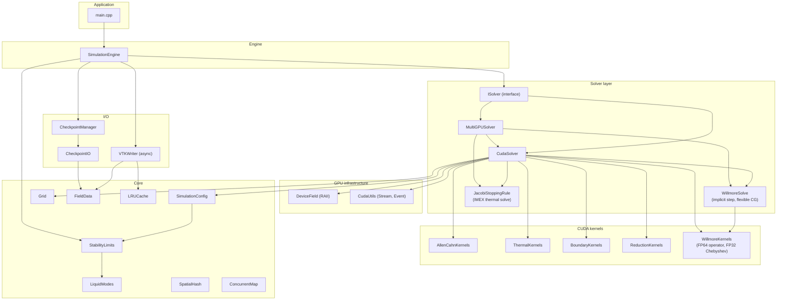
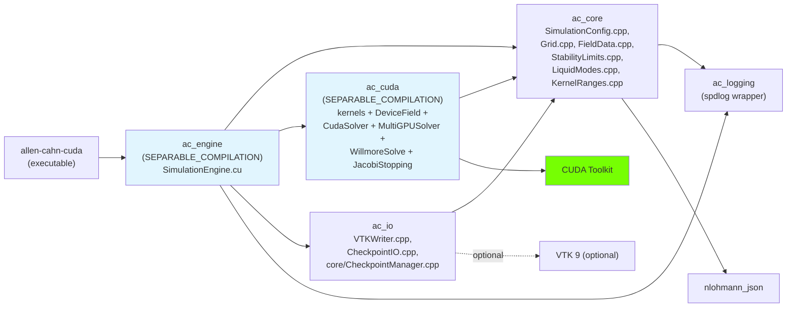
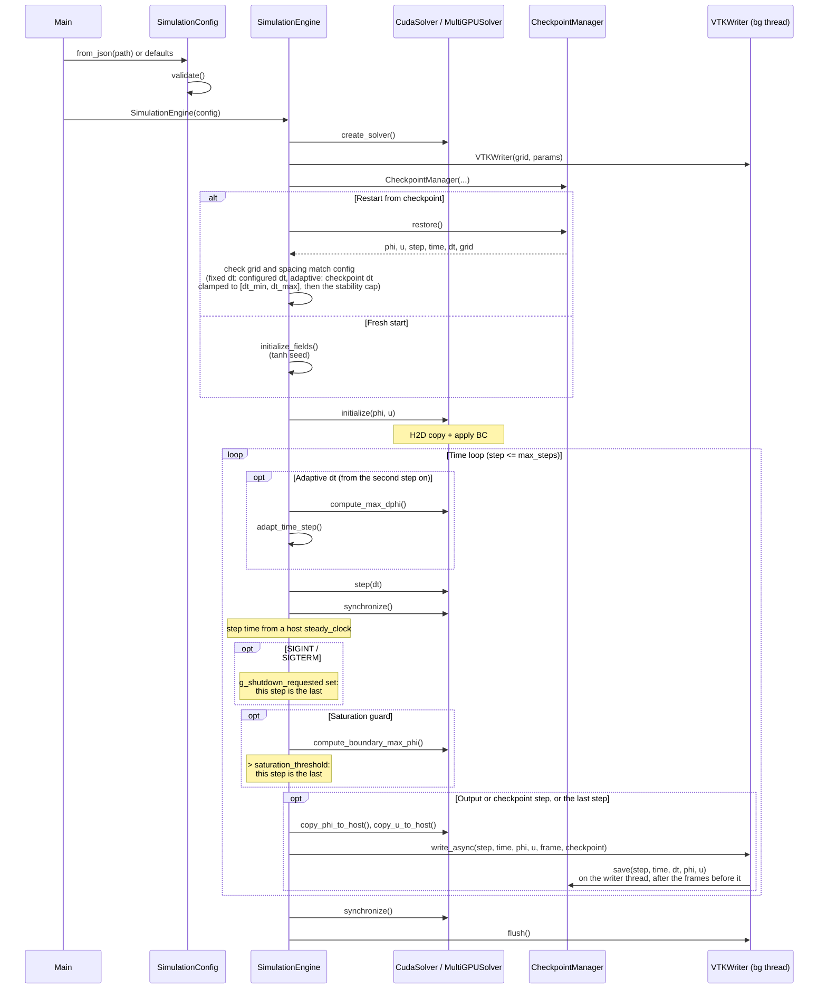
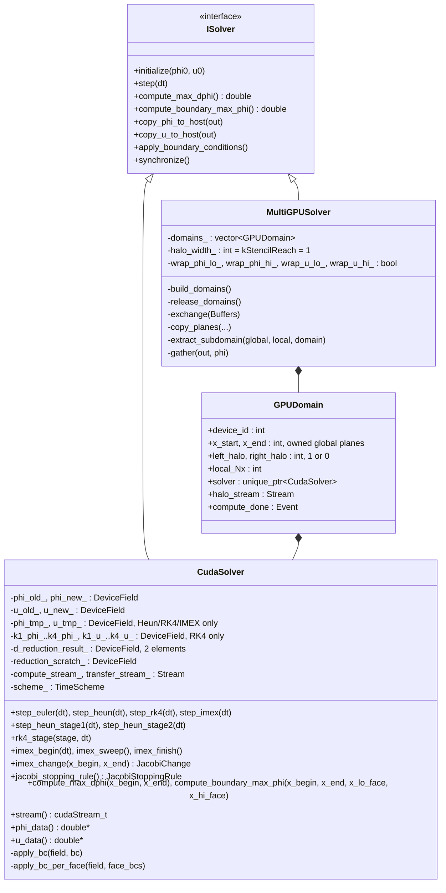
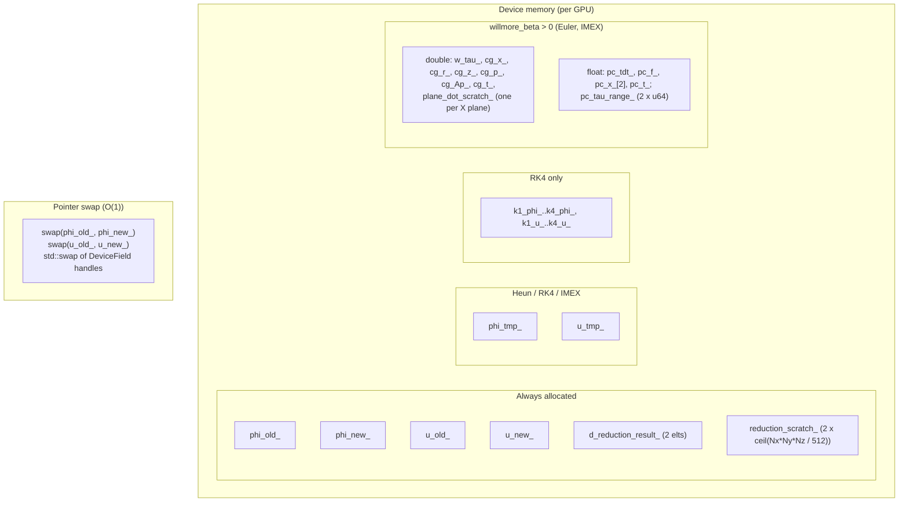
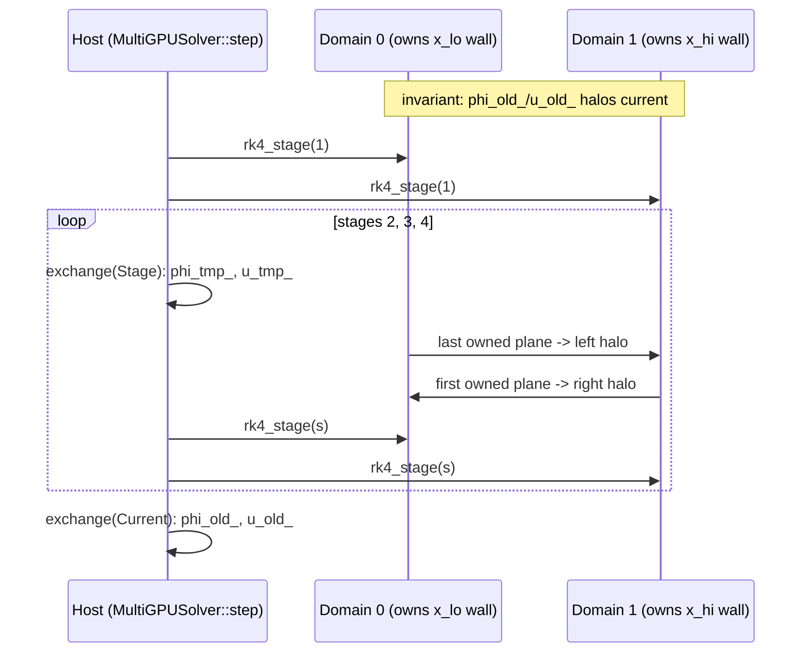
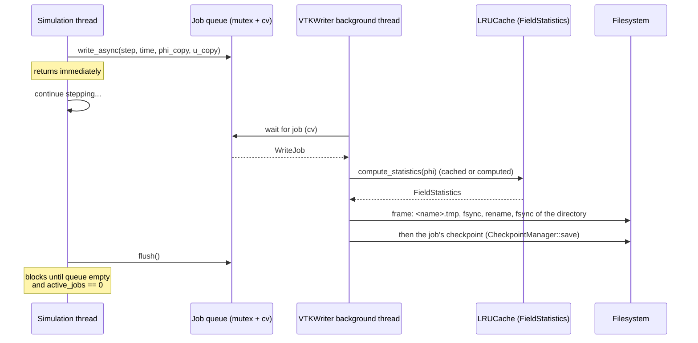
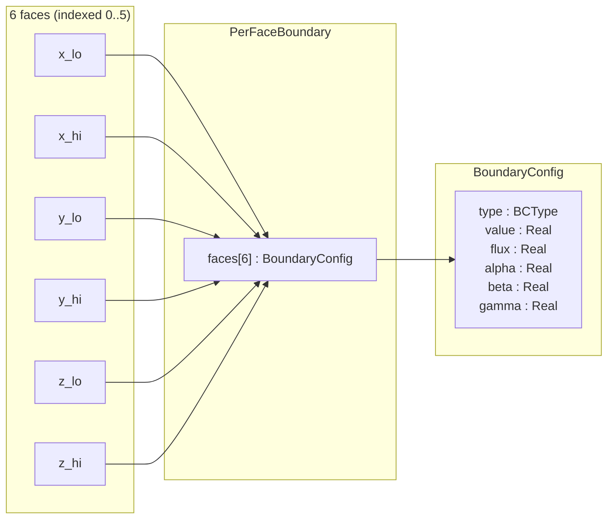
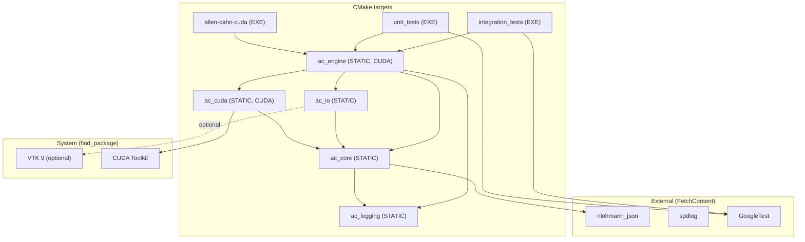

# Architecture Guide

This document describes the high-level architecture of Allen-Cahn-CUDA:
how the source tree is organised into layered libraries, how the runtime
components interact, and what the threading and memory model look like.
Every claim cites the source file and line where the corresponding code
lives.

---

## 1. System Overview

Allen-Cahn-CUDA is a GPU-accelerated 3D phase-field simulation
implementing the coupled Allen–Cahn and thermal-diffusion equations
(Karma–Rappel formulation) for dendritic solidification. The system is
organised into layered libraries with strict dependency direction:
upstream layers never include downstream ones.

---

## 2. Module / Library Decomposition

The project is split into five static libraries plus the executable and
two test executables (`src/CMakeLists.txt`).

A few non-obvious facts about the build graph:

- **`ac_core` is intentionally minimal.** It only compiles
  `SimulationConfig.cpp`, `Grid.cpp`, `FieldData.cpp`, `StabilityLimits.cpp`,
  `LiquidModes.cpp` and `KernelRanges.cpp` (`src/CMakeLists.txt`; the last holds
  the values of kernel quantities `validate()` checks, such as the Willmore
  diagonal `d_L`, which `willmore_spectrum` takes from there). `LRUCache`, `SpatialHash`, and
  `ConcurrentMap` are header-only utilities included by downstream
  libraries; they have no `.cpp`. So is `Interval.hpp`, the outward-rounded
  interval arithmetic `LiquidModes.cpp` builds its certified bounds from;
  `LiquidModesDetail.hpp` exposes that search's pieces to
  `tests/unit/test_LiquidModes.cpp`.
- **`CheckpointManager.cpp` lives under `src/core/` but compiles into
  `ac_io`** (`src/CMakeLists.txt`). It is grouped there because
  `CheckpointManager.hpp` includes `io/CheckpointIO.hpp`, so the only
  acyclic placement is in the I/O library that already depends on core.
- **CUDA separable compilation** is enabled on `ac_cuda` and `ac_engine`
  so that device-side functions can call across translation units.

---

## 3. Simulation Lifecycle

`SimulationEngine::run()` is the top-level method; the time loop itself is
`SimulationEngine::time_loop()` (both in `SimulationEngine.cu`).

---

## 4. Solver Class Hierarchy

The interface is in `src/cuda/ISolver.cuh`; `CudaSolver` and
`MultiGPUSolver` are in `src/cuda/`. The stage-level methods of
`CudaSolver` (`step_heun_stage1/2`, `rk4_stage`, `imex_*`) and the
X-ranged reductions are public because `MultiGPUSolver` drives each
domain's solver stage by stage and exchanges halos between the stages;
`step_heun`, `step_rk4` and `step_imex` are the same stages run back to
back.

---

## 5. GPU Memory Layout

Each `DeviceField<double>` is a flat allocation of
`Nx * Ny * Nz * sizeof(double)` bytes via `cudaMalloc`, with row-major
indexing `idx = x*Ny*Nz + y*Nz + z` (`DeviceField<float>` likewise with 4
bytes). Allocations are made in `CudaSolver`'s constructor from the active
time scheme and `willmore_beta`; the measured bytes per cell of each
combination are in the README (GPU memory budget).

---

## 6. Multi-GPU Halo Exchange

One RK4 step on two domains (Euler, Heun and IMEX follow the same pattern
with the exchanges listed in `DESIGN.md` §7):

Each `exchange()` records `compute_done` on every domain's compute
stream, makes every halo stream wait on all of those events, then copies
with `cudaMemcpyPeerAsync` in two host-synchronised phases: the periodic
X wrap (only when X is periodic) and then the neighbour halos. Halo and
periodic X planes of each sub-solver carry a zero-flux Neumann
placeholder BC; `exchange()` overwrites those planes before any stencil
reads them.

---

## 7. Async I/O Pipeline

Implementation: `src/io/VTKWriter.cpp`. The writer thread is owned by
the `VTKWriter` instance and joined in the destructor with `stop_` set
under the mutex (`VTKWriter::~VTKWriter` in `VTKWriter.cpp`).

Backpressure: producers wait on `queue_cv_` when the queue depth plus
in-flight jobs would exceed `max_queue_depth_`
(`VTKWriter::write_async` in `VTKWriter.cpp`).

Crash-safety: every write goes to `<file>.tmp` first, is synced and is
renamed atomically once it is complete (for raw writes, which use
`std::ofstream` in `VTKWriter::write_raw_file`, once `close()` has flushed
it), and the directory is synced; a failed write removes its `<file>.tmp`.
Checkpoints are saved by the same thread after the frames enqueued before
them (`SimulationEngine::write_step`), and once a job fails the later ones
are dropped: a checkpoint never precedes a frame up to its step, which a
resume would not write again.

---

## 8. Per-Face Boundary Condition System

`BoundaryParams` (in `SimulationConfig.hpp`) holds **both** a uniform
`BoundaryConfig` (`phi_bc`, `u_bc`) and a `PerFaceBoundary`
(`phi_faces`, `u_faces`); `CudaSolver::apply_phi_bc` and
`CudaSolver::apply_u_bc` (`CudaSolver.cu`) apply the per-face set through
`apply_bc_per_face` when the boolean `per_face` is true and the uniform one
through `apply_bc` otherwise.

Each face is launched as a 2D kernel covering its surface; the launch
order is **Z, Y, X** so that periodic faces see the latest values
(`launch_boundary_conditions` and `launch_boundary_conditions_per_face` in
`BoundaryKernels.cu`). Corner / edge ownership is explicit
(X owns full plane, Y excludes X-edges, Z excludes both X- and Y-edges
— `apply_bc_face_kernel` in `BoundaryKernels.cu`).

---

## 9. Thread Safety Model

| Component        | Synchronisation                          | Access pattern                                |
|------------------|-------------------------------------------|------------------------------------------------|
| `LRUCache`       | `std::shared_mutex`                       | Shared reads, exclusive writes                 |
| `ConcurrentMap`  | 16 striped `std::shared_mutex` shards     | Distributed contention                         |
| `SpatialHash`    | None (build-then-query)                   | Single-threaded build, read-only after         |
| `VTKWriter`      | `std::mutex` + `std::condition_variable`  | Producer-consumer with bounded queue           |
| `DeviceField`    | None (single CUDA stream per solver)      | Stream ordering provides serialisation          |
| `MultiGPUSolver` | Per-domain streams + CUDA events           | Every halo stream waits on every domain's compute event; host syncs halo streams |
| Signal handling  | `std::atomic<bool> ac::g_shutdown_requested` | `sigaction` with `SA_RESTART`               |

`g_shutdown_requested` is defined in `src/core/SimulationEngine.cu`
inside `namespace ac`, declared `extern` in `SimulationEngine.hpp`,
and signalled from `signal_handler` in `main.cpp`, a `sigaction`-installed
handler.

---

## 10. Build System

Top-level options (`CMakeLists.txt`):

| Option           | Default   | Purpose                                         |
|------------------|-----------|-------------------------------------------------|
| `AC_BUILD_TESTS` | `ON`      | Build the `unit_tests` and `integration_tests` |
| `AC_CUDA_FAST_MATH` | `OFF`  | Pass `--use_fast_math` to NVCC (Release only)   |

Install rule: `install(TARGETS allen-cahn-cuda RUNTIME DESTINATION bin)`.

CMake presets (see `CMakePresets.json`):

- `release` — `Release` build into `build/release/`.
- `debug` — `Debug` build with tests enabled into `build/debug/`.
- `relwithdebinfo` — `RelWithDebInfo` for profiling.

---

## 11. CI/CD Pipeline

`/.github/workflows/ci.yml` defines eight jobs, on pushes to `master`, `main` and
`feature/**` and on pull requests to `master` and `main`:

| Job              | Runner          | What it does                                                              |
|------------------|-----------------|---------------------------------------------------------------------------|
| `format-check`   | `ubuntu-latest` | `clang-format-18 --dry-run --Werror` over the C++ and CUDA sources of `src/` and `tests/` |
| `clang-tidy`     | `ubuntu-latest`, `nvidia/cuda:12.6.0-devel` container | Generates compile_commands and runs `make lint`: `clang-tidy-18` on the `.cpp` / `.hpp` files of `src/`; advisory: warnings do not fail it (an error of clang-tidy itself does), and no job depends on it |
| `build-and-test` | self-hosted GPU | Debug and Release with CUDA 12.6.0, configured with the README's command; the unit, integration and end-to-end tests with `AC_REQUIRE_GPU=1` |
| `build-cpu-only` | `ubuntu-latest`, `nvidia/cuda:12.6.0-devel` container | Release build and every `ctest` test: the CPU tests run, the CUDA tests and the e2e tests that run a simulation are reported as Skipped |
| `viz-smoke`      | `ubuntu-latest` | The visualizer's `--self-test` and `tests/visualize_smoke.py` (Xvfb), and the resume helper's and GPU-runner guard's tests |
| `docker-build`   | `ubuntu-latest` | Buildx build of the `dev`, `test`, `prod` and `cuda-dev` Dockerfiles, a check of each image's user and writable directories, and the `test` image's suite (no GPU) |
| `k8s-validate`   | `ubuntu-latest` | `kubectl kustomize` of `k8s/base` and both overlays, each to a file (a render error or an empty render fails the step), then `kubeconform` (offline, no API server required); kubectl and kubeconform are pinned releases checked against their published SHA-256 |
| `release-docker` | `ubuntu-latest` | On a push to the default branch (`master`), after every job but `clang-tidy`: build & push the `ghcr.io/...` production image |

The `k8s-validate` job uses `kubeconform` because `kubectl apply
--dry-run=client` always tries to contact the API server for resource
discovery, which has no destination in CI.
