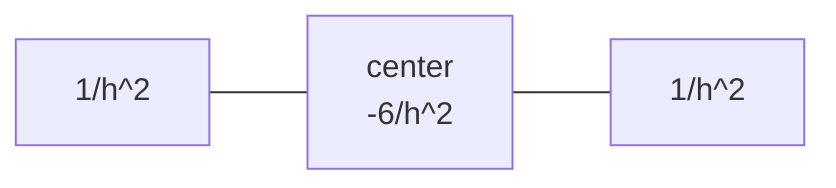
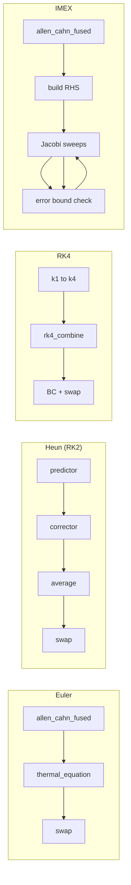
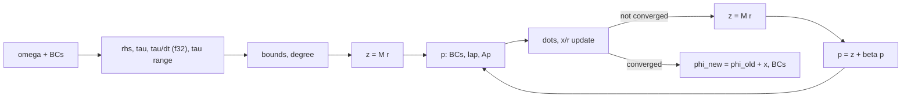
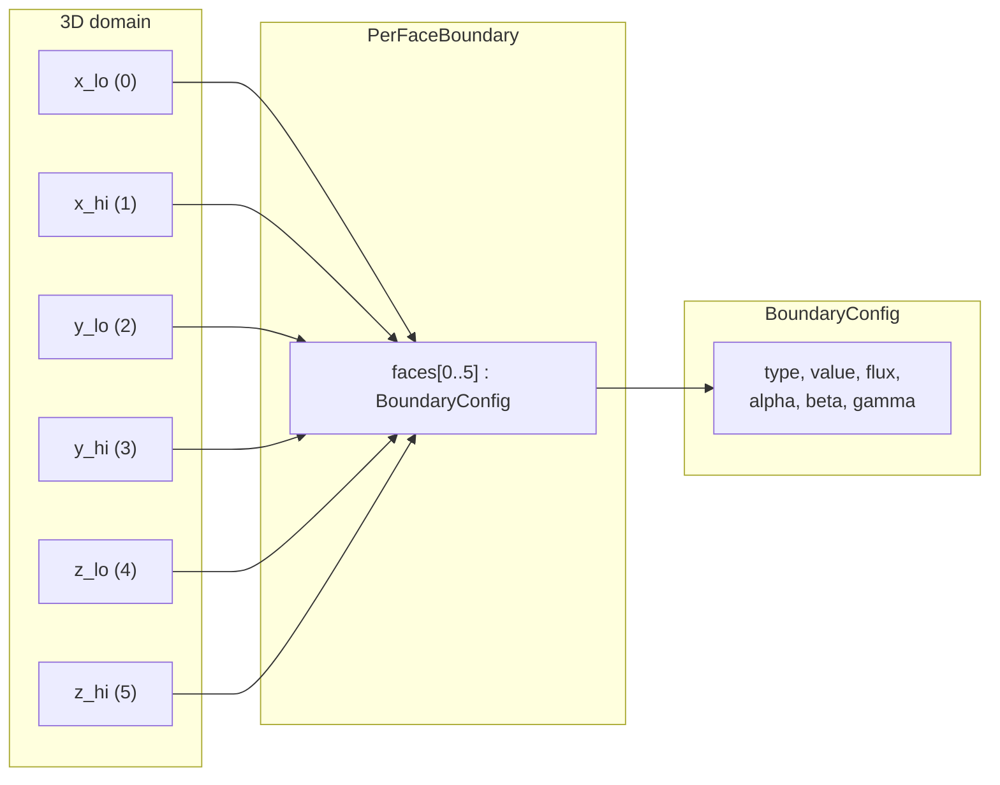
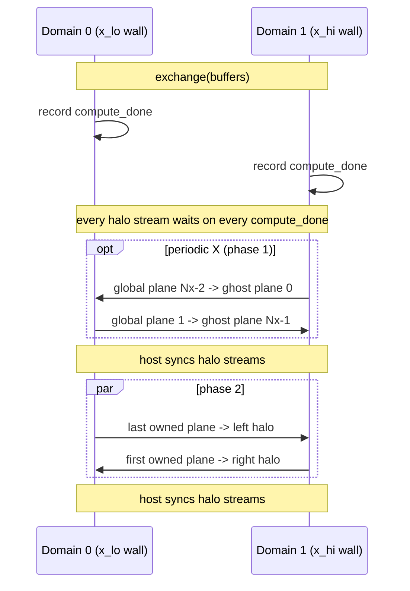
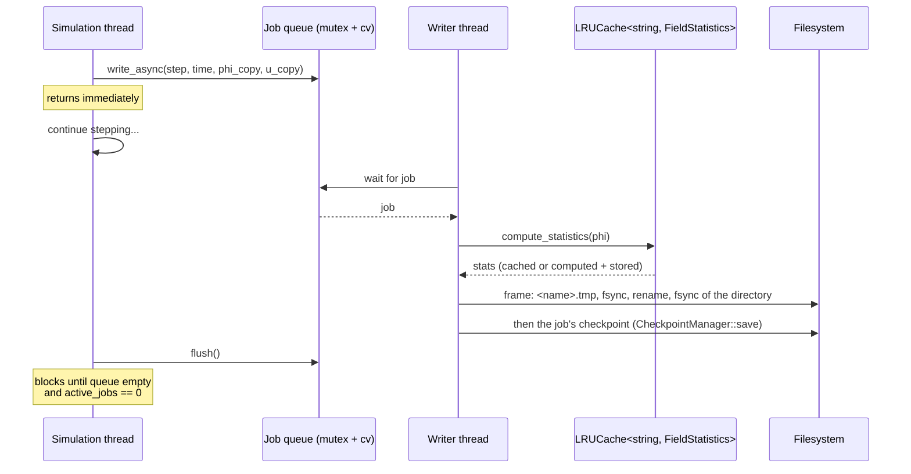
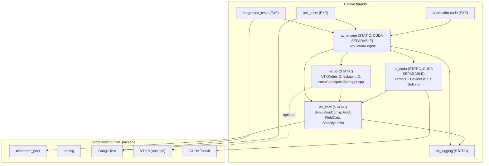

# Design Document

This document covers the algorithms, data structures, numerical schemes, and
multi-GPU strategy used by Allen-Cahn-CUDA.

---

## 1. Mathematical Model

### 1.1 Allen–Cahn equation (phase field)

The phase-field variable `phi` evolves under the Karma–Rappel anti-trapping
formulation:

```
tau(n) * dphi/dt = div(F) - dF/dphi
```

where `F` is the anisotropic gradient flux assembled by the kernel as

```
F_i = wn^2 * phi_i  +  16 * W0 * wn * eps * dFunc_i      (i = x, y, z)
```

(see `allen_cahn_fused_kernel` in `src/cuda/AllenCahnKernels.cu` for the
fused single-pass form, and `anisotropic_flux` / `anisotropic_divergence` in
`src/cuda/Kernels.cuh` for the helpers).

- `tau(n) = tau0 * A(n)^2` — orientation-dependent relaxation time.
- `wn = W0 * A(n)` — orientation-dependent interface width.
- `A(n)` — cubic anisotropy with 4-fold symmetry. For `|grad phi|^2 > 1e-30`:

  ```
  A(n) = (1 - 3*eps) * (1 + (4*eps / (1 - 3*eps)) * (qrt / sq^2))
  ```

  with `sq = sum(phi_i^2)` and `qrt = sum(phi_i^4)`. For the degenerate
  `|grad phi|^2 <= 1e-30` case the kernel returns the **spherical average**
  `1 - 3*eps/5` (`compute_An` in `Kernels.cuh`). This is the average of A
  over the unit sphere using `<n_i^4> = 1/5`, giving `<sum n_i^4> = 3/5`.
  The earlier value `1 - 5*eps/3` was a bug, now fixed.

- `dFunc(l, m, n) = (l^3 (m^2 + n^2) - l (m^4 + n^4)) / (l^2 + m^2 + n^2)^2`
  (`dFunc` in `Kernels.cuh`).
- `dF/dphi = -phi*(1 - phi^2) + lambda * u * (1 - phi^2)^2`
  (`dF_dphi` in `Kernels.cuh`).

### 1.2 Thermal-diffusion equation

```
du/dt = D * Laplacian(u) + 0.5 * dphi/dt
```

The kernel discretises the latent-heat term as `0.5 * (phi_new - phi_old)`,
which is `0.5 * dt * dphi/dt` to leading order in `dt`
(`thermal_equation_kernel` in `src/cuda/ThermalKernels.cu`):

```cpp
double lap_u       = laplacian(u_old, x, y, z, p);
double latent_heat = 0.5 * (phi_new[c] - phi_old[c]);
u_new[c] = u_old[c] + latent_heat + p.dt * p.D * lap_u;
```

For RK4, `thermal_rhs_kernel` (`ThermalKernels.cu`) evaluates the right-hand
side at each stage as `D * Lap(u) + 0.5 * k_phi`, where `k_phi` is the
Allen–Cahn RHS for that stage. Heun's two stages are Euler steps and use
`thermal_equation_kernel`.

### 1.3 Karma–Rappel parameter relations

Members of `PhysicsParams` in `src/core/SimulationConfig.hpp`:

```cpp
Real a1 = 1.25 / std::sqrt(2.0);   // ≈ 0.8839
Real a2 = 0.64;
Real lambda() const { return W0 * a1 / d0; }
Real tau0()   const { return (W0*W0*W0 * a1 * a2) / (d0 * D)
                          + (W0*W0 * beta0) / d0; }
```

The `beta0` term is the kinetic-coefficient contribution (defaults to 0).

---

## 2. Spatial Discretization

### 2.1 7-point standard Laplacian

Second-order central differences on the 6 face neighbours
(`laplacian_7pt` in `src/cuda/Kernels.cuh`):

```
Lap(phi) = (phi[x+1] + phi[x-1] - 2*phi[c]) / dx^2
         + (phi[y+1] + phi[y-1] - 2*phi[c]) / dy^2
         + (phi[z+1] + phi[z-1] - 2*phi[c]) / dz^2
```

Stencil:



### 2.2 27-point isotropic Laplacian (Patra–Karttunen)

Improved-isotropy 2nd-order stencil over all 26 neighbours, requires
`dx = dy = dz = h` (`laplacian_27pt` in `Kernels.cuh`):

```
Lap(phi) = (14*sum_face + 3*sum_edge + 1*sum_corner - 128*phi_center) / (30*h^2)
```

| Neighbour type | Count | Per-neighbour weight | Sum  |
|----------------|-------|----------------------|------|
| Face           | 6     | 14/30                | 84/30 |
| Edge           | 12    | 3/30                 | 36/30 |
| Corner         | 8     | 1/30                 | 8/30  |
| Center         | 1     | −128/30              | −128/30 |

Consistency check: `84 + 36 + 8 = 128`. The configuration validator refuses
the 27-point stencil unless `dy` and `dz` equal `dx` exactly
(`SimulationConfig::validate` in `SimulationConfig.cpp`): the stencil takes `dx`
for all three directions.

### 2.3 Gradient stencils

**2nd-order central** (used in production kernels,
`gradient_x` / `gradient_y` / `gradient_z` in `Kernels.cuh`):

```
grad_x phi = (phi[x+1] - phi[x-1]) / (2*dx)
```

**4th-order central** (available, used in tests,
`gradient_x_4th` / `gradient_y_4th` / `gradient_z_4th` in `Kernels.cuh`):

```
grad_x phi = (-phi[x+2] + 8*phi[x+1] - 8*phi[x-1] + phi[x-2]) / (12*dx)
```

### 2.4 Memory layout

Row-major XYZ, identical on host (`FieldData::linear_index` in
`FieldData.hpp`) and device (`idx3d` in `Kernels.cuh`):

```
index(x, y, z) = x * Ny * Nz + y * Nz + z
```

The intermediate is computed in `long long` to avoid overflow on grids
near `INT_MAX/8`.

---

## 3. Time Integration Schemes

All schemes are implemented in `src/cuda/CudaSolver.cu`.

### 3.1 Forward Euler

```
phi_new = phi_old + dt * f(phi_old, u_old)        # allen_cahn_fused
u_new   = u_old + 0.5*(phi_new - phi_old) + dt*D*Lap(u_old)   # thermal_equation
```

Then `swap(phi_old, phi_new); swap(u_old, u_new)` (O(1) pointer swap).
Boundary conditions are applied to `phi_new` and `u_new` between the
two updates and at the end (`CudaSolver::advance_phi` and
`CudaSolver::euler_thermal_and_swap` in `CudaSolver.cu`).

### 3.2 Heun (RK2)

Two-stage predictor–corrector
(`CudaSolver::step_heun_stage1` and `step_heun_stage2` in `CudaSolver.cu`):

```
# Stage 1 (predictor)
phi_tmp = AllenCahn(phi_old, u_old)
u_tmp   = Thermal  (u_old, phi_tmp, phi_old)

# Stage 2 (corrector)
phi_new = AllenCahn(phi_tmp, u_tmp)
u_new   = Thermal  (u_tmp, phi_new, phi_tmp)

# Average
phi_new = 0.5 * (phi_old + phi_new)
u_new   = 0.5 * (u_old   + u_new)
```

The `average_kernel` writes back into `phi_new`/`u_new` and intentionally
allows aliasing of input and output for that operand
(`CudaSolver.cu`).

### 3.3 Classical RK4

Four stages computing `k1..k4` of phi and u via `allen_cahn_rhs_kernel`
(the same `allen_cahn_rate` as the Euler kernel) and `thermal_rhs_kernel`,
then a final `rk4_combine_kernel`:

```
y_new = y_old + (dt/6) * (k1 + 2*k2 + 2*k3 + k4)
```

(`CudaSolver::rk4_stage`). The stages store only the RHS arrays `k1..k4`;
the flux is recomputed at the cell faces, never stored.

### 3.4 IMEX (explicit AC + implicit thermal)

The Allen–Cahn equation is integrated explicitly. The thermal equation
becomes `(I − dt*D*Lap) u_new = u_old + 0.5*(phi_new − phi_old)` and is
solved by Jacobi sweeps (`CudaSolver::step_imex`, `imex_sweep`): every
`kJacobiCheckFreq` (10) sweeps one fused reduction
(`launch_max_abs_diff_and_max_abs`) returns the change of the last sweep
and the largest |u|, and `JacobiStoppingRule` accepts the iterate when its
certified max-norm error bound is at most `kJacobiTol` (1e-10), or throws
when the iterate is not finite, when rounding alone reaches the tolerance,
or when the change stops decreasing (docs/THEORY.md §10.2). There is no
fixed sweep limit.



### 3.5 Willmore-regularised phase-field step (Euler / IMEX, β > 0)

With `physics.willmore_beta > 0` the phase-field part of an Euler or IMEX
step (`CudaSolver::advance_phi`) is the linearly implicit Willmore step of
`docs/THEORY.md` §4.3; the thermal part is unchanged. `solve_willmore_step`
(`src/cuda/WillmoreSolve.cu`) drives one solve over all domains from
`CudaSolver` building blocks, so `MultiGPUSolver` reuses it with its halo
exchanges:

1. `willmore_omega`: ω = W₀²∇²φ + φ − φ³, homogeneous BCs on ω.
2. `willmore_rhs_init`: τ and the right-hand side; x = z = p = 0; τ/dt in
   single precision and the exact τ range (`launch_precond_tau_scan`).
3. Host: spectral bounds `[a, b]`, `κ_A` and the Chebyshev plan
   (`willmore_spectrum`, `chebyshev_plan`, `docs/THEORY.md` §4.4).
4. Flexible CG in double precision; each iteration: homogeneous BCs on p,
   t = ∇²p, Ap, four per-plane dot products, x/r update, z = M r, and
   p = z + β p. z = M r is the Chebyshev iteration in single precision: one
   first step, then per step the iterate's Laplacian and one update kernel.
5. `willmore_finish`: φ_new = φ_old + x, φ's BCs.

| Constant | Value | Where |
|---|---|---|
| `kWillmoreCgTolerance` | 1e-10 (relative residual) | `WillmoreSolve.cuh` |
| `kWillmoreCgMaxIterations` | 1000 outer iterations, then throw (a backstop, not derived from a bound; measured solves take 2 or 3, `docs/THEORY.md` §4.4) | `WillmoreSolve.cuh` |
| Chebyshev degree | lowest that guarantees 2 outer iterations in exact arithmetic (11 for run_dendrite: β = 0.25, dt = 0.000625) | `chebyshev_plan` |

The single-precision kernels (`WillmoreKernels.cu`) cover the interior with a
(z, y) thread grid and a loop over X planes, and every kernel that produces
the iterate or its Laplacian also writes the face ghost cells that depend on
it (homogeneous rule of the face, or the periodic image), so no boundary
launch is needed between steps. The double-precision Willmore stencils
multiply by 1/h² and 1/dt precomputed on the host (they are bound by
double-precision throughput on GeForce-class GPUs).



---

## 4. Adaptive Time Stepping & Stability Limits

`SimulationEngine::adapt_time_step` does three things:

1. Reads `max_dphi = solver_->compute_max_dphi()`
   (parallel reduction of `|phi_new − phi_old|`).
2. Targets `adaptive_tolerance` per step:
   `new_dt = dt * clamp(0.9 * tolerance / max_dphi, 0.5, 1.5)`.
3. Clamps to `[dt_min, dt_max]`, then caps at `cfl_safety` times the
   smaller explicit stability limit, last, so dt_min cannot lift a step
   above it. φ unchanged gives tolerance / max_dphi = +∞ and the factor 1.5.

The limits (`core/StabilityLimits.hpp`, docs/THEORY.md §10.1) are the exact
limit of the explicit thermal update of Euler, Heun and RK4,
`dt * D * rho <= r` (rho = 4 sum_d h_d^-2 for the 7-point, 184/(30 h^2) for
the 27-point stencil; r = 2, or 2.785293563405282 for RK4; none for IMEX),
and, as a necessary condition, that of the explicit phase-field update in the
liquid: `dt (Lam - beta L) <= r tau` for every mode, the uniform liquid's
exact modes (shift, checkerboards, axial waves; closed form) and every
Fourier mode of a liquid with a small gradient along any direction n
(tau = tau0 A(n)^2, the gradient energy's full Hessian H(n) in Lam), the
latter as a certified bound from a branch and bound in interval arithmetic
rounded outward at every operation (`core/LiquidModes.hpp`,
`core/Interval.hpp`; above the maximum by at most 1e-9 max(1, maximum)). A
mode with `Lam + beta L < 0` grows at every dt: `validate` rejects the
configuration (beta too small for an epsilon above 1/15 at that spacing)
and names the mode with a certified upper bound of its `Lam + beta L`, or,
when the search cannot decide the sign within its budget (beta very close
to the smallest value that regularises epsilon), the range the minimum
lies in.
`SimulationConfig::validate` rejects a fixed dt above either limit, and with
adaptive stepping a time.dt or dt_min above the cap and `cfl_safety`
outside (0, 1]. The engine computes the cap once, in its constructor.
For a valid file `allen-cahn-cuda --validate-config` prints the lines of
`stability_limits_report`: the thermal limit with the scheme and stencil,
the phase-field limit with the scheme (`stencil` selects only the thermal
Laplacian), and with adaptive stepping the cap, each printed to 17
significant digits like the rejection messages, `none` for +∞:

```
thermal dt limit (scheme <euler|heun|rk4|imex>, stencil <7pt|27pt>): <limit|none>
phase-field dt limit (scheme <euler|heun|rk4|imex>, any stencil): <limit|none>
adaptive dt cap (cfl_safety times the smaller limit): <cap|none>
```

The validator also rejects:
- `time.adaptive_tolerance <= 0` when `time.adaptive == true`.
- `output.format` other than `"vts"` or `"raw"`.
- `checkpoint.keep_last < 1`, `time.saturation_check_freq < 1`, a negative
  entry of `gpu.device_ids`, an empty `checkpoint.restart_file`,
  `output.output_dir` or `checkpoint.checkpoint_dir` (the engine creates
  both), `initial.seed_radius <= 0`, `epsilon` outside `[0, 1/3)`, etc.
- more than 2^31 − 1 grid points (kernels index cells with 32-bit `int`).
- several `gpu.device_ids` without `gpu.multi_gpu` (the run would use the
  first only), and a multi-GPU split that leaves a domain fewer than
  `kMinOwnedPlanes` = 2 X planes (section 7; the solver's constructor has the
  same rule).
- a real parameter that is not a finite number (only a configuration built
  in code can hold one); `tau0` or `lambda` not finite and positive, a
  relaxation time `tau0 A(n)^2` of some orientation outside the positive
  doubles (`relaxation_time_range`, `core/KernelRanges.hpp`), or, on a cold
  start, an infinite `lambda delta` (`docs/THEORY.md` 5);
- phase-field boundary data that take phi outside [-1, 1] (`docs/THEORY.md`
  9.1);
- with `willmore_beta > 0`, `willmore_beta d_L` or the preconditioner
  diagonal `tau/dt + willmore_beta d_L` at the smallest step beyond single
  precision (`docs/THEORY.md` 4.4).

The parser (`parse_config`) is strict: an unknown key in any section is an
error that names the key and the allowed ones (keys starting with `_` are
comments), so is a key given twice in one object (`parse_json`: JSON keeps
only the last value, which would drop an earlier setting or section without
a word), and so is a boundary parameter of another type than the face's
(`dirichlet` takes `value`, `neumann` `flux`, `robin` `alpha`, `beta` and
`gamma`, `periodic` none; `type` defaults to `dirichlet`), which the ghost
fill would ignore. A section that is not a JSON object is an error, an integer
field (grid dimensions, step counts and intervals, `keep_last`, device ids)
takes only a JSON integer in the range of `int` (a fraction, an exponent, a
boolean or a string is an error, not a conversion), and a per-face
`boundary.phi` / `boundary.u` (any of `x_lo` … `z_hi` present) must name all
six faces and nothing else. `allen-cahn-cuda --validate-config FILE` runs the
parser and validator without touching the GPU and, for a valid file, prints
the limit lines above; the ctest `e2e.ShippedConfigsValidate` runs it on
every configuration the repository ships (`config/*.json`, the k8s
payloads, the Makefile's `run_vtk.json` and the JSON examples in the docs),
requires the limit lines for each, and checks that a `time.dt` equal to a
printed limit (thermal, phase-field, adaptive cap) is accepted and one
double above it rejected.

---

## 5. Boundary Conditions

`BoundaryKernels.cu` implements four BC types — Dirichlet, Neumann,
Periodic, Robin — applied per face. Each face is launched as a 2D kernel
covering its surface; corners and edges follow an explicit ownership rule
to avoid double writes (X faces own their full plane, Y excludes
X-edges, Z excludes both — see `apply_bc_face_kernel` in `BoundaryKernels.cu`).

The six faces are launched in **Z, Y, X** order so periodic / coupled
faces see the values written by the others before reading
(`launch_boundary_conditions` and `launch_boundary_conditions_per_face` in
`BoundaryKernels.cu`).

### 5.1 Per-face BC system

`SimulationConfig.hpp` defines:

```cpp
struct PerFaceBoundary {
    std::array<BoundaryConfig, 6> faces;   // x_lo, x_hi, y_lo, y_hi, z_lo, z_hi
};
struct BoundaryParams {
    BoundaryConfig    phi_bc, u_bc;        // uniform fallback
    PerFaceBoundary   phi_faces, u_faces;  // per-face overrides
    bool              per_face = false;    // selector
};
```

`CudaSolver::apply_phi_bc` and `CudaSolver::apply_u_bc` (`CudaSolver.cu`)
dispatch to the per-face launcher (`apply_bc_per_face`) when
`per_face == true`, else to the uniform launcher (`apply_bc`).



Robin BC enforces `alpha*u + beta*du/dn = gamma`. The validator
(`SimulationConfig::validate`) requires `alpha`, `beta` and `gamma` finite,
forbids `alpha == 0 && beta == 0` and `alpha` and `beta` of opposite signs,
and rejects a ghost constant `gamma/(alpha + beta/h)` (`h` the spacing normal
to the face) beyond the double range. The fill computes the ghost
`(gamma + beta*u_inner/h)/(alpha + beta/h)` from the coefficients of
`scaled_robin`, scaled by one power of two so that the denominator lies in
(1/8, 1) in magnitude: it never vanishes or overflows, the ghost keeps its
bits whenever every intermediate is a normal double, and its factor of
`u_inner` lies in [0, 1] (docs/THEORY.md §9.1). The Willmore solve takes that
factor from `robin_ghost_coefficient`, which uses the same coefficients.
Dirichlet values and Neumann fluxes must be finite as well.

### 5.2 Periodic faces come in pairs

A periodic BC fills the ghost plane at one face from the interior plane next
to the opposite face (`x = 0` from `x = Nx-2`, `x = Nx-1` from `x = 1`), so
it identifies the two faces of an axis. `SimulationConfig::validate` rejects
per-face BCs that make only one face of an axis periodic, for `phi` and `u`
alike.

With only one face periodic, the ghost cells couple the first interior plane
to the far one in one direction only. The 7-point Laplacian with that ghost
fill is then neither symmetric nor conservative (its flux no longer
telescopes to the boundary), which matches no boundary condition of the
continuous problem. Measured on a 24³ grid with `h = 0.4`, periodic `x_lo`
and zero-flux `x_hi`:

| Faces on X | `|y·Lx − x·Ly| / (|y| |Lx|)` | change of `Σu` after 200 steps of pure diffusion, per unit of initial bump content |
|---|---|---|
| both zero-flux | 9e-19 | ≤ 7e-13 |
| both periodic | 8e-19 | ≤ 7e-13 |
| periodic `x_lo`, zero-flux `x_hi` | 3.6e-4 | −0.49 |

The diffusion runs start from `phi = −1` everywhere (no latent heat) and a
heat bump next to `x_lo`; the loss is the same with Euler, Heun, RK4 and
IMEX.

---

## 6. Saturation Guard

`SimulationEngine::check_saturation` calls
`solver_->compute_boundary_max_phi()`, an O(N²) reduction implemented in
`CudaSolver::compute_boundary_max_phi`. It reads the interior cells next to
the walls (the first and last interior layer of each axis; on several GPUs
only the domains' physical X walls count), computes the maximum, and
triggers a clean shutdown if it exceeds `time.saturation_threshold`
(default `-0.5`): from then on the wall's boundary condition acts on the
solid and the run no longer represents growth into an unbounded melt. The
boundary cells themselves are not read: they hold the boundary condition
(a Dirichlet value never changes), or for zero-flux and periodic faces a
copy of the cells next to the wall, so for those faces the result is the
same.

---

## 7. Multi-GPU Strategy

`MultiGPUSolver` (`src/cuda/MultiGPUSolver.cu`) decomposes the domain
along the X axis and reproduces the single-GPU `CudaSolver` bit for bit
for every time scheme and boundary layout.

| Aspect | Choice | Where |
|---|---|---|
| Decomposition | contiguous X slabs, `Nx / n` planes each, remainder to the first domains | `MultiGPUSolver::build_domains` |
| Halo width | `kStencilReach` = 1 plane (face-flux Allen-Cahn, thermal and Jacobi stencils read ±1) | `MultiGPUSolver` constructor |
| Halo placement | only on sides that face another domain | `GPUDomain::left_halo` / `right_halo` |
| Physical X walls | held by the first / last domain, which apply the configured BC | `build_domains` |
| Halo / periodic X faces inside a sub-solver | zero-flux Neumann placeholder, overwritten by `exchange()` before it is read | `build_domains` |
| Minimum slab | every domain owns ≥ `kMinOwnedPlanes` = 2 planes (the BC at an X wall reads the plane next to it; the periodic wrap reads planes 1 and Nx−2), else `std::invalid_argument`; the last domain owns the fewest, `Nx / n` | `SimulationConfig::validate()` and the constructor |
| Domains per device | any; `gpu.device_ids` may repeat an ID | constructor (peer access only between distinct IDs) |

**Why this is exact.** Every owned cell is computed by the same kernel from
the same operands as in the single-GPU run, provided every plane the
stencil reads is current:

1. The first and last domains own the global planes `0` and `Nx-1`, so the
   BC kernels (Z, then Y, then X) act on exactly the same cells as in the
   single-GPU run. Y/Z BCs only read within an X plane, so they are
   unaffected by the decomposition.
2. A periodic X BC copies plane `Nx-2` to `0` and plane `1` to `Nx-1`; the
   two planes live on different domains, so `exchange()` performs this
   *wrap* (phase 1), completed before the neighbour exchange (phase 2) so
   that phase 2 can never forward a stale ghost plane (possible only for an
   end domain owning no more planes than the halo width, which the 2-plane
   minimum excludes).
3. `exchange()` runs whenever a stencil is about to read a buffer whose
   halos are stale (table below).
4. Reductions (`compute_max_dphi`, `compute_boundary_max_phi`, the IMEX
   residual) run over each domain's owned slab only, with the X walls
   counted only on the first/last domain. Maximum is exact and
   order-independent, and NaN propagates (`nan_max` on the device,
   `nan_aware_max` across domains), so adaptive `dt`, the saturation guard
   and the IMEX early exit take identical decisions.

| Scheme | Exchanges per step |
|---|---|
| Euler | `phi_old_`/`u_old_` after the step |
| Heun | predictor (`phi_tmp_`/`u_tmp_`) between the stages, then the new state |
| RK4 | stage state (`phi_tmp_`/`u_tmp_`) before stages 2, 3 and 4, then the new state |
| IMEX | the Jacobi iterate (`u_new_`) after every sweep, then the new state |
| Euler / IMEX with β > 0 | additionally, in the Willmore solve: ω once; per CG iteration the direction and its Laplacian; per Chebyshev step the single-precision iterate and its Laplacian |

The IMEX solver applies the stopping rule to the global change and
magnitude (max over the domains' owned cells) every 10 sweeps, like the
single-GPU solver, so both run the same number of Jacobi sweeps.

**Synchronisation.** Before an exchange every domain records
`compute_done` on its compute stream and every halo stream waits on all
of those events (a copy reads another domain's memory). The copies use
`cudaMemcpyPeerAsync` on the halo streams, and the host synchronises the
halo streams after each phase, so the next kernels on any compute stream
see the new halos. Each domain's streams and events are created with its
device current, and the destructor releases each domain with its device
current.

**Evidence.** `tests/unit/test_MultiGPUSolver.cu` compares
`MultiGPUSolver` (2 and 3 domains sharing device 0) with `CudaSolver`
bit for bit after `initialize()` and after every one of 8 steps. It covers
Euler, Heun, RK4 and IMEX × {uniform, per-face with Robin, fluxes, Z
periodic and the 27-point stencil, periodic X}, including an `Nx = 6`
split where every domain owns exactly two planes, and the same layouts for
Euler and IMEX with the Willmore term (β > 0, 14 cases). It also compares
`compute_max_dphi` and `compute_boundary_max_phi`, and a full adaptive-`dt`
`SimulationEngine` run.



---

## 8. Checkpointing

### 8.1 On-disk format

`CheckpointIO::Header`, defined in `src/io/CheckpointIO.hpp`:

```cpp
#pragma pack(push, 1)
struct Header {
    char     magic[8] = {'A','C','C','H','K','P','T','\0'};
    int      version  = 2;     // CheckpointIO::kVersion
    int      Nx, Ny, Nz;
    double   dx, dy, dz;
    double   dt, time;
    int      step;
    int      num_fields;       // always 2 (phi, u)
    uint32_t data_crc32;       // CRC-32 of phi || u (version 1: 0 = none)
    uint32_t header_crc32;     // version 2: CRC-32 of the header, this field 0
    char     reserved[48];
};
#pragma pack(pop)
static_assert(sizeof(Header) == 128, ...);
```

Layout on disk: `[Header][phi_data][u_data]`. `data_crc32` covers the
concatenated field bytes and `header_crc32` the 128 header bytes with
itself zero (`CheckpointIO::header_crc32`), so every byte of the file is
under a CRC; the table is generated once in `CheckpointIO::compute_crc32`
and reused by both writer and reader (`CheckpointIO.cpp`). `write` produces
version 2. Version 1, written before the header CRC (the field was
reserved, zero), is still read: its header is checked field by field only,
and `data_crc32 == 0` there means that no payload CRC was computed.

### 8.2 Write protocol (crash-safe)

`CheckpointIO::write` (`CheckpointIO.cpp`), which the engine runs on the
writer thread after the frames enqueued before the checkpoint (9), does:

1. `open` `path.tmp` with `O_WRONLY | O_CREAT | O_TRUNC`.
2. Compute CRC32 over `[phi || u]`.
3. POSIX `write()` of header + phi + u, retrying on `EINTR`.
4. `fsync(fd)`, `close(fd)`.
5. `rename(path.tmp, path)` (atomic on POSIX).
6. `open(parent_dir)` + `fsync` to make the rename durable.

A failure in steps 3 to 5 removes `path.tmp` before it throws: the partial
file is as large as the checkpoint, and retention counts only
`checkpoint_<step>.acbin`, so nothing else would remove it.

### 8.3 Read protocol

`CheckpointIO::read` validates magic, version (1 or 2), for version 2 the
header CRC (so a changed step, time or dt is caught also where it is a run
state in range), `num_fields`, dimensions of at least 3, positive grid
spacing, the run state (a step >= 0, a finite time >= 0 and a finite
dt > 0; `write` refuses the same values), that the file size is exactly
the header plus two fields of the header's grid (before allocating; a
header whose size overflows 64 bits is rejected), and the payload CRC
(always in version 2; in version 1 when it is not 0). `read_header`, which
retention uses, takes a header only with the magic, a version `read`
takes and, for version 2, a matching header CRC.
`SimulationEngine::initialize_from_checkpoint` additionally rejects a
checkpoint whose grid dimensions or spacing differ from the current
config, and one holding a non-finite value. It restores step and time; a
fixed-dt run (`time.adaptive` false) continues with the configured dt,
with a warning if the checkpoint was written with another one (the
configured dt is the one `validate()` checked and the step-counted
frequencies assume), and an adaptive run continues from the checkpoint's
dt, clamped to [dt_min, dt_max] and capped at `cfl_safety` times the
stability limits like every adapted step (with a warning if that changes
it). A restart is requested iff
`checkpoint.restart_file` is set; if that file does not exist the run
fails (`CheckpointManager::restore`) instead of cold-starting, which
would otherwise overwrite and rotate away the real checkpoints. The
command line `allen-cahn-cuda --resume config.json`
(`SimulationEngine::Start::ResumeLatest`) instead restores the newest
checkpoint of the run's grid in `checkpoint_dir` that reads back intact
(`CheckpointManager::restore_latest`), or starts at step 0 if there is none;
`restart_file` must not be set with it. The Kubernetes Job and the
Makefile's `cuda-resume-*` targets run this way, so a retry continues the
interrupted run. A restored state that is
saturated (the saturation guard's final checkpoint) is not advanced.

### 8.4 Rolling retention

`CheckpointManager` (`src/core/CheckpointManager.cpp`) writes
`checkpoint_<step>.acbin` on every `frequency`-th step. After each write
it lists the directory (the only source of truth) and, for the step *S*
just written, keeps *S* plus the `keep_last - 1` highest steps below it and
deletes the rest, including every step above *S*: those come from an
earlier run past this run's restart point, and keeping them would let
"resume from the latest checkpoint" jump back to that stale history. Each
removal is logged at info level. Only names of the exact form
`checkpoint_<digits>.acbin` whose header has this run's grid (`Nx`, `Ny`,
`Nz`, spacing) are managed: a checkpoint of another grid cannot belong to
this trajectory and is left alone, with one warning. Two runs of the same
grid cannot be told apart, so every run needs its own `checkpoint_dir`.
The repository's `config/<name>.json` files and the `config/run_vtk.json`
that `make cuda-run-vtk` writes use `checkpoints/<name>` (and `out/<name>`
for their output), and `e2e.ShippedConfigsValidate` fails if two of them
have the same `checkpoint_dir` or the same `output_dir`. Both k8s payloads
(base, which the prod overlay keeps, and dev) use
`/data/output/checkpoints` (and `/data/output`) on the PVC of
`k8s/base/pvc.yaml`, which `k8s/base/job.yaml` mounts at `/data/output`;
each overlay deploys the Job and its own copy of that PVC into its own
namespace
(`allen-cahn-dev`, `allen-cahn-prod`).
`restore()` without a `restart_file` walks the directory in descending
step order and returns the first checkpoint of this run's grid that reads
back intact and whose header records the step of its name: one of another
grid, a damaged one (header, size or CRC) or one of another step (a copy
under another name, which restored would restart at its older step and make
the next save delete the genuine newer checkpoints as left above it) is
skipped with a warning
(`CheckpointManagerTest.RestoreFallsBackToTheNewestIntactCheckpointOfThisGrid`,
`RestoreSkipsACheckpointWhoseHeaderStepIsNotItsName`).

### 8.5 Failure and exit semantics

| Condition | Detection | Result |
|---|---|---|
| NaN/Inf field | host scan of a restored checkpoint, before every output and checkpoint and after the last step; NaN-propagating `compute_max_dphi` (adaptive dt) and `compute_boundary_max_phi` (saturation guard) | `std::runtime_error`, exit 1, nothing of the state written; the scan's error names the first such cell (its coordinates; interior, or the face, edge or corner of the boundary layer) and the cause: the checkpoint's data, the boundary fill of the start state before any step (an edge or corner composes its faces' fills), or a divergence |
| `SIGINT` / `SIGTERM` | lock-free atomics set by the handler, checked after every step | output + checkpoint of the current step, exit 128 + signal if that step is before `max_steps` (`SimulationEngine::exit_status`); a run that reached `max_steps` is complete (exit 0) |
| Solid reaches a wall | saturation guard every `saturation_check_freq` steps, and at a restored state | output + checkpoint, exit 0; a restart from a saturated state computes nothing |
| An argument the command line does not take | `main` | usage, exit 1 (nothing is run) |
| A frame or checkpoint write fails | the writer thread; the first failure is rethrown by the next `write_async` or the final `flush` | later snapshots dropped (no checkpoint after a failed frame), `std::runtime_error`, exit 1 |
| A Willmore step cannot proceed | relaxation times or the right-hand side's norm not finite (`solve_willmore_step`) | `std::runtime_error` naming the cause: `tau0` or `tau0 A(n)^2` outside the doubles, a gradient whose fourth powers overflow A(n); a non-finite state, `lambda u` beyond the double range, a phase-field term beyond it, or finite components whose squares overflow; a `dt` for which `tau/dt` overflows |
| The IMEX rounding term reaches the tolerance | `JacobiStoppingRule` | `std::runtime_error`: whether a smaller `dt` can certify (and by how much it must shrink) or no `dt` can at this `max abs(u)` (`docs/THEORY.md` 10.2) |
| Grid above 2^31 − 1 points | `SimulationConfig::validate`, `CudaSolver` constructor | `std::invalid_argument` (kernels use 32-bit cell indices) |

---

## 9. Async I/O Pipeline (`VTKWriter`)

`src/io/VTKWriter.cpp` runs a single background writer thread, which writes
the frames and saves the checkpoints in the order the engine enqueues them
(`SimulationEngine::write_step`: at a step with both, the frame first):



Key invariants:

- `stop_` is read+modified under `queue_mutex_`; the destructor sets it
  and `notify_all()`-s before joining the thread (`VTKWriter::~VTKWriter`
  in `VTKWriter.cpp`).
- The producer (`write_async`) blocks via `queue_cv_.wait()` when the
  queue depth + in-flight jobs would exceed `max_queue_depth_`,
  providing backpressure (`VTKWriter.cpp`).
- VTK output uses an atomic temp-file + `std::filesystem::rename` so a
  crash mid-write never leaves a corrupted `.vts`
  (`VTKWriter::write_vtk_file`).
- Raw output uses `std::ofstream` + atomic rename for the same reason
  (`VTKWriter::write_raw_file`); the file is renamed only after `close()`
  has flushed it without an error (a field smaller than the stream's
  buffer, 8 KiB in libstdc++, reaches the file only there).
- A failed or unpublishable output file (VTS or raw) is removed before the
  error is reported.
- Every frame is synced before its rename and its directory after it, as a
  checkpoint is (8.2); one job runs at a time, in order, and once one has
  failed the later ones are dropped. So a checkpoint exists only when every
  frame up to its step is on disk: a resume continues at the step after it
  and does not write those frames again. The simulation thread does not
  wait for either (it only copies the fields into the job).
- Field statistics (min, max, mean, L2-norm) are cached by
  `step:fieldname` in an `LRUCache<string, FieldStatistics>`
  (`VTKWriter::compute_statistics`).

---

## 10. Concurrent Data Structures

| Structure         | Header                       | Synchronization                     | Use |
|-------------------|------------------------------|-------------------------------------|-----|
| `LRUCache<K,V>`   | `src/core/LRUCache.hpp`       | `std::shared_mutex`                 | VTK statistics cache (writer thread + main thread) |
| `ConcurrentMap<K,V>` | `src/core/ConcurrentMap.hpp` | 16 `std::shared_mutex` shards (lock striping) | Future high-contention shared state |
| `SpatialHash<V>`  | `src/core/SpatialHash.hpp`    | None — build-then-query                | Not used in `src/` (unit tests only); 3D bucketing of field coordinates (FNV-1a hash) |

`ConcurrentMap`'s shard count is the template parameter `NumStripes`,
default 16 (`ConcurrentMap.hpp`). The shard index is
`Hash{}(key) % NumStripes`, with `Hash` defaulting to `std::hash<Key>`.

---

## 11. Build System



`CheckpointManager.cpp` lives under `src/core/` but is compiled into
`ac_io` because `CheckpointManager.hpp` includes `io/CheckpointIO.hpp`
(`src/CMakeLists.txt`).

---

## 12. Performance & Optimisation Notes

These optimisations are implemented in the codebase; benchmarking specific
to your hardware should be done with `make cuda-run-default` against
`config/default.json` to obtain ground-truth numbers.

| Optimisation | Where | Rationale |
|--------------|-------|-----------|
| Fused Allen–Cahn kernel | `allen_cahn_fused_kernel` (`AllenCahnKernels.cu`), `anisotropic_divergence` (`Kernels.cuh`) | No `Fx`/`Fy`/`Fz` global arrays: each cell computes its six face fluxes on the fly, so a face flux between two interior cells is computed by both of them. |
| O(1) field swap | `DeviceField.cuh` (friend `swap`) | Pointer swap replaces `cudaMemcpy` of full fields per step. |
| Pre-allocated reduction scratch | `reduction_scratch_` (`CudaSolver.cu`, constructor) | Avoids per-call `cudaMalloc` in the reduction launcher. |
| Grid-stride reduction kernels | `ReductionKernels.cu` | Reductions correctly cover all elements even when scratch is undersized — no silent loss. |
| Atomic file writes | `VTKWriter::write_vtk_file` / `write_raw_file` (`VTKWriter.cpp`), `CheckpointIO::write` (`CheckpointIO.cpp`) | `tmp` + `fsync` + `rename` + `fsync` of the parent directory makes crash-mid-write recoverable; checkpoints follow the frames before them on the writer thread. |
| Boundary-only saturation reduction | `boundary_max_kernel` (`CudaSolver.cu`) | O(N²) instead of O(N³); avoids full host transfer. |
| `__launch_bounds__(256)` on hot kernels | various `.cu` files | Bounds register pressure for predictable occupancy. |
