# Mathematical Theory: Allen-Cahn Phase-Field Model for Dendritic Solidification

> **Comprehensive mathematical reference** for the Allen-Cahn CUDA phase-field
> simulation code. This document covers the governing equations, discretization
> schemes, anisotropy model, boundary conditions, stability analysis, and
> numerical methods implemented in the solver.

---

## Table of Contents

1. [Introduction](#1-introduction)
2. [Free Energy Functional](#2-free-energy-functional)
3. [Governing Equations](#3-governing-equations)
4. [Anisotropy Model](#4-anisotropy-model)
5. [Nondimensionalization](#5-nondimensionalization)
6. [Spatial Discretization](#6-spatial-discretization)
7. [Gradient Operators](#7-gradient-operators)
8. [Time Integration Schemes](#8-time-integration-schemes)
9. [Boundary Conditions](#9-boundary-conditions)
10. [Stability Analysis](#10-stability-analysis)
11. [Discretisation of ∇·F (face fluxes)](#11-discretisation-of-f-face-fluxes)
12. [Multi-GPU Domain Decomposition](#12-multi-gpu-domain-decomposition)
13. [Advanced Data Structures](#13-advanced-data-structures)
14. [References](#14-references)

---

## 1. Introduction

Phase-field models provide a powerful framework for simulating microstructural
evolution during solidification. Instead of tracking the sharp solid-liquid
interface explicitly (a moving boundary problem), the phase-field approach
introduces a continuous **order parameter** `φ(x,t)` that varies smoothly
across a diffuse interface of characteristic width `W`.

| Region | Phase Field Value | Physical Meaning |
|--------|-------------------|------------------|
| Solid  | `φ = +1`          | Fully solidified  |
| Liquid | `φ = -1`          | Fully liquid      |
| Interface | `-1 < φ < +1`  | Diffuse transition zone |

This approach naturally handles:
- **Topological changes** (merging/splitting of dendrite arms)
- **Complex geometries** (no mesh conforming to the interface)
- **Anisotropic growth** (crystallographic orientation effects)
- **Thermal coupling** (latent heat release during solidification)

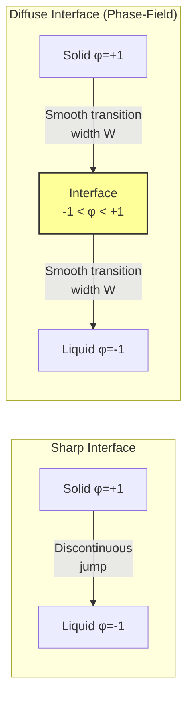

The key advantage of the diffuse interface approach is that the interface
position is implicitly defined by the `φ = 0` contour, eliminating the need
for explicit interface tracking algorithms.

---

## 2. Free Energy Functional

The total free energy of the system is given by the Ginzburg-Landau functional:

```
F[φ, u] = ∫ [ (W²/2)|∇φ|² + f(φ) + λ·g(φ,u) ] dV
```

where:
- `(W²/2)|∇φ|²` — **gradient energy** penalizing spatial variations in `φ`
- `f(φ)` — **double-well potential** providing two stable phases
- `λ·g(φ,u)` — **coupling term** between phase field and temperature

### Double-Well Potential

The double-well potential takes the standard form:

```
f(φ) = -φ²/2 + φ⁴/4
```

This potential has:
- Two minima at `φ = ±1` (solid and liquid phases)
- A local maximum at `φ = 0` (unstable interface state)
- Energy barrier height of `1/4`

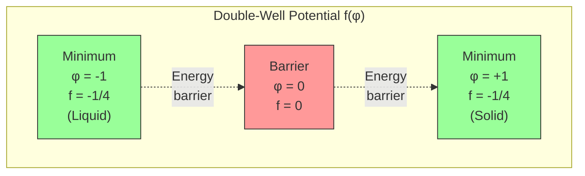

### Free Energy Derivative

The variational derivative of `F` with respect to `φ` yields the driving
force for the Allen-Cahn equation:

```
δF/δφ = -W²∇²φ + f'(φ) + λ·∂g/∂φ
```

In the code, the free energy derivative (reaction term) is implemented as:

```
dF_dphi(φ, u, λ) = -φ(1 - φ²) + λu(1 - φ²)²
```

The first term `-φ(1-φ²)` drives `φ` toward `±1`. The second term
`λu(1-φ²)²` couples the thermal field to the interface motion.

---

## 3. Governing Equations

The model solves two coupled partial differential equations: the **Allen-Cahn
equation** for the phase field `φ` and the **thermal diffusion equation** for
the dimensionless temperature `u`.

### 3.1 Allen-Cahn Equation

```
τ₀·A(n̂)² · ∂φ/∂t = W₀²·∇·[A(n̂)²·∇φ] 
                    + W₀²·∂/∂xⱼ[|∇φ|²·A(n̂)·∂A/∂(∂φ/∂xⱼ)]
                    + φ(1-φ²) - λu(1-φ²)²
```

where:
- `τ₀` — relaxation time scale
- `A(n̂)` — anisotropy function (see Section 4)
- `W₀` — interface width parameter
- `λ` — coupling constant
- `n̂ = ∇φ/|∇φ|` — interface normal direction

The two gradient terms are the divergence of the **flux** `F = ∂f/∂(∇φ)` of
the gradient-energy density `f(p) = ½·W₀²·A(p)²·|p|²` (`p = ∇φ`):

```
Fx = wn²·px + 16·ε·W₀·wn·dFunc(px, py, pz)
Fy = wn²·py + 16·ε·W₀·wn·dFunc(py, pz, px)
Fz = wn²·pz + 16·ε·W₀·wn·dFunc(pz, px, py)
```

where `wn = W₀·A(p)` and `τn = τ₀·A(n̂)²`. (`∂A/∂p_i = 16ε·dFunc_i/|p|²`, and
that `1/|p|²` cancels the `|p|²` of the chain rule, so no `|p|²` factor
remains; `anisotropic_flux` in `Kernels.cuh`, checked against a long-double
derivative of `f` by `FluxIsVariationalDerivativeOfGradientEnergy`.)

The update becomes:

```
φ^{n+1} = φ^n + (Δt/τn)·[∇·F - dF_dphi(φ, u, λ)]
```

with `∇·F` discretised in conservative face-flux form (Section 11).

### 3.2 Thermal Diffusion Equation

```
∂u/∂t = D·∇²u + (1/2)·∂φ/∂t
```

where:
- `D` — thermal diffusivity
- `(1/2)·∂φ/∂t` — latent heat source term

Discretized (forward Euler):

```
u^{n+1} = u^n + 0.5·(φ^{n+1} - φ^n) + Δt·D·∇²u^n
```

The latent heat term `0.5·(φ^{n+1} - φ^n)` represents energy released/absorbed
during the phase transition.

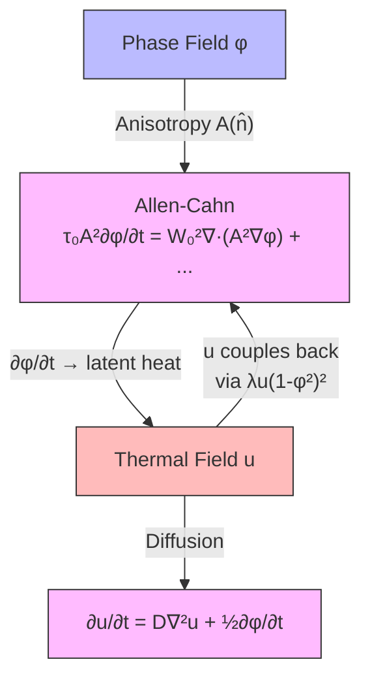

---

## 4. Anisotropy Model

Crystallographic anisotropy is essential for producing realistic dendritic
morphologies. The code implements **cubic (4-fold) anisotropy** following
the formulation of Karma and Rappel (1998).

### 4.1 Anisotropy Function

The anisotropy function `A(n̂)` modulates the interface width and relaxation
time based on the interface normal direction:

```
A(n̂) = (1 - 3ε)·[1 + (4ε/(1-3ε))·(n̂x⁴ + n̂y⁴ + n̂z⁴)]
```

where `ε ∈ [0, 1/3)` is the anisotropy strength parameter.

In terms of gradient components (avoiding explicit normalization):

```
A(∇φ) = (1 - 3ε)·[1 + (4ε/(1-3ε))·(φx⁴ + φy⁴ + φz⁴)/(φx² + φy² + φz²)²]
```

**Special cases:**
- `ε = 0` → `A = 1` (isotropic growth)
- `ε > 1/15` → the gradient energy is no longer convex and the equation is
  ill-posed without regularisation (Section 4.3). `ε < 1/3` is required
  because `A` is evaluated as `(1−3ε)·[1 + (4ε/(1−3ε))·…]`; `A` itself spans
  `[1 − 5ε/3, 1 + ε]` since `Σ n̂ᵢ⁴ ∈ [1/3, 1]`
- `|∇φ|² < 10⁻³⁰` → `A = 1 - 3ε/5` (spherical-average isotropic limit; see below)

**Spherical-average derivation of the regularized fallback.** When
`|∇φ| → 0`, no preferred crystal direction exists, so the natural value to
return is the average of `A(n̂)` over the unit sphere. Using
`⟨n̂_i⁴⟩ = 1/5` over the unit sphere in 3D, we get
`⟨n̂x⁴ + n̂y⁴ + n̂z⁴⟩ = 3/5`, so

```
⟨A⟩_sphere = (1 − 3ε)·(1 + (4ε/(1−3ε))·(3/5))
           = (1 − 3ε) + (12ε/5)
           = 1 − 3ε/5
```

The code implements exactly this value in `compute_An` (`Kernels.cuh`):

```cpp
return 1.0 - 3.0 * epsilon / 5.0;
```

### 4.2 Anisotropy Derivative (dFunc)

The force computation requires derivatives of the anisotropy function. The
helper function `dFunc` computes the directional derivative:

```
dFunc(l, m, n) = [l³(m² + n²) - l(m⁴ + n⁴)] / (l² + m² + n²)²
```

This function vanishes when `|∇φ|² < 10⁻³⁰` to avoid division by zero.

The three force components use **cyclic permutation** of the arguments:
- `Fx` uses `dFunc(φx, φy, φz)`
- `Fy` uses `dFunc(φy, φz, φx)`
- `Fz` uses `dFunc(φz, φx, φy)`

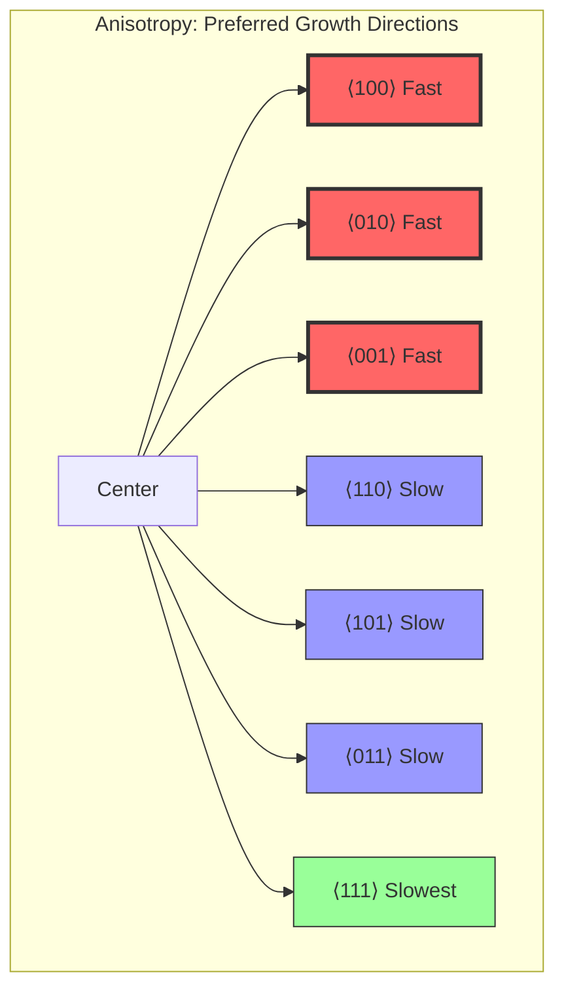

### 4.3 Well-posedness and Willmore regularisation (ε > 1/15)

**The threshold.** The flux is `F = ∂f/∂p` of `f(p) = ½W₀²A(p)²|p|²`, so
the Allen–Cahn operator `∇·F(∇φ)` is elliptic exactly when the Hessian
`∂²f/∂p²` is positive definite for every direction `p` (Legendre–Hadamard).
Scanning 20 000 directions (plus the exact ⟨100⟩, ⟨110⟩, ⟨111⟩) with the
code's `A`, its smallest eigenvalue is +0.2625 at ε = 0.05, +0.00107 at
ε = 0.0666, −0.00053 at ε = 0.0667 and −0.896 at ε = 0.12, always first along
⟨100⟩; bisection puts the sign change at ε = 0.066667 = 1/15. In the {100}
plane `A = 1 + ε cos 4θ` and the sharp-interface stiffness `A + A'' =
1 − 15ε cos 4θ` gives the same bound. Above 1/15 the equation has negative
diffusion along ⟨100⟩: this is a property of the model, not of the code.
Physically it corresponds to missing orientations (corners), which a
continuum model can only describe with an additional length scale.

**Evidence in the solver.** The same seed (radius 4, in a box of side 50.4,
Δ = 0.55 with u = −Δ initially and on the walls, zero-flux φ, 27-point
stencil, W₀ = 1, D = 2, d₀ = 0.5, Euler) grown to t = 15 at h = 0.8, 0.4 and
0.2 (64³, 127³, 253³; dt = 0.03, 0.0075, 0.001875 ∝ h²). Both differences
between successive resolutions are taken on the interior nodes of the
h = 0.8 grid, which are nodes of all three grids; their ratio is 4 for
second-order convergence and below 1 when refinement moves φ further than
the previous refinement did. The last column is the largest difference
between h = 0.4 and h = 0.2 over every interior node of the h = 0.4 grid.

| ε | ‖φ₀.₈ − φ₀.₄‖∞ | ‖φ₀.₄ − φ₀.₂‖∞ | ratio | ratio of the mean \|·\| | ‖φ₀.₄ − φ₀.₂‖∞, all h = 0.4 nodes |
|---|---|---|---|---|---|
| 0 | 1.00e-1 | 2.19e-2 | 4.57 | 4.22 | 2.30e-2 |
| 0.05 | 9.95e-2 | 2.21e-2 | 4.51 | 4.43 | 2.21e-2 |
| 0.12 (β = 0) | 1.83e-1 | 7.04e-2 | 2.61 | **0.87** | **2.87e-1** |

At ε = 0.12 without regularisation the mean difference grows under
refinement, and the largest change of the second refinement, 0.287, lies
between the h = 0.8 nodes, 4.1 times the largest change on them and larger
than any change of the first refinement: halving h creates structure at the
scale of the new grid. In the converging cases the two maxima agree within
5 %.

`SimulationConfig::validate()` therefore rejects ε > 1/15 unless
`physics.willmore_beta > 0`.

**Regularised model.** With `h(φ) = φ − φ³` and `ω = W₀²∇²φ + h(φ)`, the
free energy gains `(β/2)∫ω²` (Wheeler 2006 [10]; Torabi et al. 2009 [11]) and
the equation becomes

```
τ(n̂) ∂φ/∂t = ∇·F(∇φ) + h(φ) − λu(1−φ²)² − β M(φ),
M = W₀²∇²ω + h'(φ) ω,     h'(φ) = 1 − 3φ².
```

**Flat interfaces.** ω uses the isotropic Laplacian; the gradient energy does
not. `A` has degree 0 in `p`, so along a fixed normal n̂ (coordinate s)
`∇·F = W₀²A(n̂)²φ''`, and the planar equilibrium profile of the unregularised
equation (u = 0) is `φ₀ = −tanh(s/(√2 W₀A(n̂)))`, of width `W₀A(n̂)`. On it
`ω = (1 − A(n̂)⁻²) h(φ₀)`, which vanishes only where `A(n̂) = 1` (ε = 0, or
`Σ n̂ᵢ⁴ = 3/4`); `A` is `1 + ε`, `1 − ε` and `1 − 5ε/3` along ⟨100⟩, ⟨110⟩
and ⟨111⟩. For ε > 0 the Willmore term therefore also changes every flat
interface with `A(n̂) ≠ 1`, by an amount that depends on its orientation. At
ε = 0.12, β = 0.25 (`run_dendrite.json`), `max|βM(φ₀)|` is 0.033, 0.084 and
0.20 along ⟨100⟩, ⟨110⟩ and ⟨111⟩, against `max|h(φ₀)| = 0.385`, and the
stationary flat profile of the regularised equation (u = 0, solved in 1D by
Newton's method) differs from φ₀ by 0.0125, 0.0200 and 0.0390 in the max
norm, with `∫φ'²` changed by +2.7 %, −4.2 % and −8.0 %. The thin-interface
constants a₁ and a₂ in λ and τ₀ (§5) come from the analysis of the
unregularised equation, whose flat interface is φ₀.

Linearised about a flat ⟨100⟩ front, the fourth-order term bounds the growth
rate of the backward-diffusing modes, which restores well-posedness: to first
order in β a perturbation of wavenumber k grows at a rate
∝ (|S| + (4/5)β(1 − A⁻²))W₀²k² − βW₀⁴k⁴ with A = 1 + ε (the term in
(1 − A⁻²) comes from ω ≠ 0 on the flat profile), so only k below a band edge
k_c grow, and corners are rounded on the length `ℓ = W₀√(β/|S|)`, which is
1/k_c without that term. The band edge of the linearisation about the
stationary regularised profile (the zero of the largest eigenvalue of the 1D
operator) is 1/k_c = 0.5206, 0.5188, 0.5189 and 0.5180 W₀ at the shipped
(ε, β) = (0.07, 0.0149), (0.10, 0.153), (0.12, 0.25) and (0.15, 0.401),
1.4–1.9 % below ℓ. S is the most negative eigenvalue of the Hessian
above, always along ⟨100⟩, where it equals `(1 + ε)(1 − 15ε)` (the scan
gives −0.0535, −0.55, −0.896 and −1.4375 at ε = 0.07, 0.10, 0.12 and 0.15).

**Refinement with the regularisation** (same setup as the table above,
ε = 0.12):

| β | ℓ/W₀ | ‖φ₀.₈ − φ₀.₄‖∞ | ‖φ₀.₄ − φ₀.₂‖∞ | ratio | ratio of the mean \|·\| | ‖φ₀.₄ − φ₀.₂‖∞, all h = 0.4 nodes | Chebyshev degree (h = 0.8, 0.4, 0.2) |
|---|---|---|---|---|---|---|---|
| 0.25 | 0.53 | 2.60e-1 | 6.67e-2 | 3.90 | 3.76 | 6.67e-2 | 19, 36, 71 |
| 1 | 1.06 | 6.78e-1 | 2.02e-1 | 3.36 | 3.16 | 2.04e-1 | 33, 70, 145 |
| 4 | 2.11 | 1.25 | 5.54e-1 | 2.25 | 2.05 | 5.54e-1 | 51, 129, 287 |

Every regularised ladder converges, and convergence is best for the smallest
β. These ladders refine dt with h², so they also carry the time error of the
linearly implicit step, whose constant grows with β (see the time stepping
paragraph below): at β = 1 the time error of dt = 0.0075 at h = 0.4 alone is
about 0.25 in the max norm (first-order Richardson estimate from a time
ladder at h = 0.4), the size of ‖φ₀.₄ − φ₀.₂‖∞ = 0.20. The regularisation
also changes the solution where none is needed: at ε = 0.05 (convex) and
h = 0.4, dt = 0.0075, φ moves by 0.19, 0.50 and 1.03 in the max norm
(1.4e-3, 5.8e-3 and 2.0e-2 in the mean) for β = 0.25, 1 and 4 (at the same
dt, so this includes the part of the time error that grows with β), against
a spatial error of 0.028 (4.3e-4) of the unregularised solution there; the
solid fraction at t = 15 drops from 4.25 % to 4.16, 3.93 and 3.26 %.

**Choice of β.** The rule, fixed before the β = 0.25 ladder was run and
before the β = 4 ladder finished (its h = 0.8 and 0.4 legs were complete;
the h = 0.2 leg, which its ratio needs, was still running): the smallest
tested ℓ at ε = 0.12 whose ladder has a ratio above 2 in both norms (each
halving of h removes more than half of the difference,
closer to the formal order 2 than to stagnation). That is β = 0.25,
ℓ* = 0.528 W₀, which is also the one that converges best and changes the
solution least. The shipped configurations keep this corner length at every
ε, `β(ε) = |S(ε)| ℓ*²/W₀²`, so the band of growing modes is resolved by the
same margin at every ε to within 0.5 % (its edge k_c, above, lies between
1/(0.5206 W₀) and 1/(0.5180 W₀)):

| ε | S(ε) | β (3 significant digits) |
|---|---|---|
| 0.07 | −0.0535 | 0.0149 |
| 0.10 | −0.55 | 0.153 |
| 0.12 | −0.896 | 0.25 |
| 0.15 | −1.4375 | 0.401 |

Each shipped configuration's own refinement ladder (time error removed; see
the choice of dt below) validates its β: the ratios are 4.7–6.0 in both
norms. Values of β below 0.25 at ε = 0.12 were not tested.

**Time stepping (linearly implicit Euler).** `M` is split into its bulk
linearisation `L = W₀⁴∇⁴ − 4W₀²∇² + 4` (exact about φ = ±1) and a remainder,
and the increment `δφ = φⁿ⁺¹ − φⁿ` solves

```
(τ/dt + βL) δφ = ∇·F(∇φⁿ) − ∂F/∂φ(φⁿ, uⁿ) − β M(φⁿ)
```

on the interior cells. Every ∇² is the 7-point Laplacian. The ∇² of φ in ω
reads φ's own boundary values: `willmore_omega` runs on `phi_old_`, whose
boundary cells hold φ's boundary condition (set by `apply_phi_bc`; in a
multi-GPU run the halo exchange fills the halo planes and the periodic X
ghost planes). Inside walls that hold φ = −1, φ ≡ −1 therefore gives ω = 0
(`UniformLiquidInsideInhomogeneousWallsStaysExact` keeps φ exactly −1 there).
The ∇² in `L` and the ∇² of ω act on fields whose boundary cells hold the
homogeneous form of φ's boundary condition (Dirichlet 0, zero flux, periodic,
Robin with γ = 0; `hom_phi_faces_` in `src/cuda/CudaSolver.cu`). That
Laplacian is symmetric for every accepted boundary condition, `L` is the
square of `W₀²∇² − 2` with this ∇² (§4.4) and τ > 0, so the matrix is
symmetric positive definite. It
is solved to a relative residual of 1e-10 by conjugate gradients with a
Chebyshev polynomial preconditioner (§4.4). β = 0 recovers explicit Euler.
The scheme requires `time.scheme` euler or imex (heun and rk4 are fully
explicit and are rejected).

**Evidence.**

| Test | Result |
|---|---|
| `LinearisedAmplificationMatchesAnalyticSymbol` — one step of a Fourier mode on φ = −1 vs `g = 1 + dt(−W₀²s − 2 − βL_k)/(τ₀ + dt βL_k)` (W₀ = 1.3, β = 1.5, a different spacing per axis) | asserts \|measured − g\| ≤ 1e-7 (1 + \|g\|) and \|g\| < 1 for modes (1,0,0), (3,2,1), (8,8,7); the printed values differ by 2.5e-9, 2.1e-9 and 4e-10, g is −0.00554 for the last where explicit Euler gives −436.8, and every solve took 2 outer iterations (printed, not asserted) |
| `VanishingBetaReducesToExplicitEuler` (β = 1e-13) | equal to the unregularised solver within 1e-12 |
| `FirstOrderConvergenceInTime` (ε = 0.12, β = 1, 24³ at h = 0.4, max-norm differences of successive dt halvings at t = 0.4) | asserts observed orders above 0.9 from dt = 0.0025 and from 0.00125, the second also below 1.1 (printed: 0.951, 0.974). From dt = 0.02 the orders are 0.68, 0.82, 0.91, 0.95, 0.97 (0.74, 0.86, 0.92, 0.96, 0.98 at ε = 0.05, β = 1); explicit Euler (β = 0, run at ε = 0.05 because ε > 1/15 needs β > 0) blows up at dt = 0.02 and has order 0.999–1.000 below it. dt = 0.02 exceeds Euler's thermal limit 0.01333 (§10.1), which `validate()` enforces; the regularised runs stay bounded over their 20 steps |
| `MultiGPUEquivalence/*_Willmore` | multi-GPU (2, 3 domains; uniform, per-face, periodic X) bit-identical to single GPU for Euler and IMEX |
| `RegularisedConvergesUnregularisedDoesNot` (integration; the refinement ladder above in a box of 18.4, 24³/47³/93³, t = 7.5, both differences on the 24³ nodes) | ratios 0.889 (max) and 0.406 (mean) without the Willmore term, 3.56 and 3.90 with β = 0.25; red when the solver ignores β |

With β = 1 the linearly implicit step has a larger first-order error
constant than explicit Euler has without the Willmore term: in the setup of
`FirstOrderConvergenceInTime`, ‖φ(dt = 0.00125) − φ(dt = 0.000625)‖∞ at
t = 0.4 is 2.6e-3 at ε = 0.05 and 4.0e-3 at ε = 0.12, against 6.1e-5 for
explicit Euler (β = 0) at ε = 0.05. `dt` must be chosen with that in mind.

**Choice of dt for the shipped configurations.** The rule, fixed before any
configuration's spatial error e_s was measured: dt is the largest of 0.02, 0.01, 0.005, 0.0025,
0.00125, … (these divide the end time of every configuration, so the output,
checkpoint and saturation-check intervals keep their times) whose time
error does not exceed the spatial error of h = 0.4, in the max norm and in
the mean, and which is stable. Both errors are measured per configuration,
with its ε, β, Δ, stencil, boundary-condition types and seed radius, in the
box and to the time of the refinement study above (side 50.4, t = 15):

- time error at h = 0.4: `e_t(dt) = 2‖φ_dt − φ_dt/2‖` (first-order
  Richardson; the ratio of successive differences is measured to be 2);
- spatial error of h = 0.4: at each of h = 0.8, 0.4, 0.2 the first-order time
  error is removed, `φ₀ = 2φ(dt = 0.000625) − φ(dt = 0.00125)`; then
  `e_s = ‖φ₀(0.4) − φ₀(0.2)‖ / (1 − 1/R)` with R the ratio of the two
  successive differences on the h = 0.8 nodes, the norm over every interior
  node of the h = 0.4 grid (the nodes of e_t). R also validates β for that
  configuration (above 2 in both norms).

Stability. With the Willmore term implicit, the explicit thermal update of
Euler limits dt: `Δt ≤ h²/(6D)` = 0.01333 (7-point) and `60h²/(184D)` =
0.02609 (27-point) at h = 0.4, D = 2 (§10.1). Runs bracket both: 7-point
stable at 0.0125 and blown up at 0.014 (step 163); 27-point stable at 0.025
to t = 81 and blown up at 0.027 (step 646) and 0.03 (step 58). IMEX solves u
implicitly and stayed stable at dt = 0.04 in every configuration.

Results (e in the max norm / the mean; e_t at the chosen dt):

| Configuration | ε, β | Stencil, φ walls | R | e_s(0.4) | Euler: dt, e_t | IMEX: dt, e_t |
|---|---|---|---|---|---|---|
| `default.json`, k8s base, README example (600³); `benchmark_small.json`, k8s dev (128³) | 0.07, 0.0149 | 7-point, Dirichlet | 5.23 / 5.99 | 0.057 / 1.0e-3 | 0.0025: 0.011 / 6.5e-4 | 0.005: 0.012 / 6.6e-4 |
| Makefile `cuda-run-vtk` (128³) | 0.07, 0.0149 | 27-point, zero flux | 4.69 / 5.32 | 0.071 / 1.6e-3 | 0.005: 0.021 / 1.3e-3 | 0.01: 0.024 / 1.3e-3 |
| `run_dendrite.json` (160³) | 0.12, 0.25 | 27-point, zero flux | 5.34 / 5.58 | 0.061 / 1.8e-3 | 0.000625: 0.023 / 1.6e-3 | 0.000625: 0.021 / 1.5e-3 |
| `run_dendrite_large.json` (384³) | 0.10, 0.153 | 27-point, zero flux | 5.07 / 5.23 | 0.031 / 5.9e-4 | 0.00125: 0.012 / 5.4e-4 | 0.00125: 0.011 / 4.8e-4 |
| `run_dendrite_long.json` (192³) | 0.15, 0.401 | 27-point, zero flux | 5.50 / 5.56 | 0.031 / 8.5e-4 | 0.0003125: 0.0131 / 6.2e-4 | 0.0003125: 0.0125 / 5.9e-4 |

Every configuration's R is above 2 in both norms, so the corner length ℓ* is
resolved at every shipped ε. In every configuration the next larger dt
meets the max norm and fails the mean: the time error is spread more evenly
over the front (its maximum is 14–23 times its mean) than the spatial error
(35–56 times). IMEX, which differs from Euler only in treating u
implicitly, has 0.57 of Euler's time error at ε = 0.07 and about 0.9 at
ε ≥ 0.10, where the error of the φ step, common to both, dominates.

**Choice of scheme.** Between Euler and IMEX, each at its own dt, a
configuration ships the one whose measured cost per unit of simulated time
is lower in each of four interleaved repetitions (RTX 4090, CUDA 13.2,
median over 200 steps after 220 from the seed, no other process on the
GPU). Where neither is lower in all four, the two costs are equal within
the spread of the measurement, and the configuration keeps Euler, which
needs 13 % less memory (Appendix C: 108.1 against 124.1 bytes per cell
with β > 0):

| Configuration | Euler: ms/step, ms per unit time | IMEX: ms/step, ms per unit time | Shipped |
|---|---|---|---|
| `benchmark_small.json` (128³) | 3.52–3.55, 1407–1419 | 6.25–6.27, 1250–1254 | IMEX, dt = 0.005 |
| Makefile `cuda-run-vtk` (128³) | 3.57, 713–715 | 7.13–7.14, 713–714 | Euler, dt = 0.005 (tie) |
| `run_dendrite.json` (160³) | 7.80–7.81, 12 482–12 500 | 11.05–11.06, 17 680–17 690 | Euler, dt = 0.000625 |
| `run_dendrite_large.json` (384³) | 117.9, 94 330–94 339 | 164.0, 131 203–131 212 | Euler, dt = 0.00125 |
| `run_dendrite_long.json` (192³) | 14.41–14.42, 46 116–46 133 | 20.27–20.29, 64 879–64 928 | Euler, dt = 0.0003125 |

(ranges over the four repetitions). In every other configuration one
scheme is lower in all four repetitions, by 10.9–29.4 %. For `cuda-run-vtk`
IMEX was lower in three repetitions, by 0.09–0.11 %, and Euler in one, by
0.04 %, while each scheme's own cost varied by up to 0.25 % between
repetitions: a tie, so Euler. The 600³ configurations (`default.json`, the
k8s base and the README example) use Euler, dt = 0.0025: with β > 0 the
IMEX fields alone take 24.9 GiB there, more than a 24 GB GPU has
(Appendix C). The k8s dev overlay is by its own
description the base with a smaller grid and fewer steps, so it keeps the
base's scheme and dt. Two outer iterations in every step of every run above.

### 4.4 Solving the implicit step

The increment solves `A δφ = b` on the interior cells, with

```
A = T/dt + βL,   L = B²,   B = W₀²∇²ₕ − 2,   T = diag(τ),
```

∇²ₕ the 7-point Laplacian with the homogeneous boundary fill of §4.3.
`src/cuda/WillmoreSolve.cu` solves it by conjugate gradients in double
precision, preconditioned by a Chebyshev polynomial in `D⁻¹A`,
`D = T/dt + β d_L` (`d_L` the interior diagonal of `L`), applied in single
precision.

**Spectral bounds.** ∇²ₕ is the Kronecker sum of one 1-D second-difference
matrix per axis. Every accepted boundary condition keeps these symmetric: a
Robin face (ghost = c · adjacent value) only changes an end diagonal by c, and
a periodic axis couples its two ends in both directions (a periodic face
without a periodic opposite face is rejected, `docs/DESIGN.md` §5.2). Their
Gershgorin intervals therefore bound their spectra, and spec(∇²ₕ) lies in
[ℓ, υ], the sums over the axes. For every accepted boundary condition
(Robin c ∈ [0, 1], §9.1) that is within [−4 Σ_d h_d⁻², 0]; the bounds are
computed from the faces' rules and also hold for c outside [0, 1].
Then spec(B) lies in [W₀²ℓ − 2, W₀²υ − 2] and spec(L) in [L_min, L_max], the
range of the square over that interval. For a vector v let
`t = vᵀTv / (dt vᵀv)` and `l = vᵀLv / vᵀv`; the Rayleigh quotient of `D⁻¹A`
is `g(t, l) = (t + βl) / (t + β d_L)`, monotone in t and in l, so
spec(D⁻¹A) lies in [a, b], the extremes of g over t ∈ {τ_min/dt, τ_max/dt}
and l ∈ {L_min, L_max}. τ_min and τ_max are the exact minimum and maximum of
τ over the interior cells, reduced on the GPU at every step, so the bounds
hold for the operator that is actually solved. The benchmark case of this
section is the run_dendrite grid (160³, h = 0.4, zero-flux φ) at β = 1,
dt = 0.005, ε = 0.12: [a, b] = [0.0409, 3.214], b/a = 78.5. The shipped
`run_dendrite.json` (β = 0.25, dt = 0.000625) gives [a, b] = [0.5645, 2.006],
b/a = 3.55.

**Preconditioner.** `M = p_k(D⁻¹A) D⁻¹`, p_k the Chebyshev polynomial of
degree k on [a, b]: the spectrum of `MA` lies in [1 − e_k, 1 + e_k],
`e_k = 1/T_k(σ)`, `σ = (b + a)/(b − a)`. `M` is symmetric positive definite:
1 − λ p_k(λ) is the scaled Chebyshev polynomial, whose modulus stays below 1
for 0 < λ < a + b, so p_k > 0 up to a + b. That margin above b (a relative
a/b, 1/78.5 above) is far larger than any rounding of the bounds or of the
single-precision operator. `M r` is computed from zero by the Chebyshev
iteration in the single-update form
`x_{j+1} = x_j + ρ_jρ_{j−1}(x_j − x_{j−1}) + (2ρ_j/δ) D⁻¹(r − A x_j)`
(Saad [12], Algorithm 12.1 and the update after it), k − 1 applications of
`A`. The residual `r − A x_j` is computed explicitly at every step, so there
is no gap between a recursive and the true residual, and for a real spectrum
the recurrence does not amplify earlier rounding errors (Gutknecht & Röllin
[15], Algorithm 2 and Theorem 2).

**Degree.** For conjugate gradients with an SPD preconditioner,
`‖e_j‖_A ≤ 2 q^j ‖e₀‖_A` with `q = (√κ − 1)/(√κ + 1) = e_k/(1 + √(1 − e_k²))`
for κ = (1 + e_k)/(1 − e_k). From x₀ = 0 this bounds the stopping quantity:
`‖r_j‖/‖b‖ ≤ 2 q^j √κ_A`, `κ_A = (τ_max/dt + βL_max)/(τ_min/dt + βL_min)`.
One outer iteration would need e_k ≈ tol/√κ_A, about 10⁻¹¹, far below the
single-precision unit roundoff (6·10⁻⁸) in which the polynomial is applied.
For j ≥ 2 iterations the degree needed is k_j ≈ ln(2√κ_A/tol)/(j acosh σ)
plus a constant, so the inner work j·k_j hardly depends on j, while every
outer iteration adds one double-precision operator application and four
reductions: two is the cheapest possible count. The solver takes the lowest
degree with `2 q² √κ_A ≤ tol` (closed form, then checked exactly at k and
k − 1): 58 for the benchmark case, 11 for the shipped `run_dendrite.json`.
At degree 48 the bound guarantees that three iterations meet the tolerance,
but not two: `2 q³ √κ_A ≤ tol` holds from degree 39 on, `2 q² √κ_A ≤ tol`
only from 58 on. A single-precision prototype of the same preconditioner, on
the interval [0.0409, 3.2138], measured three outer iterations at degree 48
and two at 56 and 64. Rounding in the single-precision
polynomial can only add outer iterations; it cannot loosen the result,
because the stopping test is in double precision.

It does add them when κ_A is large. Measured (β = 1, ε = 0.12): at h = 0.8
and 0.4 two outer iterations in every solve of every refinement and
time-step run above; at h = 0.2 (dt = 0.001875, κ_A ≈ 465, degree 145) a
third one in 11 of the 4000 steps of a 93³ run and in 48 % of the 8000 steps
of the 253³ run; at β = 4 and h = 0.2 (degree 287) in every step. The first
three-iteration step of the 93³ run, replayed: the same flexible CG with the
same plan, polynomial and operator in double precision takes two iterations
(relative residual 2.2e-6, then 2.7e-12); with the GPU's single-precision
polynomial it reaches 2.1e-5, then 9.95e-11, at the 1e-10 tolerance. z = M b
in single precision differs from the double-precision one by 3.0e-7
relative, but A(z₃₂ − z₆₄) differs from A z₆₄ by 2.1e-5: the rounding error
lies in high modes, which A amplifies relative to the smooth solution, so
each outer iteration reduces the residual by about that much at best. At
h = 0.4, where every shipped configuration runs, two iterations were reached
in every one of the 1.2 million steps of the 106 runs at h = 0.4 in this
section and §4.3 (every shipped configuration's ε, β and dt ladder), and at
h = 0.2 in all 180 000 steps of the shipped-β space ladders (dt ≤ 0.00125).
For the κ_A of h = 0.2 and β ≥ 1, a
lower degree aiming at three iterations would do less work; the degree rule
stays with the exact-arithmetic guarantee because no rigorous a priori bound
of the single-precision error is available to choose between the two. For
the same reason the cap of 1000 outer iterations, after which a solve throws
(`kWillmoreCgMaxIterations`), is a backstop, not derived from a bound.

**Outer iteration.** The single-precision polynomial is symmetric only up to
rounding (in `SinglePrecisionMatchesExactPolynomial` it differs from the same
polynomial applied in double precision by 6.2–9.0 · 10⁻⁸ relative), so the
outer loop is flexible conjugate gradients:
`β_j = −α_j z_{j+1}·Ap_j / (z_j·r_j)`, the
Polak–Ribière form, which keeps the convergence of CG when the preconditioner
varies slightly between iterations (Notay [13]; Golub & Ye [14]). The
stopping test is unchanged (‖r‖ ≤ 10⁻¹⁰ ‖b‖ in double precision); the true
residual recomputed after a solve is 4.1–7.9 · 10⁻¹² in the nine cases of
`TrueResidualMeetsTheTolerance`.
After 100 steps of the benchmark case the phase field differs from the one
computed with the Jacobi-preconditioned CG it replaces by at most 1.3 · 10⁻¹².

**Range.** Before the polynomial, r is scaled by 2⁻ᵉ, e = ⌊log₂‖r‖⌋ (‖r‖ as
computed in double precision), so 2⁻ᵉ‖r‖ lies in [1, 2) and no component
overflows in single precision. The norm does not bound the components from
below: those under 2⁻¹²⁶ in magnitude (single precision's smallest normal
number) are rounded to multiples of 2⁻¹⁴⁹, to 0 at 2⁻¹⁵⁰ and below, an
absolute error of at most 2⁻¹⁵⁰ each (with the default build flags;
`AC_CUDA_FAST_MATH` flushes subnormals to 0). The scaling adds no rounding
of its own, so the preconditioned vector is the same bits for r and 2ᵐr, up
to 2ᵐ, as long as no squared component of either underflows in double
precision. A step from φ = 2⁻¹⁵⁰ψ (ψ of order 1), whose right-hand side
(‖b‖ = 4.8 · 10⁻⁴²) lies entirely below single precision's normal range,
gives the same bits as one from φ = 2⁻⁴⁰ψ (‖b‖ = 6.2 · 10⁻⁹), scaled by 2¹¹⁰
(`TinyRightHandSideGivesTheScaledIncrementBitwise`).
The operator itself is not scaled: every cell stores τ/Δt as a float and the
polynomial divides by the float sum τ/Δt + β d_L, so `validate()` requires
β d_L and that sum to be finite floats (below 2¹²⁸ − 2¹⁰³) at the largest
relaxation time any orientation reaches (τ₀A(n)², as the kernel rounds it,
`relaxation_time_range`) and the smallest step (Δt, and with adaptive
stepping Δt_min). Each rounding involved is monotone, so this decides every
cell and every step. Past either, every preconditioned residual of the
affected cells is 0 or NaN, and the solve breaks down at its first iteration
(β = 10¹⁵⁰, or Δt = 5 · 10⁻³²⁴, or τ₀ = 5.6 · 10²⁹⁹ from D = 10⁻³⁰⁰, in
a fuzz campaign of accepted configurations). The bound assumes subnormal
floats are kept (`AC_CUDA_FAST_MATH` off, the default).

**Double-precision stencils.** The double-precision Willmore stencils multiply
by 1/h² and 1/dt computed once on the host instead of dividing. On GPUs with
a reduced double-precision rate these stencils are bound by double-precision
throughput (RTX 4090: their time equals their instruction count at the
measured rate within 1.4 %, and grows linearly with the number of divisions
at fixed memory traffic), and each division compiles to a reciprocal estimate
refined by eight double-precision instructions. A step of the benchmark case
dropped from 17.33 to 15.9 ms (both measured when the change was made;
16.0 ms on the current code, table below).

**Multi-GPU.** The single-precision iterate and its Laplacian are exchanged
between domains like the double-precision fields (their boundary cells
follow φ's homogeneous boundary condition and wrap where φ wraps), τ_min and
τ_max are exact, and dot products are summed per X plane in global order, so
a decomposed run gives the same bits as one GPU (`MultiGPUEquivalence/*_Willmore`).

**Cost** (RTX 4090, CUDA 13.2, β = 1, Euler, ms per step over the first
steps of a run from the seed; the Jacobi column is the Jacobi-preconditioned
CG this section replaces, measured before it was replaced):

| Case | Jacobi CG | Chebyshev | Degree | Outer iterations |
|---|---|---|---|---|
| 64³, h = 0.8, dt = 0.03, ε = 0.12 | 8.20 | 1.20 | 33 | 2 |
| 127³, h = 0.4, dt = 0.0075, ε = 0.12 | 60.7 | 6.95 | 70 | 2 |
| 160³, h = 0.4, dt = 0.005, ε = 0.12 (run_dendrite grid) | 106.9 | 16.0 | 58 | 2 |
| 192³, h = 0.4, dt = 0.005, ε = 0.15 (run_dendrite_long grid) | 222.8 | 37.3 | 61 | 2 |
| 253³, h = 0.2, dt = 0.001875, ε = 0.12 | 1102.9 | 185.0 | 145 | 2 (2.48 on average over 8000 steps) |
| 384³, h = 0.4, dt = 0.005, ε = 0.10 (run_dendrite_large grid) | 2010.9 | 288.3 | 55 | 2 |

For comparison, an unregularised (β = 0) Heun step on the run_dendrite grid
at dt = 0.005, ε = 0.12 takes 8.82 ms.

**Evidence** (`tests/unit/test_WillmorePreconditioner.cu`):

| Test | Checks |
|---|---|
| `SecondDifferenceBoundsContainTheExactSpectrum` | the per-axis bounds contain the exact eigenvalues of the 1-D matrices, n = 1…6, every pair of ghost rules, including Robin with c > 1 and c < 0 (which `validate()` rejects) and with a denominator of 10⁻³¹ |
| `LowestDegreeMeetingTheBoundAndExactPolynomial` | the degree is the lowest meeting the bound; the recurrence coefficients reproduce T_k((θ − λ)/δ)/T_k(σ) |
| `SpectrumBoundsContainEveryEigenvalue` | the eigenvalues of the assembled production operator, scaled by D, lie in [a, b] for eight grids and boundary layouts (Robin c near 0 and near 1 and with α, β < 0, anisotropic spacing, axes of one and two cells) |
| `SinglePrecisionMatchesExactPolynomial` | z = M r from the device (single precision) is within k(b/a) u₃₂ relative of the same polynomial applied in double precision to the assembled operator, for the eight grids above and a dt other than the configuration's; that tolerance is a first-order rounding estimate, not a proven bound, and is 8.3 · 10⁻⁶ to 3.9 · 10⁻⁵ there; the printed differences are 6.2 · 10⁻⁸ to 9.0 · 10⁻⁸ |
| `TinyRightHandSideGivesTheScaledIncrementBitwise` | the power-of-two scaling: bitwise scale equivariance down to a phase field of order 10⁻⁴⁵ (right-hand side ‖b‖ = 4.8 · 10⁻⁴²) |
| `TrueResidualMeetsTheTolerance` | true relative residual after a solve ≤ 10⁻¹⁰ plus the recursive residual's rounding drift, 16 u₆₄ κ_A per iteration, for the eight grids above and a right-hand side with ‖b‖ < 1; printed 4.1 · 10⁻¹² to 7.9 · 10⁻¹² |
| `EveryStepUsesThePlanOfItsOwnTimeStep` | with dt changing between steps (adaptive stepping), every solve uses the bounds and degree of its own dt |
| `NonFiniteStateThrows` | a NaN or infinite phase field makes the step throw instead of looping |

---

## 5. Nondimensionalization

The physical parameters are nondimensionalized following the
Karma–Rappel (1998) thin-interface formulation, with the capillary length
`d₀` as a free parameter:

| Parameter | Formula | Description |
|-----------|---------|-------------|
| `W₀` | Set directly | Interface width |
| `d₀` | Set directly | Capillary length |
| `D`  | Set directly | Thermal diffusivity |
| `δ`  | Set directly | Dimensionless undercooling |
| `ε`  | Set directly | Anisotropy strength, `ε ∈ [0, 1/3)` |
| `β₀` | Set directly (default 0) | Kinetic coefficient |
| `a₁` | `1.25 / √2 ≈ 0.8839` | Asymptotic constant |
| `a₂` | `0.64`  | Asymptotic constant |
| `λ`  | `W₀ · a₁ / d₀` | Coupling strength |
| `τ₀` | `(W₀³ · a₁ · a₂) / (d₀ · D) + (W₀² · β₀) / d₀` | Relaxation time |

These derived quantities are computed by `PhysicsParams::lambda()` and
`PhysicsParams::tau0()` (`src/core/SimulationConfig.hpp`):

```cpp
Real a1 = 1.25 / std::sqrt(2.0);
Real a2 = 0.64;
Real lambda() const { return W0 * a1 / d0; }
Real tau0()   const {
    return (W0*W0*W0 * a1 * a2) / (d0 * D)
         + (W0*W0 * beta0) / d0;
}
```

The first term of `τ₀` is the diffusive contribution; the second adds the
kinetic-undercooling correction, active when `β₀ ≠ 0`.

`validate()` requires both as the kernels receive them to be finite and
positive. `τ₀` divides every phase-field increment and `λ` multiplies
`u (1 − φ²)²` in `∂F/∂φ` at every interior cell, so an infinite one (`d₀` or
`D` subnormal) makes the first step non-finite, and `τ₀ ≤ 0` (`a₂ ≤ 0`, or a
negative `β₀` beyond the diffusive term) removes or reverses the relaxation.
`a₁ = 5√2/8` is a ratio of positive integrals, and `λ ≤ 0` removes or
reverses the coupling of `u` to `φ`. The relaxation time of every interface
orientation, `τ₀A(n)²` with `A(n)` from `1 − 5ε/3` (along ⟨111⟩) to `1 + ε`
(along ⟨100⟩), must be a positive finite double as the kernel rounds it,
and on a cold start, where `u = −δ` (§5.1), so must `λδ`.

### 5.1 Initial conditions

The seed is initialised as a smooth `tanh` profile centred at the domain
midpoint (`SimulationEngine::initialize_fields` in `SimulationEngine.cu`):

```
φ(x) = − tanh( (r − r₀) / (√2 · W₀) )      with r = ||x − x_c||
u(x) = − δ                                  everywhere (uniform undercooling)
```

This yields `φ ≈ +1` (solid) inside the seed and `φ ≈ −1` (liquid) outside,
with the planar equilibrium profile of the isotropic (ε = 0) model; for ε > 0
the planar equilibrium along n̂ has width `W₀A(n̂)` (§4.3).

---

## 6. Spatial Discretization

The code provides two Laplacian stencils on a uniform Cartesian grid with
spacing `h = dx = dy = dz`.

### 6.1 Standard 7-Point Laplacian (2nd Order)

The standard central-difference Laplacian uses only face neighbors:

```
∇²φ ≈ (φ_{i+1,j,k} + φ_{i-1,j,k} - 2φ_{i,j,k}) / dx²
     + (φ_{i,j+1,k} + φ_{i,j-1,k} - 2φ_{i,j,k}) / dy²
     + (φ_{i,j,k+1} + φ_{i,j,k-1} - 2φ_{i,j,k}) / dz²
```

**Properties:**
- 2nd-order accurate: truncation error `O(h²)`
- 7 stencil points (center + 6 face neighbors)
- Supports anisotropic grids (`dx ≠ dy ≠ dz`)
- Compact stencil: only nearest neighbors needed

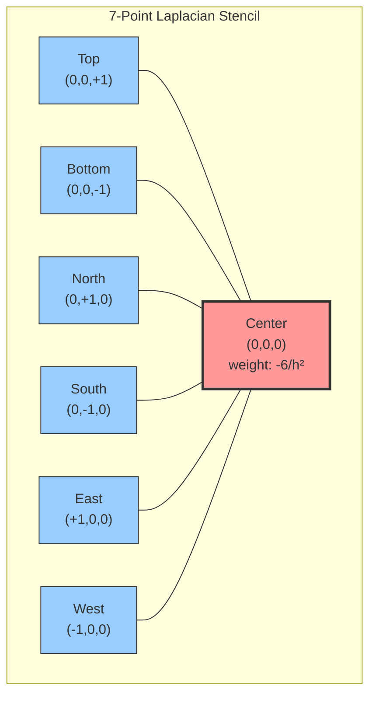

| Neighbor Type | Count | Offset | Weight per neighbor |
|---------------|-------|--------|---------------------|
| Face          | 6     | `(±1,0,0)`, `(0,±1,0)`, `(0,0,±1)` | `+1/h²` |
| Center        | 1     | `(0,0,0)` | `-6/h²` |

### 6.2 Isotropic 27-Point Laplacian (Patra–Karttunen)

The 27-point stencil reduces leading-order anisotropic discretisation
error by including edge and corner neighbours with the Patra–Karttunen
weights:

```
∇²φ ≈ (14·Σ_face + 3·Σ_edge + 1·Σ_corner − 128·φ_center) / (30·h²)
```

where:
- `Σ_face`   = sum over 6 face neighbours
- `Σ_edge`   = sum over 12 edge neighbours
- `Σ_corner` = sum over 8 corner neighbours

**Weight verification:** `6×14 + 12×3 + 8×1 = 84 + 36 + 8 = 128 = |center weight|` ✓ (consistent discrete Laplacian).

These exact weights are implemented in `laplacian_27pt` (`Kernels.cuh`):

```cpp
// Patra-Karttunen weights (2nd-order accurate, improved isotropy):
// face=14, edge=3, corner=1, center=-(6*14+12*3+8*1)=-128, divisor 30*h^2
return (14.0 * face + 3.0 * edge + 1.0 * corner - 128.0 * center) / (30.0 * h * h);
```

The configuration validator refuses this stencil unless `dy` and `dz` equal
`dx` exactly (`SimulationConfig::validate` in `SimulationConfig.cpp`): the
stencil, and the IMEX Jacobi sweep with it, take `dx` for all three
directions.

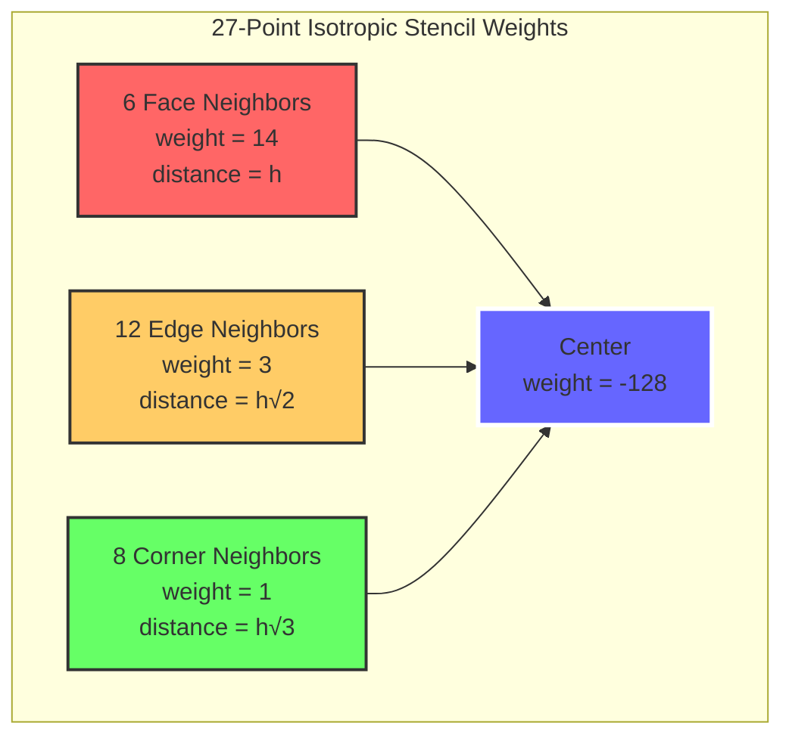

| Neighbor Type | Count | Distance | Weight | Total Contribution |
|---------------|-------|----------|--------|--------------------|
| Face          | 6     | `h`      | 14     | 84                 |
| Edge          | 12    | `h√2`   | 3      | 36                 |
| Corner        | 8     | `h√3`   | 1      | 8                  |
| Center        | 1     | 0        | -128   | -128               |

**Properties:**
- 2nd-order accurate with an isotropic leading error: for smooth φ it gives
  `∇²φ + (h²/12)·∇²∇²φ + O(h⁴)`, and its `O(h⁴)` term is not isotropic. On
  the same cubic grid the 7-point stencil gives
  `∇²φ + (h²/12)·Σ_d ∂⁴φ/∂x_d⁴ + O(h⁴)`, whose `h²` term is not isotropic
- Requires `dx = dy = dz` (isotropic grid)
- 27 stencil points → higher bandwidth cost per point
- `stencil` selects only the Laplacian of u: the solver calls `laplacian()`
  (`Kernels.cuh`) only in the thermal kernels (`ThermalKernels.cu`), and the
  IMEX Jacobi sweep (`jacobi_step_kernel` in `CudaSolver.cu`) uses the same
  weights. The Allen–Cahn rate (`allen_cahn_rate`, `[∇·F − dF_dphi]/τn` with
  the face-flux ∇·F of §11) and the Willmore 7-point Laplacian (`lap7` in
  `WillmoreKernels.cu`) do not depend on `stencil`

**When to use which stencil:**
- **7-point**: Faster, works with anisotropic grids, sufficient for many problems
- **27-point**: isotropic leading error in the Laplacian of u; requires `dx = dy = dz`

---

## 7. Gradient Operators

### 7.1 Second-Order Central Differences

```
∂φ/∂x ≈ (φ_{i+1} - φ_{i-1}) / (2·dx)
∂φ/∂y ≈ (φ_{j+1} - φ_{j-1}) / (2·dy)
∂φ/∂z ≈ (φ_{k+1} - φ_{k-1}) / (2·dz)
```

- Truncation error: `O(h²)`
- Stencil width: 3 points (±1)
- Used in the fused Allen-Cahn kernel for force computation

### 7.2 Fourth-Order Central Differences

```
∂φ/∂x ≈ (-φ_{i+2} + 8φ_{i+1} - 8φ_{i-1} + φ_{i-2}) / (12·dx)
```

| Stencil Point | Weight |
|---------------|--------|
| `i-2`         | `+1/12` |
| `i-1`         | `-8/12` |
| `i+1`         | `+8/12` |
| `i+2`         | `-1/12` |

- Truncation error: `O(h⁴)`
- Stencil width: 5 points (±2)
- Higher accuracy for smooth fields at the cost of wider halo requirement

---

## 8. Time Integration Schemes

The code implements four time integration schemes with increasing accuracy
and complexity.

### 8.1 Forward Euler (1st Order, 1 Stage)

The simplest explicit method:

```
φ^{n+1} = φ^n + Δt · f(φ^n, u^n)
u^{n+1} = u^n + 0.5·(φ^{n+1} - φ^n) + Δt·D·∇²u^n
```

With `physics.willmore_beta > 0` the φ update is the linearly implicit
Willmore step of §4.3 instead; the u update is unchanged.

**Butcher Tableau:**
```
0 |
--|---
  | 1
```

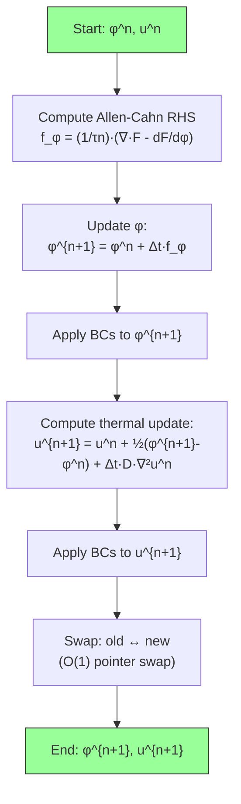

### 8.2 Heun's Method / RK2 (2nd Order, 2 Stages)

Heun's method is a predictor-corrector scheme:

```
Stage 1 (predictor):
  φ̃ = φ^n + Δt · f(φ^n, u^n)
  ũ = u^n + Δt · g(u^n, φ̃, φ^n)

Stage 2 (corrector):
  φ** = φ̃ + Δt · f(φ̃, ũ)
  u** = ũ + Δt · g(ũ, φ**, φ̃)

Average:
  φ^{n+1} = 0.5·(φ^n + φ**)
  u^{n+1} = 0.5·(u^n + u**)
```

This gives the correct formula: `y_{n+1} = y_n + (Δt/2)·(f₁ + f₂)`

**Butcher Tableau:**
```
0   |
1   | 1
----|------
    | 1/2  1/2
```

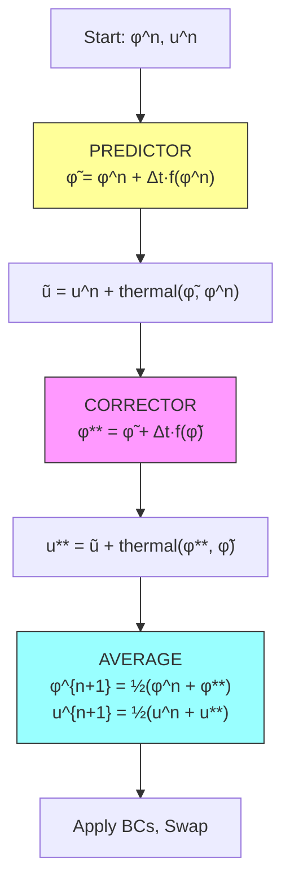

### 8.3 Classical RK4 (4th Order, 4 Stages)

The classical four-stage Runge-Kutta method:

```
k₁ = f(tₙ, yₙ)
k₂ = f(tₙ + Δt/2, yₙ + Δt/2·k₁)
k₃ = f(tₙ + Δt/2, yₙ + Δt/2·k₂)
k₄ = f(tₙ + Δt, yₙ + Δt·k₃)
y_{n+1} = yₙ + (Δt/6)·(k₁ + 2k₂ + 2k₃ + k₄)
```

The latent heat enters through the thermal rate of every stage,
`k_u = D·∇²u + ½·k_φ` (`thermal_rhs_kernel`); no latent-heat step follows the
combination.

**Butcher Tableau:**
```
0   |
1/2 | 1/2
1/2 | 0    1/2
1   | 0    0    1
----|------------------
    | 1/6  1/3  1/3  1/6
```

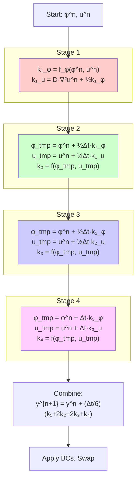

**Note:** Each stage evaluates the Allen–Cahn rate with
`allen_cahn_rhs_kernel`, which calls the same `allen_cahn_rate` as the Euler
kernel (§11), and the thermal rate with `thermal_rhs_kernel`. Besides the
four solution fields only the stage state (`phi_tmp_`, `u_tmp_`) and the
rates `k1..k4` of φ and u are stored: 14 double fields and no force arrays
(Appendix C).

### 8.4 IMEX (Implicit-Explicit)

The IMEX scheme treats different terms with different methods:
- **Explicit**: Allen-Cahn equation (nonlinear reaction + anisotropy); with
  `physics.willmore_beta > 0` the linearly implicit Willmore step of §4.3
- **Implicit**: Thermal diffusion (linear, stiff at small grid spacings)

```
Phase-field step:
  φ^{n+1} = φ^n + Δt·f_AC(φ^n, u^n)    [fused Allen-Cahn kernel; β > 0: §4.3]

Implicit step:
  Solve: (I - Δt·D·∇²)·u^{n+1} = u^n + 0.5·(φ^{n+1} - φ^n)
```

The implicit system is solved by **Jacobi sweeps** until a bound on the
max-norm error of the iterate, checked every 10 sweeps, is at most 1e-10;
an iterate that cannot be certified ends the step with an error (§10.2).
One 7-point sweep:

```
u_new[c] = (rhs[c] + Δt·D·Σ_d (u_old[c+e_d] + u_old[c−e_d]) / h_d²) / (1 + 2·Δt·D·Σ_d 1/h_d²)
swap(u_old, u_new)
```

(the 27-point sweep uses the stencil's weights 14, 3, 1 and centre 128,
divided by 30 h²).

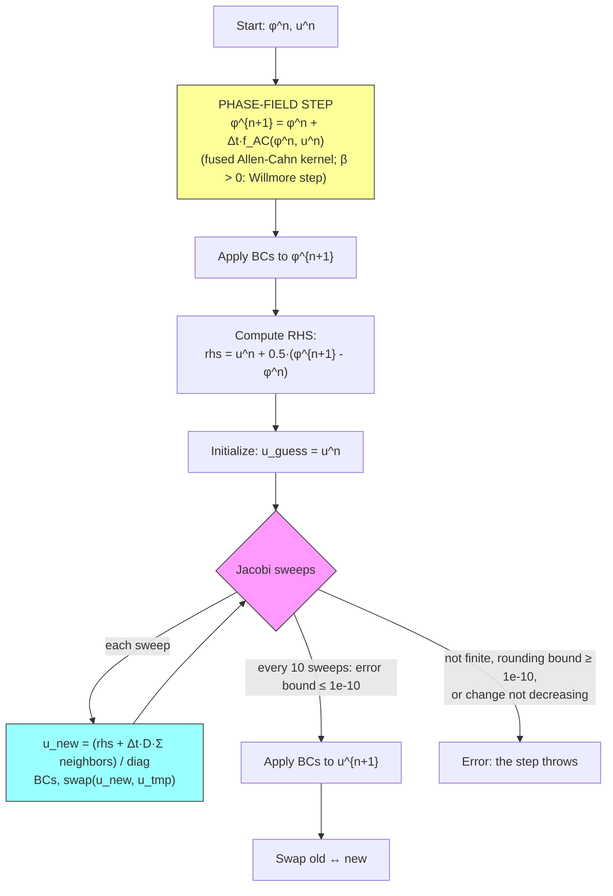

**Why IMEX?** The explicit thermal update has a stability limit
(`Δt ≤ h²/(6D)` for the 7-point and `60h²/(184D) ≈ 0.326 h²/D` for the
27-point stencil, §10.1) which can be very restrictive for fine grids.
Making it implicit removes this constraint while keeping the nonlinear
Allen-Cahn term explicit (where implicit treatment would require a nonlinear
solver). The explicit phase-field update keeps its own limit (§10.1), below
the thermal one at the default physics (0.010626 against 0.013333); the
Willmore term (β > 0) raises it, to 0.027467 at the shipped ε = 0.07,
β = 0.0149 and to 0.17–0.69 at the larger β of the dendrite configurations.

---

## 9. Boundary Conditions

The code supports four types of boundary conditions, configurable independently
for each of the six domain faces.

### 9.1 Types

**Dirichlet (fixed value):**
```
φ|_Γ = g
```
Sets the field to a prescribed value at the boundary.

**Neumann (fixed flux):**
```
∂φ/∂n|_Γ = q
```
Zero-flux (`q=0`): `φ[boundary] = φ[interior]` (copies nearest interior value).
Non-zero flux: `φ[boundary] = φ[interior] + q·h` on lo and hi faces alike, q
the outward normal derivative and h the spacing along the face normal
(`src/cuda/BoundaryKernels.cu`).

**Periodic:**
```
φ[0] = φ[N-2]
φ[N-1] = φ[1]
```
Wraps the domain so opposite faces are connected.

**Robin (mixed):**
```
α·φ + β·∂φ/∂n = γ
```
General linear combination of Dirichlet and Neumann conditions, ∂φ/∂n the
outward normal derivative. With `∂φ/∂n ≈ (φ[boundary] − φ[interior])/h`:

```
φ[boundary] = (γ + (β/h)·φ[interior]) / (α + β/h) = c·φ[interior] + γ/(α + β/h),
c = (β/h) / (α + β/h)
```

`validate()` requires α, β and γ finite, α and β not both zero and not of
opposite signs (αβ ≥ 0), and the ghost constant γ/(α + β/h) within the
double range. The fill multiplies α, β and γ by one power of two 2⁻ᵏ that
brings max(|α|, |β|/h) into (1/8, 1/2) (`scaled_robin`): the denominator
α + β/h then lies in (1/8, 1) in magnitude, so it cannot vanish and the
scaled γ cannot overflow while the quotient is finite, and the ghost keeps
its bits whenever every intermediate is a normal double. Unscaled, β = 10³⁰⁸
at h = 0.4 makes β/h infinite and the ghost 0 or NaN, and β = 5·10⁻³²⁴ at
h = 4 makes β/h zero and the ghost NaN. Then c ∈ [0, 1] (c = 0 at β = 0,
Dirichlet-like; c = 1 at α = 0, Neumann-like).
Opposite signs describe a face that feeds the field in proportion to its own
value, a negative heat-transfer coefficient: for γ = 0 the heat equation
gives d/dt ½∫u² = −D∫|∇u|² − D(α/β)∮u², and the boundary term is a source
when α/β < 0. Their ghost factor c lies outside [0, 1], where the stability
limit of §10.1 and the Jacobi bound of §10.2 fail: a 32³ run (h = 0.4,
D = 2) with one u face α = −1.1, β = 0.4 (c = −10) reaches NaN within 100
steps under Euler and under IMEX at Δt = 0.01, below the explicit limit
0.0133 of §10.1; with α = +1.1 (c = 0.48) both run normally.

For φ the boundary data must also keep the order parameter in its range
[−1, 1] (−1 liquid, +1 solid). Every fill is affine in the adjacent interior
value with a factor c ∈ [0, 1]: a Dirichlet ghost is the value, a Neumann
ghost φ[interior] + flux·h, a Robin ghost c·φ[interior] + γ/(α + β/h) with
1 − c = α/(α + β/h). Such a map takes [−1, 1] into itself exactly when it
takes ±1 into it, which is |value| ≤ 1, flux = 0 and |γ| ≤ |α| (for every h
and β), and the same holds in the kernel's arithmetic, whose operations are
monotone and odd. `validate()` requires exactly that (Robin(α, 0, γ) is the
Dirichlet value γ/α and Robin(0, β, γ) the flux γ/β, so the three conditions
are one). A face outside it holds the wall's φ beyond the double well, where
the reaction no longer restores φ: ten configurations of a fuzz campaign
with such Robin faces (γ/α from 671 to beyond the double range) failed at
run time, by a NaN relaxation time where the gradient's fourth powers
overflow A(n), by the latent heat of the wall exceeding the IMEX Jacobi
rounding bound, or by a divergence within three steps.

### 9.2 Per-Face Configuration

Each of the 6 faces can have an independent BC type:

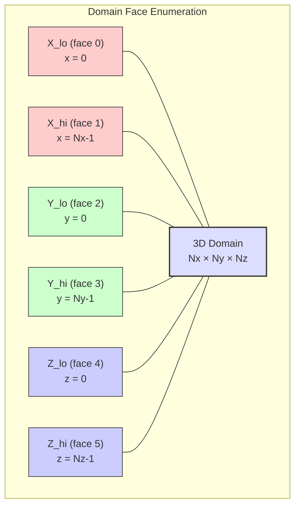

This enables complex simulation setups, e.g.:
- Periodic in X and Y, Neumann (insulating) in Z
- Dirichlet (fixed temperature) on one face, Neumann (adiabatic) on others
- Robin (convective heat transfer) on exposed surfaces

---

## 10. Stability Analysis

### 10.1 Explicit Stability Limits

**Thermal update.** The explicit thermal update `u ← u + Δt·D·∇²ₕu` (Euler,
and every stage of Heun and RK4) multiplies an eigenmode of ∇²ₕ with
eigenvalue −μ by R(−Δt·D·μ), R the scheme's stability polynomial:
1 + z (Euler), 1 + z + z²/2 (Heun), 1 + z + z²/2 + z³/6 + z⁴/24 (RK4).
|R(z)| ≤ 1 on the real interval [−r, 0] with r = 2 for Euler and Heun and
r = 2.785293563405282 for RK4 (the real root of z³ + 4z² + 12z + 24, where
R(z) returns to 1). The update is stable exactly when Δt·D·ρ ≤ r, ρ the
spectral radius of −∇²ₕ:

```
7-point:   ρ = 4 Σ_d h_d⁻²     (12/h² for cubic cells)
27-point:  ρ = 184/(30 h²)
```

These hold for every accepted boundary condition. Let X_d = T_d⁺ + T_d⁻ be
the sum of the two shifts along axis d, with the ghost rules of §9.1 (a
ghost is c ∈ [0, 1] times its adjacent value plus a constant, or the
periodic copy). X_d is symmetric with spectrum in [−2, 2] (Gershgorin:
radius 2 in the interior rows, [c − 1, c + 1] in the end rows), and the X_d
of different axes commute. The 7-point Laplacian is Σ_d (X_d − 2)/h_d²;
the 27-point is (14 ΣX_d + 3 Σ_{d<e} X_d X_e + X_x X_y X_z − 128)/(30h²),
edge and corner ghosts included, since the faces are filled Z, Y, X and a
ghost of a ghost applies both rules. Both are multilinear polynomials in
commuting symmetric matrices, so their spectra lie in the polynomial's range
over the cube [−2, 2]³, whose extremes are at its vertices: [−ρ, 0] with ρ
above, at the checkerboard vertex (−2, −2, −2). On a periodic grid with an
even number of interior cells per axis the checkerboard is an exact mode and
ρ is attained; otherwise the largest eigenvalue is within O(1/N²) of ρ.

**Phase field.** The explicit phase-field update is linearised about the
liquid φ = −1, where the reaction's derivative is 2 (independent of u), in
two kinds of liquid.

*The uniform liquid.* A perturbation ηψ(x) is an exact mode when every face
sees a gradient along its normal only (A = 1 + ε there): the uniform shift
ψ = 1, the checkerboards (−1)^{Σ_{d∈S} x_d} over a subset S of the axes, and
the waves cos(θx_a) along one axis a (0 < θ < π) that alternate along a
subset S' of the other two; in all of them the tangential averages of
central differences vanish on every face. The face-flux divergence (§11,
whatever `stencil` says) acts on them as W₀²(1 + ε)² times the 7-point
Laplacian, eigenvalue −μ, μ = Σ_d 2(1 − cos θ_d)/h_d². Their cell gradient
is zero for the shift and the checkerboards, so τ = τ_cb = τ₀(1 − 3ε/5)²
(the value the kernel uses for a zero gradient), and axial for the waves,
τ = τ₀(1 + ε)² (once their cell gradient exceeds the kernel's zero-gradient
threshold, |∇φ|² > 10⁻³⁰). With

```
Λ = W₀²(1 + ε)² μ + 2,    L = (W₀² μ + 2)²
```

and the Willmore step (Euler and IMEX, β > 0, §4.4), which solves
(τ/Δt + βL)δφ = rhs with rhs = −(Λ + βL)η at the mode, one step multiplies η by

```
g = 1 − Δt (Λ + β L) / (τ + Δt β L),    |g| ≤ 1  ⟺  Λ + βL ≥ 0  and  Δt (Λ − β L) ≤ 2 τ
```

(Heun and RK4 have β = 0 and the factor R(−ΔtΛ/τ), stable for ΔtΛ ≤ rτ.)
Λ − βL is concave in μ: the shift gives 2 − 4β, a finite limit for every
β < 1/2; the checkerboards give μ_S = 4 Σ_{d∈S} h_d⁻²; on each family of
waves the maximum over μ ∈ [μ_S', μ_S' + 4/h_a²] is at W₀²μ + 2 = (1 + ε)²/(2β)
when that lies inside, or at an end: all in closed form.

*A liquid with a small gradient.* In the tail of an interface the liquid has
a small smooth gradient along some unit direction n. With the coefficients
frozen there, every Fourier mode exp(iθ·x) is an eigenmode: the face fluxes
respond with W₀²H(n), H(n) the Hessian of ½A²|p|², the gradient energy
½W₀²A²|p|² per W₀² (all its entries, `gradient_energy_hessian`; the energy is
2-homogeneous, so H depends on the direction only: (1 + ε)² along an axis,
S(ε) across it), the cell gradients
keep their direction (τ = τ₀A(n)²; the change of τ multiplies the
background's own rate, which vanishes at an equilibrium tail), and the
face-flux discretisation (normal difference, averaged central tangential
differences) gives

```
σ_n(θ) = Σ_d H_dd(n) 2 (1 − cos θ_d)/h_d² + Σ_{d≠e} H_de(n) sin θ_d sin θ_e / (h_d h_e),
Λ = W₀² σ_n(θ) + 2
```

with the same L and g. At the checkerboards (θ_d ∈ {0, π}) the cross terms
vanish; between them they do not, and with the Willmore term Λ − βL, which
βL makes concave in μ, peaks between the checkerboards.

**Two conditions.** A mode with Λ + βL < 0 grows at every Δt. The uniform
liquid has Λ + βL ≥ 2; a gradient mode has it negative where H(n) is not
positive semidefinite (ε > 1/15) and β is too small at the spacing: at
ε = 0.3, β = 0.1, h = 0.4 the wave θ = (0, 0.437π, −0.455π) across an axial
gradient has Λ + βL = −40.66, at ε = 0.12, β = 0.01 another one −16.28.
`validate()` rejects such a configuration and names the mode. Otherwise the
limit is the smallest rτ/(Λ − βL) over the modes with Λ − βL > 0.

**Computation** (`phase_field_dt_limit`, `phase_field_unstable_mode`,
`core/LiquidModes.hpp`). The uniform liquid in closed form. The gradient
modes by a branch and bound over n (the octant: a sign change of n_d
together with θ_d changes nothing; with equal spacings the triangle
n_x ≥ n_y ≥ n_z, since permuting the axes of n and θ together changes
nothing) and θ (θ_x ∈ [0, 3.2] by evenness, θ_y, θ_z ∈ [−3.2, 3.2] by
periodicity). Every bound it uses is a composition of interval operations
rounded outward (`core/Interval.hpp`: each result one unit in the last place
or more beyond the rounded value, the formula's coefficients enclosed too,
an overflow kept as an enclosure, sine and cosine widened past glibc's
error of at most one unit), so it holds for the exact real formula: the
smallest of a per-axis decomposition of the objective (each axis's concave
part exact) and second-order Taylor bounds in n and in θ with interval
Hessians over the box. It discards wave-number boxes whose θ-gradient
excludes zero (the periodic function has its maximum at a stationary
point). Every mode it records carries the lower end of an enclosure of its
value. For the limit it returns an upper bound B of
M = max (Λ − βL)/A(n)² once no box can exceed the best recorded value by
more than 10⁻⁹·max(1, value) (`kLiquidModeTolerance`): M lies between the
two, so the limit rτ₀/B is at most a relative 10⁻⁹·max(1, 1/M) below the
frozen-coefficient limit. At ε = 0 these modes are the uniform liquid's
(H = I, A = 1) and are not searched: Λ − βL then depends on μ alone and,
with β > 0, peaks on a whole level set of μ, which no branch and bound
narrows to 10⁻⁹. For Λ + βL it proves Λ + βL ≥ 0 for every mode or finds a
mode whose enclosure is negative, and `validate()` names that mode with the
enclosure's upper end. Each search has a budget of 2·10⁷ box evaluations:
the shipped physics need 1.2·10⁴ to 1.6·10⁵, the tests up to 1.5·10⁶;
close to the smallest β that regularises ε the sign search needs more, the
closer it is (at ε = 0.12, h = 0.4 it decides β = 0.053008, min Λ + βL in
[0, 0.0057], in 0.3 s and β = 0.052949, min in [0, 0.0015], in 3 s; at
β = 0.0529346, between the latter and β = 0.0529199 with a witness at
−0.0006, the budget runs out), and then `validate()` rejects the
configuration with the range min Λ + βL is known to lie in; a limit search
beyond its budget uses the upper end of its range, a looser bound.
`tests/unit/test_LiquidModes.cpp` checks every interval operation, the
coefficients and their derivatives,
each bound, the discarded boxes, the domain and its symmetries, and the
results against binary128 references, the Hessian by differentiating the
kernel's flux. On the development machine (one core, the Release flags) a
limit takes 0.04 s without the Willmore term and 0.33–0.38 s with it on a
cubic grid (the shipped physics), 0.13 s and 1.0–1.7 s with the spacings
0.4, 0.5 and 0.6; the sign 0.02–0.04 s and 0.14–0.21 s; both are cached per
physics within a process.

**Result.** Without the Willmore term the full checkerboard of a ⟨111⟩
gradient binds on a cubic grid (ε = 0.05: 0.010626, against 0.012570 for the
uniform liquid; at ε = 0 the uniform liquid's 2τ₀/(12W₀²/h² + 2)). With it
the binding mode is a wave across the gradient: at ε = 0.07, β = 0.0149,
h = 0.4 (`default.json`, `benchmark_small.json`, the Makefile's
`run_vtk.json`, the k8s payloads) a gradient along ⟨101⟩ and
θ = (0.652π, 0, −0.652π), limit 0.027467, below the 0.031570 the
checkerboards alone give and the uniform liquid's 0.052546 (its 1-D
checkerboard). For the dendrite configurations it is a gradient along a
⟨110⟩ direction and a long wave across it (θ = 0.11π–0.20π): 0.2913
(`run_dendrite.json`), 0.16986 (`run_dendrite_large.json`), 0.68562
(`run_dendrite_long.json`). Every shipped dt is far below them
(0.0003125–0.005). It is a necessary condition, not shown to be sufficient:
inside an interface the anisotropic update has no closed form (its
linearisation is not symmetric for ε > 0).

**Measured** (`StabilityLimitsGpuTest`, periodic 18³, h = 0.4, D = 2, the
perturbation over 40 steps): at 0.99 and 1.01 times each limit the factor
per step is 0.9800 / 1.0200 (Euler), 0.9802 / 1.0202 (Heun) and 0.9588 /
1.0428 (RK4) for both stencils, as R predicts to 10⁻⁹; for the phase field
(IMEX) of the uniform liquid 0.980 / 1.020 for the full checkerboard at
ε = 0 and 0.05 with β = 0, and 0.990 / 1.009 (1-D) and 0.996 / 1.004 (2-D)
at ε = 0.07, β = 0.0149, where at Δt = 0.06 the full checkerboard decays
(0.817) and the 1-D one grows (1.126); for a liquid with a ⟨111⟩ gradient
of 10⁻⁶ at ε = 0.05, 0.982 / 1.007 at its limit 0.010626, and 1.204 at 0.99
times the uniform liquid's limit; the uniform shift at ε = 0.12, β = 0.25,
0.993 / 1.007 at its limit 0.974318; and at ε = 0.07, β = 0.0149 on a periodic
46 × 4 × 46 grid a liquid with a ⟨101⟩ gradient of 10⁻³ and the wave
θ = 2π·15/46 across it, 0.991 / 1.009 at its frozen limit 0.0274673
(`phase_field_dt_limit` 4·10⁻⁷ below it) and 1.114 at 0.99 times 0.031570. The runs of §4.3 bracket the thermal
limits on the shipped grids: 7-point stable at 0.0125 and blown up at
0.014, 27-point stable at 0.025 and blown up at 0.027.

**Validation** (`core/StabilityLimits.hpp`, `SimulationConfig::validate`):
a configuration with a liquid mode Λ + βL < 0 is rejected, naming the mode
and a certified upper bound of its Λ + βL;
a fixed Δt above either limit is rejected, with the configured stencil,
spacing per axis and scheme (IMEX has no thermal limit); the message gives
Δt and the limit to 17 significant digits. With adaptive stepping every
step after the first, and the first after a restart, is capped at
`cfl_safety` times the smaller limit (§10.3), so `cfl_safety` must lie in
(0, 1] and time.dt (the first step) and dt_min must not exceed that cap. At
h = 0.4, D = 2 and the default physics (ε = 0.05, d₀ = 0.5) the limits are
0.013333 (thermal, Euler and Heun, 7-point), 0.026087 (27-point), 0.018569
(RK4, 7-point) and 0.010626 (phase field).

### 10.2 Jacobi Iteration Convergence

IMEX solves `(I − Δt·D·∇²ₕ)u = rhs` by Jacobi sweeps

```
u_{k+1} = (rhs + Δt·D·(off-diagonal part of ∇²ₕ) u_k) / (1 + s)
s = 2Δt·D Σ_d h_d⁻²  (7-point),   s = 128 Δt·D / (30 h²)  (27-point)
```

(s is Δt·D times the sum of the stencil's off-diagonal weights), with the
ghost cells of u_k holding its boundary values (§9.1), refilled after every
sweep (`CudaSolver::imex_sweep`).

**Contraction.** Write the ghost values through the interior values they
copy: a face ghost is c times its adjacent value plus a constant, c = 0
(Dirichlet), 1 (Neumann with any flux, Robin with α = 0), c ∈ [0, 1] for
every Robin face `validate()` accepts (§9.1); a periodic ghost copies the
interior cell next to the opposite face; the edge and corner ghosts the
27-point stencil reads chain two or three of these (faces filled Z, Y, X);
multi-GPU halos copy the neighbouring domain's cells. The iteration matrix J
then has non-negative entries and row sums at most

```
q = s/(1 + s)
```

since every off-diagonal weight is positive and a ghost passes on at most
its weight. So ‖J‖∞ ≤ q for every accepted boundary condition and number of
GPUs. If every u face is Neumann (any flux; also Robin with α = 0) or
periodic, every row sum equals q, the constant vector is an eigenvector and
ρ(J) = q; a Dirichlet face or a Robin face with α ≠ 0 makes ρ(J) < q (J is
irreducible). Iteration matrices built from an exact emulation of the
sweep and the ghost fill (832 small grids: one to four cells per axis, both
stencils, every pair of rules on the x faces with four layouts that cover
every rule on the y and z faces; Δt·D = 0.025) all have ‖J‖∞ ≤ q.
‖J‖∞ = q in the 488 in which the stencil of some cell reads no ghost whose
fill passes through a Dirichlet face or a Robin face with α ≠ 0; ‖J‖∞ < q
in the other 344, down to 0.375 q (27-point stencil, one cell along x,
Dirichlet on every face). With Robin coefficients of opposite signs, which
`validate()` rejects, ρ(J) reaches 1.29 at s = 1.5 (c = −10).

**Stopping rule.** With e_k = u* − u_k (u* the exact solution) and
d_{k+1} = max|u_{k+1} − u_k|, e_{k+1} = J e_k = J(e_{k+1} + u_{k+1} − u_k)
gives ‖e_{k+1}‖∞ ≤ q/(1 − q) · d_{k+1} = s · d_{k+1}. Every
`kJacobiCheckFreq` = 10 sweeps `JacobiStoppingRule` (`JacobiStopping.hpp`)
evaluates

```
bound = (s·d + γ_K (1 + 3s) m) / (1 − γ_K (1 + 2s)),   γ_K = K u/(1 − K u),  u = 2⁻⁵³
```

with d and m = max(|u_k|, |u_{k+1}|) over every cell (one fused reduction,
`launch_max_abs_diff_and_max_abs`), and accepts u_{k+1} when bound ≤
`kJacobiTol` = 1e-10: its interior error is then at most 1e-10 in the max
norm (the bound itself is evaluated in double precision, to a relative
10⁻¹⁵). The check frequency changes only how many sweeps run after the
bound is met (at most 9), not the accuracy. d shrinks by at least q per
sweep, so the bound is met after about ln(s·d₁/1e-10) / ln(1/q) sweeps,
≈ (1 + s)·ln(s·d₁/1e-10) for large s; there is no fixed sweep limit.

**Rounding term.** A sweep differs from the exact map of the stored iterate
by at most γ_K(|rhs| + s·m)/(1 + s) per cell (standard model; FMA
contraction only removes roundings). One term of `jacobi_step_kernel`
passes through at most 17 roundings (7-point: the neighbour pair, its
weight 1/h² and its own two, the sum over axes, Δt·D, the right-hand side,
the division, and the diagonal 1 + s) or 26 (27-point: up to 11 in the
12-term edge sum, the weights, the coefficient Δt·D/(30h²), the right-hand
side, the division and the diagonal). The ghost fill adds at most 3γ₆·m per
fill level (Robin: 6 roundings, a non-cancelling denominator since
αβ ≥ 0; Neumann 2; Dirichlet and periodic none): one level for the face
ghosts of the 7-point stencil, up to three for the corner ghosts of the
27-point stencil, i.e. 18 and 54 more. Hence K = 35 (7-point) and 80
(27-point), `kJacobiRoundingUnits7/27`. With |rhs| ≤ (1 + 2s)(m + ‖e‖)
(the equation itself) and ‖e_{k+1}‖ ≤ s·d + (1 + s)·(sweep rounding), the
bound above follows.

**Failures.** The step throws `std::runtime_error` instead of returning an
iterate the rule cannot accept:
- d or m not finite: the state diverged (a NaN or Inf in u or the latent
  heat);
- the rounding term alone, bound at d = 0, reaches 1e-10 — at
  (1 + 3s)·m ≥ 2.6·10⁴ (7-point) or 1.1·10⁴ (27-point): no number of
  sweeps certifies the tolerance. The term grows with s and falls to
  γ_K m/(1 − γ_K) as Δt → 0, so above m = 1e-10 (1 − γ_K)/γ_K (25735
  for 7 points, 11259 for 27) no Δt certifies this magnitude of u and the
  message says so (|u| that large comes from δ, the u boundary data or the
  latent heat of a phase field outside [−1, 1]); below it the message gives
  the factor s/s_max, s_max the root of the rounding term = 1e-10, that Δt
  must at least shrink by;
- d did not decrease between two checks: in exact arithmetic it shrinks by
  at least the factor q¹⁰, so rounding stopped the iteration above the
  tolerance.

**Evidence** (`tests/unit/test_ImexJacobi.cu`): one step at s = 17.1
(7-point, anisotropic spacing) and s = 16 (27-point), every kind of u face,
on one GPU and three domains, against a long-double solution of the same
system: errors 2.9·10⁻¹¹ and 8.2·10⁻¹¹ (the former test, a change below
1e-10 within at most 200 sweeps, left 6.3·10⁻⁸ and 1.4·10⁻⁸); a NaN in u
and Δt = 10⁴ throw; `JacobiStoppingRule.*` tests the rule on the host.
`benchmark_small` (1000 steps) and the IMEX rows of Appendix B (420 steps
each) stop at sweep 20 on every step under both rules, so their results are
unchanged.

### 10.3 Adaptive Time Stepping

With `time.adaptive` the step after the first is chosen from the largest
change of φ in the previous step (`SimulationEngine::adapt_time_step`):

```
ratio  = adaptive_tolerance / max|Δφ|          (+∞ when φ did not change)
new_dt = current_dt · min(1.5, max(0.5, 0.9 · ratio))
new_dt = clamp(new_dt, dt_min, dt_max)
new_dt = min(new_dt, cfl_safety · min(thermal limit, phase-field limit))   (§10.1)
```

The growth and shrink factors (1.5, 0.5) limit how fast dt changes, and 0.9
aims below the tolerance. The stability cap is applied last, so dt_min
cannot lift a step above it (`validate()` also rejects such a dt_min), and a
step without any change of φ grows dt by 1.5 up to the cap.

---

## 11. Discretisation of ∇·F (face fluxes)

`anisotropic_divergence` (`src/cuda/Kernels.cuh`) evaluates ∇·F at an
interior cell in conservative form,

```
∇·F ≈ Σ_d [ F_d(face d+½) − F_d(face d−½) ] / h_d ,
```

with `F_d` computed at each of the six faces from the gradient **at that
face**: the normal component is the compact difference of the two cells the
face separates, and each tangential component is the average of the central
differences in those two cells, e.g. for the face between `(i,j,k)` and
`(i+1,j,k)`:

```
px = (φ[i+1,j,k] − φ[i,j,k]) / dx
py = (φ[i,j+1,k] − φ[i,j−1,k] + φ[i+1,j+1,k] − φ[i+1,j−1,k]) / (4·dy)
pz = (φ[i,j,k+1] − φ[i,j,k−1] + φ[i+1,j,k+1] − φ[i+1,j,k−1]) / (4·dz)
```

Properties, each checked by a test:

| Property | Evidence |
|---|---|
| Reach ±1 cell (3×3×3), so one ghost plane per face suffices, including periodic BCs | `kStencilReach = 1`; multi-GPU halos of 1 plane reproduce single-GPU runs bit for bit |
| At ε = 0 it is exactly W₀² × the 7-point Laplacian (no odd-even decoupling) | `DivergenceAtZeroAnisotropyIsSevenPointLaplacian` (difference within 32 roundoffs) |
| Second-order accurate for the full anisotropic flux | `DivergenceIsSecondOrderAccurate`: observed order 1.99 for ε = 0, 0.05, 0.12, 0.2 |
| Small grid anisotropy that vanishes under refinement | ε = 0 seed growth: \|R₁₀₀/R₁₁₁ − 1\| = 0.0125 at h = 0.8 W₀ and 0.0022 at h = 0.4 W₀ (`GridAnisotropyVanishesUnderRefinement`) |

The previous discretisation took central differences (spacing 2h) of fluxes
evaluated with central gradients at the ±1 neighbours: a 5-point-wide
stencil that at ε = 0 is the Laplacian on a 2h lattice, decoupling odd and
even cells. It gave \|R₁₀₀/R₁₁₁ − 1\| = 0.100 at h = 0.8 W₀ and 0.0108 at
h = 0.4 W₀ in the same test, as large as the physical anisotropy at ε = 0.05,
and needed two ghost planes (one-sided gradients at the walls, a wrong
periodic neighbour at reach 2).

The Euler kernel and the RK stage kernel both call `allen_cahn_rate`, so all
four time schemes use the same spatial operator; no force arrays are stored.

---

## 12. Multi-GPU Domain Decomposition

For grids that exceed single-GPU memory, the code supports multi-GPU execution
via domain decomposition along the X axis.

### 12.1 Decomposition Strategy

The global domain is split along X into `G` contiguous slabs of `Nx/G` planes
(the remainder going to the first slabs). Each slab carries halo planes only
on sides that face another slab, `kStencilReach = 1` plane wide (the reach of
the face-flux operator, the thermal Laplacian and the Jacobi sweep), so the
first and last slabs hold the physical X walls and apply the configured BCs
there. Halos, and for periodic X the ghost planes, are refreshed before every
stencil evaluation, including between Heun/RK4 stages and after every IMEX
Jacobi sweep, which makes the multi-GPU result bit-identical to a single-GPU
run. The full protocol and its evidence are in `DESIGN.md` §7.

---

## 13. Advanced Data Structures

The three structures below are header-only (`src/core/LRUCache.hpp`,
`src/core/SpatialHash.hpp`, `src/core/ConcurrentMap.hpp`; none has a `.cpp`).
Only the LRU cache is used by the program (`src/io/VTKWriter.hpp`); the
spatial hash and the striped hash map are included only by their unit tests
(`tests/unit/test_SpatialHash.cpp`, `tests/unit/test_ConcurrentMap.cpp`).

### 13.1 Thread-Safe LRU Cache

Used in `VTKWriter` to cache, keyed by `step:field`, the statistics of phi and
u that `compute_statistics` computes before each frame is written: min, max,
mean and root mean square `√(Σv²/n)` of the field's n = Nx × Ny × Nz values
(the `l2_norm` member of `FieldStatistics` in `src/io/VTKWriter.hpp`). A
cached entry would be returned without being recomputed, but a run enqueues
each step at most once, so every lookup in a simulation misses; the entries
are read back only by `get_cached_stats`, which only a unit test calls.

**Implementation:**
- Doubly-linked list (std::list) for LRU ordering
- Hash map (std::unordered_map) for O(1) key lookup
- `std::shared_mutex`: `get()` takes it exclusively, as `put()`, `erase()` and
  `clear()` do, since a hit moves the entry to the front of the list and every
  call increments the hit or miss counter; `contains()`, `size()`,
  `hit_count()`, `miss_count()` and `hit_rate()` take it shared
  (`src/core/LRUCache.hpp`). `VTKWriter` reads the cache only through `get()`
  (`src/io/VTKWriter.cpp`), so its reads exclude each other.
- Hit/miss counters for cache performance monitoring

**Complexity:**
| Operation | Time |
|-----------|------|
| Get (hit) | O(1) amortized |
| Get (miss) | O(1) |
| Put | O(1) amortized |
| Evict | O(1) |

### 13.2 Spatial Hash Map (FNV-1a)

3D spatial bucketing for efficient neighbor queries, useful for interface
tracking and adaptive refinement region identification.

**Hash function** (`CellCoordHash`, `src/core/SpatialHash.hpp`): the FNV-1a
XOR-then-multiply step with the 64-bit FNV offset basis and prime, in
`std::size_t` arithmetic, once per cell coordinate (not per byte):
```
cx = static_cast<int>(floor(x * inv_cell_size))   (cy, cz likewise; inv_cell_size = 1 / cell_size, set once)
hash = 14695981039346656037
hash = (hash XOR cx) × 1099511628211
hash = (hash XOR cy) × 1099511628211
hash = (hash XOR cz) × 1099511628211
```
A `std::unordered_map<CellCoord, std::vector<Value>, CellCoordHash>` holds the
cells and maps the hash to its bucket.

**Operations** (x, y, z are physical coordinates):
- `insert(x, y, z, data)` — appends `data` to the values of the cell of (x, y, z)
- `query_cell(x, y, z)` — a pointer to the values of that cell, `nullptr` if
  the map has no entry for it
- `query_radius(x, y, z, radius_cells = 1)` — a copy of the values of the
  (2·radius_cells + 1)³ cells around it

Each is one `unordered_map` lookup per cell (O(1) on average).

### 13.3 Concurrent Striped Hash Map

A thread-safe hash map with 16-stripe partitioning for low contention under
concurrent access.

**Design:**
- 16 independent hash map stripes
- Per-stripe `std::shared_mutex` (readers don't block per-stripe)
- Key → stripe mapping via hash: `stripe = hash(key) % 16`
- Contention reduced by factor of 16× vs single-lock design

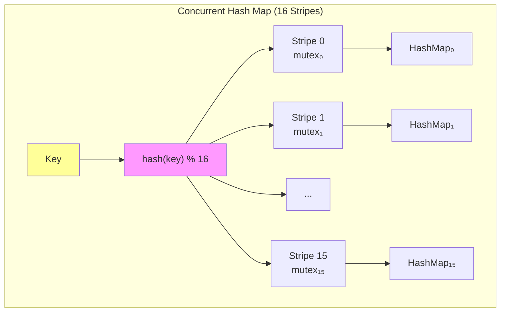

---

## 14. References

1. **Allen, S.M. and Cahn, J.W.** (1979). "A microscopic theory for antiphase
   boundary motion and its application to antiphase domain coarsening."
   *Acta Metallurgica*, 27(6), 1085–1095.

2. **Kim, S.G., Kim, W.T., and Suzuki, T.** (1999). "Phase-field model for
   binary alloys." *Physical Review E*, 60(6), 7186–7197.

3. **Karma, A. and Rappel, W.J.** (1998). "Quantitative phase-field modeling
   of dendritic growth in two and three dimensions." *Physical Review E*,
   57(4), 4323–4349.

4. **Provatas, N., Goldenfeld, N., and Dantzig, J.** (1998). "Efficient
   computation of dendritic microstructures using adaptive mesh refinement."
   *Physical Review Letters*, 80(15), 3308–3311.

5. **Patra, M. and Karttunen, M.** (2006). "Stencils with isotropic
   discretization error for differential operators." *Numerical Methods
   for Partial Differential Equations*, 22(4), 936–953. — Source for the
   27-point Laplacian weights `(14·face + 3·edge + 1·corner − 128·center)/(30·h²)`
   used in `src/cuda/Kernels.cuh::laplacian_27pt`.

6. **Plapp, M. and Karma, A.** (2000). "Multiscale finite-difference–
   diffusion–Monte-Carlo method for simulating dendritic solidification."
   *Journal of Computational Physics*, 165(2), 592–619.

7. **Kobayashi, R.** (1993). "Modeling and numerical simulations of dendritic
   crystal growth." *Physica D: Nonlinear Phenomena*, 63(3-4), 410–423.

8. **Boettinger, W.J., Warren, J.A., Beckermann, C., and Karma, A.** (2002).
   "Phase-field simulation of solidification." *Annual Review of Materials
   Research*, 32(1), 163–194.

9. **Karma, A.** (2001). "Phase-field formulation for quantitative modeling of
   alloy solidification." *Physical Review Letters*, 87(11), 115701.

10. **Wheeler, A.A.** (2006). "Phase-field theory of edges in an anisotropic
   crystal." *Proceedings of the Royal Society A*, 462(2075), 3363–3384.
   doi:10.1098/rspa.2006.1721

11. **Torabi, S., Lowengrub, J., Voigt, A., and Wise, S.** (2009). "A new
    phase-field model for strongly anisotropic systems." *Proceedings of the
    Royal Society A*, 465(2105), 1337–1359. doi:10.1098/rspa.2008.0385

12. **Saad, Y.** (2003). *Iterative Methods for Sparse Linear Systems*, 2nd
    ed. SIAM, Philadelphia. §12.3, Algorithm 12.1 (Chebyshev acceleration).
    doi:10.1137/1.9780898718003

13. **Notay, Y.** (2000). "Flexible conjugate gradients." *SIAM Journal on
    Scientific Computing*, 22(4), 1444–1460. doi:10.1137/S1064827599362314

14. **Golub, G.H. and Ye, Q.** (1999). "Inexact preconditioned conjugate
    gradient method with inner-outer iteration." *SIAM Journal on Scientific
    Computing*, 21(4), 1305–1320. doi:10.1137/S1064827597323415

15. **Gutknecht, M.H. and Röllin, S.** (2002). "The Chebyshev iteration
    revisited." *Parallel Computing*, 28, 263–283.
    doi:10.1016/S0167-8191(01)00139-9

---

## Appendix A: Summary of Notation

| Symbol | Meaning | Typical Value |
|--------|---------|---------------|
| `φ` | Phase-field order parameter | `[-1, +1]` |
| `u` | Dimensionless temperature | `[-δ, 0]` |
| `W₀` | Interface width | `1.0` |
| `τ₀` | Relaxation time | Derived |
| `λ` | Coupling constant | Derived |
| `δ` | Dimensionless undercooling | `0.1–0.8` |
| `D` | Thermal diffusivity | `1.0–10.0` |
| `ε` | Anisotropy strength | `0.0–0.33` |
| `A(n̂)` | Anisotropy function | `[1-5ε/3, 1+ε]` |
| `h` | Grid spacing | Problem-dependent |
| `Δt` | Time step | CFL-limited |

## Appendix B: Comparison of Time Integration Schemes

| Property | Euler | Heun (RK2) | RK4 | IMEX |
|----------|-------|------------|-----|------|
| Order of accuracy in time | 1 | 2 | 4 | 1 |
| Stages per step | 1 | 2 | 4 | 1 + Jacobi sweeps (until the error bound is ≤ 1e-10; §10.2) |
| GPU memory, bytes per cell (measured, Appendix C) | 32.1 | 48.1 | 112.1 | 48.1 |
| … with `willmore_beta > 0` | 108.1 | rejected | rejected | 124.1 |
| Explicit thermal update stable for (§10.1) | Δt·D·ρ ≤ 2 | Δt·D·ρ ≤ 2 | Δt·D·ρ ≤ 2.785 | any Δt (u implicit) |
| Modes of the liquid do not grow only if (§10.1; every mode) | Λ + βL ≥ 0, Δt(Λ − βL) ≤ 2τ | Δt·Λ ≤ 2τ | Δt·Λ ≤ 2.785τ | Λ + βL ≥ 0, Δt(Λ − βL) ≤ 2τ |
| ms per step, 160³, h = 0.4, dt = 0.005, ε = 0.05, β = 0 | 4.30 | 8.82 | 18.07 | 10.95 |
| ms per step, same grid, ε = 0.12, β = 0.25 | 10.84 | rejected | rejected | 17.34 |

ρ is the largest eigenvalue of −∇²ₕ: 4 Σ_d h_d⁻² (7-point), 184/(30h²)
(27-point); Λ, τ and L are those of §10.1 (the face-flux divergence and the
Willmore Laplacian do not depend on `stencil`). Costs measured on an RTX 4090 (CUDA 13.2, median over 200 steps
after 220 from the seed, no other process on the GPU) with the physics of
`run_dendrite.json`. With β > 0 the Euler and IMEX φ update is the linearly
implicit Willmore step (§4.3–4.4); the shipped configurations choose between
them by measured cost per unit of simulated time (§4.3).

## Appendix C: GPU Memory Budget (600³ Grid)

Bytes per cell measured with `cudaMemGetInfo` around the construction of
`CudaSolver` (256³ grid, RTX 4090). The 600³ column is the fields alone,
8 bytes per cell for each double-precision and 4 for each single-precision
field times 600³ = 2.16 × 10⁸ cells; one double-precision field is 1.61 GiB
there. The rest is reduction scratch and allocation granularity, measured
as 2 MiB (0.125 bytes per cell at 256³) for every scheme at 128³, 256³ and
384³ and at 192³ with β = 0, 7 MiB at 192³ with β > 0, and 12.125 MiB at
160³ with `run_dendrite.json` (Euler, β > 0).

| Scheme | Double / single fields | Bytes per cell | 600³ |
|---|---|---|---|
| Euler | 4 / 0 | 32.1 | 6.4 GiB |
| Heun, IMEX | 6 / 0 | 48.1 | 9.7 GiB |
| RK4 | 14 / 0 | 112.1 | 22.5 GiB |
| Euler, β > 0 | 11 / 5 | 108.1 | 21.7 GiB |
| IMEX, β > 0 | 13 / 5 | 124.1 | 24.9 GiB |

The Willmore step adds τ, the increment, the CG residual, preconditioned
residual, direction, `A·p` and `∇²p` in double precision and τ/dt, the scaled
residual, two Chebyshev iterates and their Laplacian in single precision
(§4.4). A regularised 600³ Euler solver was also allocated directly on the
RTX 4090: 21.7 GiB, leaving 1.4 GiB free.
